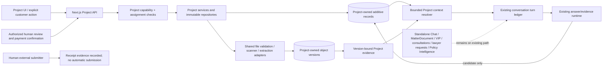

# Phase 13 M0-002 — Data Ownership and Authorization Architecture

**Disposition:** M0-002-R1 DELIVERED — AWAITING INDEPENDENT REVIEW; NOT ACCEPTED. This document is a design contract candidate, not a migration, implementation authorization, legal rule approval, or final M0 freeze.

**Original M0-002 checkpoint:** branch `phase13-study-journey-project-centric`; HEAD `576c4f37673fe78b21a4568140cbf1c56b3a7de5`; worktree was clean before the original design draft. **R1 checkpoint:** the same branch and HEAD; before R1 edits, the existing M0-002 draft was untracked and its three status records were modified from that prior documentation task, with no source/code changes. M0-001 was accepted as an input to the specification; that does not establish final owner, lawyer, or education-agent approval. The legal/admissions matrices remain provisional. No code, SQL, database, AWS/S3, Stripe, external submission, paid model call, or tests were run for R1. `git diff --check` is the requested validation after edits.

## 1. Evidence and assumptions ledger

### VERIFIED from checked-in source

- `User` has global roles `user|lawyer|admin`, `emailVerifiedAt`, `membershipTier`, and `vipExpiresAt` (`chatbot/lib/db/schema.ts:19-39`). It has no Project membership or education-agent capability model. `VipPurchase`, `VipPlanPrice`, and `VipSubscription` are separate billing records (`schema.ts:96-207`).
- `Chat` is owner-linked; `ImmigrationConversation` is keyed by Chat; `ConversationTurn` is keyed to Chat and uniquely constrains `(chatId, clientTurnId)` (`schema.ts:540-618`). Turn acquisition/fencing and terminal persistence live in `lib/conversations/turn-ledger.ts` and `widget-turn.ts`; the three widget routes use that shared lifecycle. Do not create a parallel Project turn store.
- `MatterDocument.chatId` is required, references `ImmigrationConversation.chatId` with `ON DELETE RESTRICT`, and rows store one `storageKey`, hash, security/storage/processing statuses, and `deletedAt` (`schema.ts:729-789`). `MatterDocumentProcessingRun` and `MatterDocumentEvidenceUnit` cascade from the document and preserve per-run extraction provenance (`schema.ts:791-854`).
- Upload verifies the authenticated owner's conversation, validates the actual file, creates a pending row, stores bytes, then CAS-transitions to stored (`lib/matter-documents/service.ts:117-189`; route authentication and request handling in `lib/matter-documents/http.ts:138-177` and `app/api/matter-documents/route.ts:5-21`). Existing validation enforces format/content checks and the 25 MiB request limit (`lib/matter-documents/validation.ts:467-515`; `http.ts:72-115`). The S3 adapter uses a generated key, SHA-256 checksum, and server-side AES256 (`lib/matter-documents/storage.ts:53-88`). This is source configuration, not verification of a live bucket/IAM policy.
- Chat deletion lists each conversation's document objects, deletes them from storage, and only then deletes document rows and Chat/message data (`lib/matter-documents/chat-deletion.ts:19-52`; `lib/db/queries.ts:2812-2840`). Storage failures keep database records rather than reporting successful deletion. Soft-delete and later purge paths also exist (`lib/matter-documents/service.ts:246-269`; `queries.ts:3349-3387`).
- **R1-1 source-verified security-state contradiction:** upload creates a row with `securityStatus="pending"` (`lib/matter-documents/service.ts:145-158`), then storage completion calls `transitionMatterDocumentStorageStatus()` (`service.ts:170-175`). That query sets `securityStatus="clean"` whenever `next === "stored"` (`lib/db/queries.ts:2565-2585`) without receiving scanner evidence. The separate scanner reconciler only accepts `pending → clean|rejected|failed` (`lib/matter-documents/security-reconciliation.ts:24-70`; database adapter at `queries.ts:3398-3407`). Thus source code permits successful storage to mark a row clean before this reconciler can apply a verdict. Current service/e2e test doubles also reproduce stored→clean (`lib/matter-documents/service.test.ts:114`; `document-processing-e2e.test.ts:203`), so a separately authorized code fix would need to revise those expectations. GuardDuty event parsing validates configured account/region/bucket and maps event identity/verdict (`lib/matter-documents/guardduty-sqs-reconciler.ts:1-110,155-198`), but the shared `SecurityRepository` transition receives only document ID, expected state and verdict; `scannerId`/`scanId` are validated but are not persisted by this service interface. This is a code-contract finding only: production event delivery, deployed scanner configuration and actual production behavior were not independently observed.
- Existing document evidence admission checks matching `userId + chatId`, `storageStatus=stored`, `securityStatus=clean`, and non-deleted rows; it then accepts the latest run if its status is `complete`, `partial`, or `needs_review`, provided units exist (`lib/matter-documents/ai-evidence-packet.ts:80-145`). The packet preserves `runStatus` and sets `truncated=true` for any non-complete run (`:165-218`), with fixed bounds (`:3-8`). Partial/needs-review content is therefore intentionally available as labelled uncertain AI context; it is not proof of complete requirement evidence. Scanner reconciliation's expected-state CAS is at `security-reconciliation.ts:24-70`.
- Account-level file history is a visibility surface, not shared model context: `PublicUserDocument` says `projectId:null` and `evidenceScope:"conversation"` (`lib/matter-documents/types.ts:28-39`); `service.ts:205-220` preserves that contract. `lib/conversations/scope.ts:15-88` sets `ProjectScope.projectId` to `null` and scopes evidence to one conversation.
- The turn ledger and its database constraint are already durable/idempotent (`schema.ts:569-618`; `lib/conversations/turn-ledger.ts:35-45,95-105`; `widget-turn.ts:167-235,290-343`). Legacy Chat history remains read-only and is not backfilled (`lib/conversations/history-runtime.ts:101-120`).
- Current lawyer clarification is request/answer scoped (`schema.ts:325-455`). Lawyer attachment consent is explicit, validates selected IDs against the answered turn's stored manifest, and rejects forged, cross-conversation, or stale IDs (`app/api/lawyer-requests/route.ts:40-61,97-140`; `lib/lawyer-requests/snapshot.ts:244-275`). This is a useful consent pattern, not a Project document grant.
- Existing authorization is feature-specific. `lib/lawyer-requests/rbac.ts:1-21` grants Admin broad access to those requests and only assigned lawyers access otherwise. Lawyer workspace detail is assignment checked (`lib/lawyer-workspace/access.ts:29-50`). Consultation staff access checks authenticated role parity and verified email (`lib/consultations/access.ts:26-50`). Client Portal excludes lawyer/admin (`lib/client-portal/access.ts:14-30`). These are not a unified Project policy; do not copy the clarification Admin bypass into Project access.
- Consultations are scheduled requests/events, not continuous project messaging (`schema.ts:627-724`; `lib/consultations/service.ts:97-190`).
- Policy Intelligence has persisted source snapshots with authority, canonical URL, retrieval/source/effective dates, normalized evidence and content hash (`schema.ts:1096-1129`), plus immutable revision lineage distinguishing AI analysis, lawyer override, lawyer-authored and source-first content (`schema.ts:1131-1205`). `ConversationPolicyBinding` is Chat-keyed and cascades with Chat (`schema.ts:1409-1456`); it is not a Project requirement decision.
- VIP is an AI entitlement. `assistantModeAccessPolicy` and `isActiveVip`/`isPremiumAllowed` govern assistant modes (`lib/assistant-mode-access.ts:17-36`; `lib/vip/entitlement.ts:1-49`). No professional engagement, signed service contract, customer submission authorization or offline professional-fee confirmation model was found.
- The Drizzle journal includes migrations through `0029` (`chatbot/lib/db/migrations/meta/_journal.json`); document ownership/extraction foundations are in `0018`, `0019`, `0021`; durable turns and lease are `0024`/`0025`; policy binding is `0026`.
- The inspected schema and migration journal contain no Phase 13 `StudyJourneyProject`, Project asset, `FactAssertion`, application package, professional engagement or submission-gate tables. This is a checked-source finding, not a claim about a deployed database.

### PROPOSED in this document

All `*_P` entities and every new field, constraint, API, state, role capability, source workflow, retention behavior and rollout step below are proposed. No item becomes accepted merely by appearing in this design.

### LAWYER / EDUCATION-AGENT PENDING

The supplied fact/document matrices and V2 architecture PDF are review inputs. Their SC/SD/VC/VD and conditional/optional/outcome items are not universal requirements or approved legal rules. Legal source applicability, admissions evidence sufficiency, retention/legal-hold obligations, customer disclosures, professional service terms and reviewer qualifications require human signoff.

### NOT VERIFIED

No database contents, current AWS/S3 bucket settings, object versioning/lock, IAM scope, external provider/school access, retention schedule, legal hold, professional identity/credentials, or live integration was inspected or tested. No database or external service was contacted.

## 2. Design decision candidate and boundaries

**Preferred candidate:** new Project-owned logical document assets with immutable content versions and explicit Project/application/conversation grants. Each version owns one private object key independently of any Chat. A Project Chat upload creates a Project asset version directly. Import from Standalone Chat copies the selected, owner-authorized clean source bytes into a new Project-owned version and records immutable source provenance and consent. The source Chat and `MatterDocument` remain independent; deleting that Chat cannot delete the copy.

Use existing validation, scanner reconciliation, parser/extractor, checksum, S3 adapter patterns and bounded evidence rules through a shared document-processing interface. Project persistence must not manufacture a placeholder Chat or route Project files through the current `MatterDocument` service, whose required Chat FK and owner queries are part of the existing contract. Keep `/api/matter-documents` unchanged. Add a Project-specific service adapter over shared primitives and version-bound Project processing/evidence rows. Refactor common code only after M1 is separately authorized.

**Authority scopes stay distinct:** Project is a product case container; Chat is a conversation and turn owner; `LegalMatter` is an external legal-service identity. The current Chatbot schema stores `legalMatterId` strings on several rows, not a first-party `LegalMatter` entity (`schema.ts:335,465,491,559,635,741`). Link a visa application to a legal matter only through an explicit, validated association; never equate their IDs or lifecycles.

Standalone Chat remains independent. Multiple Project chats may use the same explicitly granted Project evidence, but neither account-wide history nor another Project's data is added to context. Create Project chats and their association atomically. Do not link an old Standalone Chat's full transcript to staff or Project AI context in v1; that would disclose pre-link history under current whole-Chat read semantics. A later, separately reviewed transcript-sharing contract may change this. Document import is a separate explicit action.

The feature graph is additive and server-owned: authenticated Next.js routes resolve Project scope and produce a bounded context packet; the existing conversation turn ledger remains the persistence protocol. GPT-6 receives only a resolver-approved packet for that turn. It may draft/extract/propose; it is never a Project member, evidence authority, contract party, fee confirmer, customer, lawyer approver, or submitter.

## 3. Proposed relational model and ERD

Legend: `_E` means an existing entity; `_P` means a proposed entity. `LegalMatter` is not drawn as an existing database entity. VIP tables are shown separately with no Project relationship. All IDs are candidate UUIDs except source identifiers copied from existing systems. This is the eventual M1–M8 target model; §11 stages its introduction so M1 does not receive the whole ERD.

```mermaid
erDiagram
  USER_E ||--o{ CHAT_E : owns
  USER_E ||--o{ STUDY_JOURNEY_PROJECT_P : owns
  USER_E ||--o{ VIP_PURCHASE_E : pays_for_ai
  USER_E ||--o{ VIP_SUBSCRIPTION_E : has_ai_entitlement
  STUDY_JOURNEY_PROJECT_P ||--o{ PROJECT_MEMBERSHIP_P : includes
  USER_E ||--o{ PROJECT_MEMBERSHIP_P : joins
  PROJECT_MEMBERSHIP_P ||--o{ PROJECT_ASSIGNMENT_P : receives_capability
  USER_E ||--o{ PROJECT_ASSIGNMENT_P : assigned_staff
  PROJECT_APPLICATION_P o|--o{ PROJECT_ASSIGNMENT_P : optional_application_scope
  STUDY_JOURNEY_PROJECT_P ||--o{ PROJECT_CONVERSATION_P : contains
  CHAT_E ||--o| PROJECT_CONVERSATION_P : linked_project_chat
  STUDY_JOURNEY_PROJECT_P ||--o{ PROJECT_PERSON_P : contains_people
  PROJECT_PERSON_P ||--o{ PROJECT_PERSON_RELATION_P : relation_from
  PROJECT_PERSON_P ||--o{ PROJECT_PERSON_RELATION_P : relation_to
  STUDY_JOURNEY_PROJECT_P ||--o{ PROJECT_APPLICATION_P : has_applications
  PROJECT_APPLICATION_P ||--o| SCHOOL_APPLICATION_P : school_subtype
  PROJECT_APPLICATION_P ||--o| VISA_APPLICATION_P : visa_subtype
  PROJECT_APPLICATION_P ||--o{ APPLICATION_PARTY_P : includes
  PROJECT_PERSON_P ||--o{ APPLICATION_PARTY_P : participates
  STUDY_JOURNEY_PROJECT_P ||--o{ PROJECT_DOCUMENT_ASSET_P : owns_assets
  PROJECT_DOCUMENT_ASSET_P ||--|{ PROJECT_DOCUMENT_VERSION_P : has_versions
  PROJECT_DOCUMENT_ASSET_P ||--o{ PROJECT_DOCUMENT_GRANT_P : grants_scope
  PROJECT_APPLICATION_P o|--o{ PROJECT_DOCUMENT_GRANT_P : optional_application_scope
  PROJECT_CONVERSATION_P o|--o{ PROJECT_DOCUMENT_GRANT_P : optional_conversation_scope
  PROJECT_DOCUMENT_VERSION_P ||--o{ PROJECT_DOCUMENT_PROCESSING_RUN_P : processed_as
  PROJECT_DOCUMENT_PROCESSING_RUN_P ||--o{ PROJECT_DOCUMENT_EVIDENCE_UNIT_P : extracts
  PROJECT_DOCUMENT_EVIDENCE_UNIT_P o|--o{ PROJECT_EVIDENCE_REF_P : optional_typed_source
  PROJECT_SOURCE_SNAPSHOT_P o|--o{ PROJECT_EVIDENCE_REF_P : optional_typed_source
  POLICY_INTELLIGENCE_SOURCE_SNAPSHOT_E o|--o{ PROJECT_EVIDENCE_REF_P : optional_typed_source
  PROJECT_EVIDENCE_REF_P ||--o{ FACT_ASSERTION_EVIDENCE_P : supports_or_conflicts
  FACT_ASSERTION_P ||--o{ FACT_ASSERTION_EVIDENCE_P : has_provenance
  PROJECT_PERSON_P o|--o{ FACT_ASSERTION_P : subject
  PROJECT_APPLICATION_P o|--o{ FACT_ASSERTION_P : application_scope
  PROJECT_APPLICATION_P ||--o{ REQUIREMENT_INSTANCE_P : evaluates
  REQUIREMENT_TEMPLATE_VERSION_P ||--o{ REQUIREMENT_INSTANCE_P : instantiates
  REQUIREMENT_INSTANCE_P ||--o{ REQUIREMENT_ASSESSMENT_P : assessment_history
  REQUIREMENT_ASSESSMENT_P ||--o{ REQUIREMENT_ASSESSMENT_EVIDENCE_P : evidence_basis
  PROJECT_EVIDENCE_REF_P ||--o{ REQUIREMENT_ASSESSMENT_EVIDENCE_P : cited
  PROJECT_APPLICATION_P o|--o{ PROJECT_TASK_P : task_scope
  REQUIREMENT_INSTANCE_P o|--o{ PROJECT_TASK_P : optional_requirement_task
  PROJECT_TASK_P ||--o{ PROJECT_TASK_DEPENDENCY_P : predecessor
  PROJECT_TASK_P ||--o{ PROJECT_TASK_DEPENDENCY_P : successor
  STUDY_JOURNEY_PROJECT_P ||--o{ PROJECT_MESSAGE_P : customer_visible_messages
  STUDY_JOURNEY_PROJECT_P ||--o{ PROJECT_INTERNAL_NOTE_P : staff_only_notes
  PROJECT_APPLICATION_P ||--o{ APPLICATION_PACKAGE_VERSION_P : snapshots
  APPLICATION_PACKAGE_VERSION_P ||--|{ PACKAGE_ARTIFACT_P : contains
  PACKAGE_ARTIFACT_P ||--o{ PACKAGE_EVIDENCE_BINDING_P : supported_by
  PROJECT_EVIDENCE_REF_P ||--o{ PACKAGE_EVIDENCE_BINDING_P : cited
  APPLICATION_PACKAGE_VERSION_P ||--o{ LAWYER_APPROVAL_P : reviewed_exactly
  APPLICATION_PACKAGE_VERSION_P ||--o{ CUSTOMER_SUBMISSION_AUTHORIZATION_P : authorized_exactly
  STUDY_JOURNEY_PROJECT_P ||--o{ SERVICE_ENGAGEMENT_P : may_be_managed
  SERVICE_ENGAGEMENT_P ||--|{ SERVICE_ENGAGEMENT_VERSION_P : terms_versions
  SERVICE_ENGAGEMENT_VERSION_P ||--|{ SERVICE_ENGAGEMENT_COVERAGE_P : exact_covered_scope
  PROJECT_APPLICATION_P ||--o{ SERVICE_ENGAGEMENT_COVERAGE_P : covered_application
  SERVICE_ENGAGEMENT_VERSION_P ||--o{ CONTRACT_ACCEPTANCE_P : accepted_by
  SERVICE_ENGAGEMENT_COVERAGE_P ||--o{ OFFLINE_PAYMENT_CONFIRMATION_P : fee_events
  APPLICATION_PACKAGE_VERSION_P ||--o{ EXTERNAL_SUBMISSION_RECORD_P : submitted_version
  STUDY_JOURNEY_PROJECT_P ||--o{ PROJECT_AUDIT_EVENT_P : audit_trail

  USER_E {
    uuid id PK
    string role
    timestamp emailVerifiedAt
  }
  CHAT_E {
    uuid id PK
    uuid userId FK
  }
  VIP_PURCHASE_E {
    uuid id PK
    uuid userId FK
    string providerPaymentId
    string status
  }
  VIP_SUBSCRIPTION_E {
    uuid id PK
    uuid userId FK
    string providerSubscriptionId
    string status
  }
  POLICY_INTELLIGENCE_SOURCE_SNAPSHOT_E {
    uuid id PK
    uuid itemId FK
    string contentHash
  }
  STUDY_JOURNEY_PROJECT_P {
    uuid id PK
    uuid ownerUserId FK
    string lifecycleStatus
    int revision
  }
  PROJECT_MEMBERSHIP_P {
    uuid id PK
    uuid projectId FK
    uuid userId FK
    string status
  }
  PROJECT_ASSIGNMENT_P {
    uuid id PK
    uuid projectId FK
    uuid membershipId FK
    uuid userId FK
    uuid applicationId FK
    string capability
    timestamp revokedAt
  }
  PROJECT_CONVERSATION_P {
    uuid id PK
    uuid projectId FK
    uuid chatId FK
    uuid linkedByUserId FK
  }
  PROJECT_PERSON_P {
    uuid id PK
    uuid projectId FK
    uuid linkedUserId FK
    string personKind
  }
  PROJECT_PERSON_RELATION_P {
    uuid id PK
    uuid projectId FK
    uuid fromPersonId FK
    uuid toPersonId FK
    string relationKind
  }
  PROJECT_APPLICATION_P {
    uuid id PK
    uuid projectId FK
    string kind
    string status
    int revision
  }
  SCHOOL_APPLICATION_P {
    uuid projectId FK
    uuid applicationId PK
    string kind
    string providerId
    string courseAndIntake
  }
  VISA_APPLICATION_P {
    uuid projectId FK
    uuid applicationId PK
    string kind
    string visaTypeCode
    string externalLegalMatterId
  }
  APPLICATION_PARTY_P {
    uuid id PK
    uuid projectId FK
    uuid applicationId FK
    uuid personId FK
    string partyRole
  }
  PROJECT_DOCUMENT_ASSET_P {
    uuid id PK
    uuid projectId FK
    string lifecycleStatus
  }
  PROJECT_DOCUMENT_VERSION_P {
    uuid id PK
    uuid projectId FK
    uuid assetId FK
    int versionNumber
    string sha256
    string storageKey
    string storageStatus
    string securityStatus
  }
  PROJECT_DOCUMENT_GRANT_P {
    uuid id PK
    uuid projectId FK
    uuid assetId FK
    string scopeKind
    uuid applicationId FK
    uuid projectConversationId FK
    timestamp revokedAt
  }
  PROJECT_DOCUMENT_PROCESSING_RUN_P {
    uuid id PK
    uuid projectId FK
    uuid documentVersionId FK
    string runKind
    string providerEventId
    string scannerId
    string scanVerdict
    string extractorVersion
    string status
  }
  PROJECT_DOCUMENT_EVIDENCE_UNIT_P {
    uuid id PK
    uuid projectId FK
    uuid processingRunId FK
    int ordinal
    string locator
  }
  PROJECT_SOURCE_SNAPSHOT_P {
    uuid id PK
    uuid projectId FK
    string sourceKind
    string canonicalUrl
    string contentHash
  }
  PROJECT_EVIDENCE_REF_P {
    uuid id PK
    uuid projectId FK
    string sourceKind
    uuid projectDocumentEvidenceUnitId FK
    uuid projectSourceSnapshotId FK
    uuid policySourceSnapshotId FK
    string contentHash
  }
  FACT_ASSERTION_P {
    uuid id PK
    uuid projectId FK
    uuid personId FK
    uuid applicationId FK
    string factScope
    string factKey
    string originKind
    string machineCheckState
    uuid customerConfirmedBy FK
    uuid professionallyVerifiedBy FK
    string assertionState
  }
  FACT_ASSERTION_EVIDENCE_P {
    uuid projectId FK
    uuid assertionId FK
    uuid evidenceRefId FK
    string relationKind
  }
  REQUIREMENT_TEMPLATE_VERSION_P {
    uuid id PK
    string templateKey
    int versionNumber
    string publicationStatus
  }
  REQUIREMENT_INSTANCE_P {
    uuid id PK
    uuid projectId FK
    uuid applicationId FK
    uuid templateVersionId FK
    string requirementKey
  }
  REQUIREMENT_ASSESSMENT_P {
    uuid id PK
    uuid projectId FK
    uuid applicationId FK
    uuid requirementInstanceId FK
    string applicability
    string evidenceState
  }
  REQUIREMENT_ASSESSMENT_EVIDENCE_P {
    uuid projectId FK
    uuid assessmentId FK
    uuid evidenceRefId FK
    string relationKind
  }
  PROJECT_TASK_P {
    uuid id PK
    uuid projectId FK
    uuid applicationId FK
    uuid requirementInstanceId FK
    string taskKind
    string status
  }
  PROJECT_TASK_DEPENDENCY_P {
    uuid projectId FK
    uuid predecessorTaskId FK
    uuid successorTaskId FK
  }
  PROJECT_MESSAGE_P {
    uuid id PK
    uuid projectId FK
    uuid authorUserId FK
  }
  PROJECT_INTERNAL_NOTE_P {
    uuid id PK
    uuid projectId FK
    uuid authorUserId FK
  }
  APPLICATION_PACKAGE_VERSION_P {
    uuid id PK
    uuid projectId FK
    uuid applicationId FK
    int versionNumber
    string packageHash
  }
  PACKAGE_ARTIFACT_P {
    uuid id PK
    uuid projectId FK
    uuid packageVersionId FK
    string originKind
    string contentHash
  }
  PACKAGE_EVIDENCE_BINDING_P {
    uuid projectId FK
    uuid artifactId FK
    uuid evidenceRefId FK
  }
  LAWYER_APPROVAL_P {
    uuid id PK
    uuid projectId FK
    uuid applicationId FK
    uuid packageVersionId FK
    uuid reviewerUserId FK
    string decision
  }
  SERVICE_ENGAGEMENT_P {
    uuid id PK
    uuid projectId FK
    string state
  }
  SERVICE_ENGAGEMENT_VERSION_P {
    uuid id PK
    uuid projectId FK
    uuid engagementId FK
    int versionNumber
    string termsHash
    string coverageHash
  }
  SERVICE_ENGAGEMENT_COVERAGE_P {
    uuid id PK
    uuid projectId FK
    uuid engagementVersionId FK
    uuid applicationId FK
    string serviceKind
    string feeCondition
  }
  CONTRACT_ACCEPTANCE_P {
    uuid id PK
    uuid projectId FK
    uuid engagementVersionId FK
    uuid customerUserId FK
    string evidenceRef
  }
  OFFLINE_PAYMENT_CONFIRMATION_P {
    uuid id PK
    uuid projectId FK
    uuid coverageId FK
    uuid applicationId FK
    uuid confirmedByUserId FK
    string status
  }
  CUSTOMER_SUBMISSION_AUTHORIZATION_P {
    uuid id PK
    uuid projectId FK
    uuid applicationId FK
    uuid packageVersionId FK
    uuid customerUserId FK
    string authorizationHash
  }
  EXTERNAL_SUBMISSION_RECORD_P {
    uuid id PK
    uuid projectId FK
    uuid applicationId FK
    uuid packageVersionId FK
    uuid submittedByUserId FK
    string receiptEvidenceRef
  }
  PROJECT_AUDIT_EVENT_P {
    uuid id PK
    uuid projectId FK
    uuid actorUserId FK
    string eventKind
  }
}
```

## 4. Entity, relationship, key, and deletion contracts

All rows in this section marked **PROPOSED** are design candidates. Candidate UUID keys align with the existing Drizzle schema; the milestone that first introduces an entity must validate concrete PostgreSQL constraints and index choices. Avoid hard deletion of referenced business records. Prefer status transitions, revocation timestamps, and immutable event history; physical erasure remains subject to the retention decision in §6.

| Entity | Ownership and key/cardinality | Versioning, constraints, and lifecycle |
|---|---|---|
| **StudyJourneyProject_P** | One owner `User`; many memberships, people, applications, conversations, assets and events. `id` PK, `ownerUserId` FK. | `active → closing/deletion_review → deleted/tombstoned`; soft lifecycle only. Owner FK restricts hard deletion. Revision counter supports optimistic concurrency. No VIP, Chat, or LegalMatter identity field. |
| **ProjectMembership_P** | One project + one user; active/revoked state. Unique `(projectId,userId)` and `(projectId,id,userId)`. Project owner is explicit on the Project; other customer/collaborator/staff members require membership. | Revocation is an event/timestamp, never delete-and-recreate to erase history. Membership alone gives no staff capability. The owner gets owner permissions by `ownerUserId`. |
| **ProjectAssignment_P** | `projectId`, `membershipId`, `userId`, optional `applicationId`, and one action capability per row. Composite FK `(projectId,membershipId,userId)` must reference the same membership; optional `(projectId,applicationId)` must reference an application in that Project. | Scope must belong to the same Project; require active membership, current verified account and capability at each operation. Revoke independently of membership. The assignment's user cannot differ from its membership user. Avoid a blanket `lawyer`/`agent` access bit. |
| **ProjectConversation_P** | Join of one Project and a Chat created for that Project; `UNIQUE(chatId)` across the association table and `UNIQUE(projectId,id)` prevent one Chat from being linked to two Projects. | Create Chat, ImmigrationConversation, and link in one DB transaction. Chat FK may cascade-delete this join; Project-owned files/messages/facts do not cascade with it. V1 denies linking existing Standalone or legacy Chat history; import selected files instead. |
| **ProjectPerson_P** | Many people per Project; `id` PK, `projectId` FK; optional `linkedUserId` is an account association, not person identity. `personKind` distinguishes initial student, related person, guardian, etc. | Multiple people and multiple application parties are allowed. One `isPrimaryContact` convenience marker may be unique per Project, but does not constrain application applicants. Store minimum sensitive fields, encrypted as approved; edits create fact assertions/audit history. |
| **ProjectPersonRelationship_P** | Directed or canonical unordered pair of Project persons plus relationship kind, e.g. spouse, parent, child, guardian. | Unique `(projectId, fromPersonId, toPersonId, relationKind)`; both people must share Project. Relationship claims need provenance/confirmation where material. |
| **ProjectApplication_P** | Generic application/workflow identity under one Project; `id` PK, `projectId` FK, `kind=school|visa`, lifecycle and revision. | Unique `(projectId,id)` and `(projectId,id,kind)` support composite child FKs. Keep school and visa lifecycle separate from Project lifecycle. |
| **SchoolApplication_P** | One-to-one subtype of ProjectApplication; carries the same `projectId`, `applicationId`, and discriminator `kind='school'`, plus provider/course/campus/intake fields. One Project can have many. | Composite FK `(projectId,applicationId,kind)` to the base row plus `CHECK(kind='school')`; a deferred constraint trigger enforces exactly one matching subtype before commit. Do not constrain provider/course/intake as unique. |
| **VisaApplication_P** | One-to-one subtype with `kind='visa'`, extensible `visaTypeCode` and applicable dates/state. One Project can later hold multiple visa workflows. `externalLegalMatterId` is optional validated cross-system reference, not a local FK. | Composite FK `(projectId,applicationId,kind)` plus `CHECK(kind='visa')`; same deferred exactly-one-subtype check. Do not create a table or routing branch per subclass. |
| **ApplicationParty_P** | Join of ProjectApplication and ProjectPerson, with `projectId` duplicated as a scope key and role such as principal applicant, secondary applicant, dependent, guardian, representative. | Composite FKs `(projectId,applicationId)` and `(projectId,personId)` ensure both belong to the same Project. Unique `(applicationId,personId,partyRole)`; at most one principal applicant per application via partial unique index. |
| **ProjectDocumentAsset_P** | Stable logical Project-owned document identity; many immutable versions and grants. | Asset title/category and active/deletion state only. Project FK restricts. It has no required Chat FK. An asset can be scoped to the entire Project or one application/conversation by separate grants. |
| **ProjectDocumentVersion_P** | One immutable byte-object version under an asset; composite `(projectId,assetId,versionNumber)` unique plus random `storageKey` unique. Fields include SHA-256, canonical MIME, byte size, uploader, origin, timestamps and import provenance. | Content identity/metadata never overwritten; a replacement is another version. `storageStatus` and `securityStatus` are independent. Storage writer may set `uploading→stored` only; it cannot set `securityStatus=clean`. Only the authenticated scanner-reconciliation authority can make a version clean. |
| **ProjectDocumentGrant_P** | Asset grant to Project, application or Project-created conversation scope; stores `projectId`, `assetId`, `scopeKind`, optional `applicationId`, optional `projectConversationId`; one active grant per asset/scope/purpose. | Composite FKs bind asset and any target to the same project. A `CHECK` enforces exactly the target shape for `project|application|conversation`. Distinguish `read/download`, `use_as_AI_context`, and `include_in_package`; revocation denies future access and triggers dependent reassessment. |
| **ProjectDocumentProcessingRun_P** | Append-only scanner/extraction attempt bound to one exact ProjectDocumentVersion; records run kind, scanner/provider, provider event ID, scan verdict, object identity, extractor version, times, status and error code. | Unique provider event identity makes exact duplicates idempotent; run token/epoch and CAS prevent duplicate, replayed or out-of-order callbacks from changing a newer version state. Process/extract only after an authenticated clean verdict. |
| **ProjectDocumentEvidenceUnit_P** | Many extracted units per run; stable ordinal, locator, method, text/hash, version/run IDs. | Append-only; unique `(runId,ordinal)`. Units from another version/run cannot be substituted. A partial or `needs_review` run is not a complete checklist decision. |
| **ProjectSourceSnapshot_P** | Immutable captured school/provider/education source snapshot with source authority, canonical URL, title, retrieved time, known source/effective dates, content hash, source type, rights/retention classification and stored authorized excerpt/reference. | Do not store/copied full third-party content without a rights basis. Legal-policy snapshots should normally reference existing Policy Intelligence source snapshots, not duplicate or rewrite them. Failed/unavailable fetches are explicit unknowns, not fabricated snapshots. |
| **ProjectEvidenceRef_P** | Server-issued opaque Project evidence identity with three nullable typed FK columns: `projectDocumentEvidenceUnitId`, `projectSourceSnapshotId`, `policySourceSnapshotId`. Exactly one is non-null. | `CHECK` enforces XOR; typed FK(s) enforce real row identity; composite Project FKs bind Project-owned sources to the same Project. Policy Intelligence source identity is a direct FK to the existing global snapshot row. Store source hash/locator as immutable snapshot metadata; never use a generic string source ID. |
| **FactAssertion_P** | Append-only assertion about a ProjectPerson or application/project fact key; `projectId`, `factScope`, optional `personId` and `applicationId`, typed value, `originKind`, dates, machine-check result, customer confirmation actor/time, professional verification actor/time and assertion lifecycle state. | Composite FKs ensure any person/application belongs to the same Project. A scope-shape `CHECK` distinguishes project, person, application and application-person facts; when both application and person are set, a composite FK requires that person to be a party to that application. Verification is multidimensional: an AI-extracted assertion can also be machine-consistency-checked and separately customer-confirmed; professional verification is a distinct attributable event. `assertionState` tracks active/conflicting/stale/superseded/rejected. Machine checks are not source/legal verification. Professional verification is required only when a reviewed workflow says so; AI-extracted facts are not universally sent for lawyer verification. |
| **FactAssertionEvidence_P** | Project-scoped many-to-many link from each assertion to evidence refs, with role `supports`, `contradicts`, or `derived_from`. | Composite FKs bind both assertion and evidence ref to the same `projectId`; evidence remains exact/versioned. Missing or revoked support creates a stale/needs-review event without deleting lineage. |
| **RequirementTemplateVersion_P** | Immutable version under a stable template key and workflow/application kind. Includes schema version, definitions payload, source references, applicability interval, authored/reviewed/published actors and status. | Definitions may be typed JSON inside the immutable version rather than one table per checklist field. Unique `(templateKey,versionNumber)`. States distinguish `draft`, `reviewed`, `approved`, `published/effective`, `superseded`, `withdrawn`; none mean statutory authority by themselves. |
| **RequirementInstance_P** | One Project application + template version + requirement key. | Composite FK to `(projectId,applicationId)` and unique `(applicationId,templateVersionId,requirementKey)`. Preserve distinct `answered`, `evidenced`, `verified`, `applicable`, `completed`, `approved` concepts. |
| **RequirementAssessment_P / RequirementAssessmentEvidence_P** | Append-only assessment of one instance plus a compact join for its zero-or-many evidence refs. | Assessment composite FK binds to the same Project/application as the instance; evidence join has composite FKs to assessment and evidence ref with identical `projectId`. Unknown, applicable, not_applicable and conditional_pending remain distinct. AI cannot publish a legal rule or satisfy a human gate. |
| **ProjectTask_P / ProjectTaskDependency_P** | Generic project/application task, optionally tied to a requirement instance, package or review; dependency join between tasks. | One task type covers follow-up, evidence, review and workflow work to avoid a task table per stage. Reject self-dependencies/cycles; preserve status transitions and assignment. No task status itself is a lawyer approval. |
| **ProjectMessage_P / ProjectInternalNote_P** | Separate customer-visible project conversation and staff-only note streams. | Separate storage/query paths because confidentiality differs. Both retain actor and audit metadata. Neither is a formal legal decision; customer messages are not engagement acceptance or submission authorization. |
| **ApplicationPackageVersion_P / PackageArtifact_P / PackageEvidenceBinding_P** | Sealed immutable package manifest for one `(projectId,applicationId)` with exact ordered artifact hashes and evidence refs. | Composite FKs enforce package/artifact/evidence Project agreement; artifact origins distinguish AI-generated, lawyer-edited, customer-authored and source-uploaded content. A new version/hash is created for changes. Never mutate a sealed package; no evidence binding crosses Project or application scope. |
| **LawyerApproval_P** | Immutable decision by a verified lawyer with active Project/application assignment and `school.package.approve` or `visa.package.approve` capability; binds package ID, hash, decision and time. | `approved`, `changes_requested`, or `rejected` are separate records. A later withdrawal is an append-only event/decision. Only an approval for the currently submitted hash is effective. No role name, chat message, AI flag, assignment or older package approval substitutes. |
| **ServiceEngagement_P / ServiceEngagementVersion_P / ServiceEngagementCoverage_P** | A Project-level engagement has immutable contract versions. Each version has one-or-more coverage rows binding one application ID and exact service kind (`school`, `visa`, or a legally permitted combination represented by covered rows). | Coverage rows are immutable under the version and composite-FK scoped to the same Project. Adding an application never widens an existing contract. A changed scope creates a new contract version and fresh acceptance. Payment conditions are represented per covered application. |
| **ContractAcceptance_P** | Customer or legally authorized guardian acceptance bound to one exact engagement version and evidence/method/time. | Append-only; no chat text or AI output counts as signature/acceptance. Exact electronic-signature method and evidence retention are owner/legal decisions. |
| **OfflinePaymentConfirmation_P** | Staff-confirmed professional-fee event linked to one exact engagement coverage row/application; amount/currency, contract version, confirmer capability and evidence/reference. | Append-only confirmation/correction; only authorized staff can confirm. Every relevant application evaluates its own covered fee condition; no project-wide payment is presumed to cover new/unrelated applications. It has no Stripe provider ID or effect on VIP. |
| **CustomerSubmissionAuthorization_P** | Customer/authorized guardian decision bound to one application, package hash, submission scope and disclosure version. | Revocable through a new event. A changed package, application scope, or material disclosure invalidates authorization. No authorization can be supplied by GPT or inferred from engagement acceptance. |
| **ExternalSubmissionRecord_P** | Real human submission event bound to exact package/hash, channel, submitting professional/customer, time and real external receipt/evidence reference. | Create only after the authorized person actually submits and records evidence. School/government outcome is a separate real source/evidence event; never infer from an AI response or a prepared export. |
| **ProjectAuditEvent_P** | Append-only audit trail for membership/grant changes, file lifecycle/import, fact/requirement changes, package seals/approvals, engagement, payment, authorization, deletion and submission. | Store actor kind/user, capability/assignment, object/version/hash, timestamp, request/idempotency IDs and redacted metadata. Do not duplicate document bodies, raw PII, prompts or sensitive message text into metadata. Formal record tables remain the source of truth. |

### Proposed PostgreSQL relational constraints (design only; no SQL)

Use ordinary foreign keys and unique/check constraints where possible; do not trust service-layer checks alone for tenant boundaries. The following are concrete constraint shapes to implement and test after owner approval:

1. **Reusable project-scope keys.** Add `UNIQUE(projectId,id)` on each Project-owned parent. For subtype and cross-row references, add parent uniqueness for `(projectId,id,kind)` or `(projectId,id,applicationId)` as needed, then use composite foreign keys carrying the same `projectId` in every child row.
2. **One Project per Chat.** `ProjectConversation` has separate FKs `projectId → StudyJourneyProject.id` and `chatId → ImmigrationConversation.chatId` (whose Chat is already owner-linked), plus a global `UNIQUE(chatId)`. Use `UNIQUE(projectId,id)` for child links. This permits a Chat to be standalone (no association row) or associated to exactly one Project, never two. Create association in the same transaction as the newly created Chat/conversation and verify the Chat owner is authorized for that Project.
3. **Project-consistent assignments.** `ProjectMembership` exposes unique `(projectId,id,userId)`. `ProjectAssignment(projectId,membershipId,userId)` has a composite FK to that tuple; nullable `(projectId,applicationId)` references `ProjectApplication(projectId,id)`. Thus assignment user, membership and application cannot disagree across projects. Current-active membership/capability checks still run server-side at every operation.
4. **Document-grant target XOR.** `ProjectDocumentGrant` has a composite FK `(projectId,assetId)` to its asset and optional composite FKs `(projectId,applicationId)` and `(projectId,projectConversationId)` to their targets. A `CHECK` expresses exactly one shape: Project scope means both targets null; application scope means only `applicationId` is non-null; conversation scope means only `projectConversationId` is non-null. Partial unique indexes prevent duplicate active `(assetId,scopeKind,target,purpose)` grants per target. The composite FKs make cross-Project targets unrepresentable.
5. **Typed evidence source XOR.** `ProjectEvidenceRef` has direct nullable UUID FK columns for `projectDocumentEvidenceUnitId`, `projectSourceSnapshotId`, and the existing `PolicyIntelligenceSourceSnapshot.id`. A `CHECK` requires exactly one non-null source FK and that `sourceKind` agrees with it. Composite FKs `(projectId,projectDocumentEvidenceUnitId)` and `(projectId,projectSourceSnapshotId)` bind Project-owned source rows to the same Project; the global Policy Intelligence row remains a direct FK, with Project authorization enforced by the server when the ref is issued. No `sourceObjectId` text or polymorphic FK is used.
6. **Same-Project people, facts, evidence and requirements.** `ProjectPersonRelationship(projectId,fromPersonId)` and `(projectId,toPersonId)` both reference people in that Project. `ApplicationParty` references `(projectId,applicationId)` and `(projectId,personId)`. `FactAssertion` has composite FKs for optional person/application subjects plus a `factScope`/nullable-subject `CHECK`; when both person and application are set, a composite FK to the same Project's `ApplicationParty` proves that person participates in that application. `FactAssertionEvidence` has composite FKs for both assertion and evidence ref. Requirement instances/assessments and their evidence join, task dependencies, package/artifact/evidence bindings, approvals, customer authorizations and submission records all carry `projectId` and composite-FK every Project-scoped association. A direct `evidenceRefId` FK without project scope is insufficient.
7. **Application subtype integrity.** Base `ProjectApplication` is unique on `(projectId,id,kind)`. `SchoolApplication` carries the same three values, has `CHECK(kind='school')`, and a composite FK to the base; `VisaApplication` analogously checks `kind='visa'`. Each subtype has unique `(projectId,applicationId)`. PostgreSQL cannot enforce a cross-table “exactly one subtype” rule with a `CHECK`; use a deferred constraint trigger at transaction end to require exactly the discriminator-matching subtype and reject the other. Alternatively, keep subtype-specific nullable fields on the base row and use one row-level `CHECK`; choose before the milestone that introduces subtype rows.
8. **Exact application package identity.** `ApplicationPackageVersion` is unique on `(projectId,applicationId,id)` and `(projectId,applicationId,versionNumber)`. Approvals and customer authorizations reference `(projectId,applicationId,packageVersionId)` and store the package hash they reviewed/authorized; current-gate evaluation compares it to the immutable sealed hash. Package artifact and evidence-binding composite FKs enforce same Project.
9. **Immutable engagement coverage.** `ServiceEngagement` is Project-owned. `ServiceEngagementVersion` references `(projectId,engagementId)` and hashes both terms and the exact coverage set; `ServiceEngagementCoverage(projectId,engagementVersionId,applicationId)` references that version and a same-Project application, with `UNIQUE(engagementVersionId,applicationId,serviceKind)` and unique `(projectId,id,applicationId)` for fee-event binding. Coverage rows are immutable after offer/acceptance; a new or changed scope requires a new version and acceptance. Payment events reference the same exact coverage row/application. No trigger adds coverage just because a Project gains an application.
10. **Principal applicant and lifecycle keys.** A partial unique index permits at most one `principal_applicant` row per application. Use unique provider event IDs for scanner callback idempotency, package version numbers per application, and operation IDs per actor/project command. State transition authority and event semantics are specified in §5.

The Mermaid ERD depicts the target entities and conceptual optionality; the composite FK/check/trigger rules above define the actual same-Project and XOR guarantees. The ERD intentionally marks polymorphic alternatives as optional relationships, not as permission to persist an untyped identifier.

### Consolidation rules

- Keep one `ProjectApplication` identity with School and Visa subtype details; generic requirements, tasks, packages and gates target the common application ID. Do not make one table per subclass, provider, or intake.
- Keep one generic `ProjectPerson` and relationship model plus per-application parties; this supports spouses, children, guardians and later multiple applicants without treating a User account as the person.
- Put requirement definitions in versioned template payloads rather than a table per field. Keep per-application instances and append-only assessments relational because they need independent state and provenance.
- Use one generic `ProjectTask` for checklist/follow-up/review work and one dependency join. Use a separate `LawyerApproval` because a task completion is not formal approval.
- Use one `ServiceEngagementCoverage` join per contract-version/application to preserve immutable scope and a per-application fee condition. This replaces creating a separate engagement per application or separate tables per service kind; it does not create coverage automatically.
- `ProjectMessage` and `ProjectInternalNote` could share an underlying storage primitive, but their read authorization must remain separate. Contract acceptance, payment confirmation, customer authorization, lawyer approval and external receipt must remain separate records because they establish different actors and legal/product effects.
- Keep Project file physical ownership separate from `MatterDocument`; reuse common processing code, not fake Chat ownership or account-history semantics.

## 5. Project-document lifecycle matrix

| Event | Preconditions and state transition | Visibility/context effect | Storage, history and derived-data effect |
|---|---|---|---|
| Upload from Project Chat | Authenticated Project member with `document.upload` and an active Project conversation/application scope. Validate bounded request, file signature/format and filename; create asset/version intent with unique version key and idempotency token. Put object; CAS `uploading → stored`; security remains pending. | Pending, failed or revoked versions are invisible to downloads and AI. A stored version still cannot be evidence until scanner verdict is `clean`. | New object is Project-owned and never gets a synthetic Chat FK. Reuse existing validation, checksum, storage, scanner and parser primitives. Persist failures for cleanup/retry rather than acknowledging a lost file. |
| Security scan / extraction | Storage completion changes only `storageStatus`; `securityStatus` stays `pending`. A trusted scanner event may CAS the exact active scan attempt to `clean|rejected|failed`. Parse only the exact stored + clean + active version. | Only the active Project grant can read/download/use context. Pending, rejected, failed, deleted or empty-extraction files do not qualify. `partial`/`needs_review` units may enter AI context with explicit uncertainty and truncation metadata but cannot satisfy a formal evidence-completeness gate. | Append scanner/provider event identity and object-version/digest provenance before the security transition. Retries create a new run/epoch. Duplicate identical callbacks are idempotent; conflicting or stale callbacks cannot change current verdict and are audited for review. |
| Import from Standalone Chat | Owner explicitly selects a source `chatId + matterDocumentId`, target Project/scope and `consent=true`. Server rechecks same owner, stored/not-deleted source, reads bytes and verifies byte size/hash; do not treat the legacy `securityStatus="clean"` value alone as proof of a scanner verdict under the R1-1 finding. | Source remains conversation-scoped. Project owner chooses target grant/purpose. No other Project member gains access until that grant is active; the Project copy remains unavailable to AI until its own authenticated scan is clean. | Copy bytes to a fresh Project version/object key; record importer, source IDs/hash and time. Start the new Project version at security `pending` and rescan/re-extract it independently. Never transfer a Chat FK or share one S3 key. Deleting source Chat later cannot delete copied Project object. |
| Delete source Chat | Existing behavior remains: per-chat MatterDocument objects and rows are deleted with that Chat. | A prior independent Project import remains visible under its Project grant. Unimported Chat docs disappear according to existing behavior. | Project version has no cascading FK to Chat or MatterDocument; import provenance snapshots survive as audit identifiers, subject to the final retention policy. Project-created Chat messages/turns may be deleted with that Chat; Project documents, people, requirements, project messages and packages do not cascade. |
| Revoke member or document grant | Authorized owner/principal revokes membership/grant; transaction updates active state and increments project authorization revision. | Deny all subsequent reads, downloads, imports, AI context resolution and package inclusion immediately. Existing in-flight response is bounded to its current request; do not issue long-lived public object URLs. | Keep audit event. Mark assessments/facts/packages depending on newly unavailable evidence `needs_review`/stale; prior package and approval remain historical but cannot satisfy a current gate without renewed review. |
| Replace document | Owner uploads a new asset version under row lock/expected asset revision; unique next version. Old version is not overwritten. | Current context defaults to the active version selected for that scope. Historical versions are separately readable only with grant and purpose; never silently substitute old extraction. | New hash/version causes evidence refs and affected assessments/packages to be reevaluated. Package manifest still points to its exact old hash. Approval/authorization for a superseded active package cannot transfer to the replacement version. |
| Remove a Project asset/version | Owner requests removal. CAS to `access_revoked/delete_pending`; revoke grants; stop new processing/context/package use. | Immediate logical denial even while object cleanup is pending. Do not imply bytes are erased until the object delete is confirmed. | Candidate facts supported only by that version become stale/unavailable and leave active context; independently supported facts can remain but must retain their separate evidence. Do not cascade erase package/approval/receipt history without an approved retention rule. |
| Physical object cleanup | A worker rechecks no active grants/references/hold before delete; DeleteObject runs outside DB transaction. State transition to `deleted` only after success. | Object remains denied during retries. | S3/DB are not one transaction. Persist `delete_pending`, use idempotent retries/sweeper and audit outcomes. On failure leave a retryable tombstone; never clear the only storage key before cleanup. No hash-based dedup in v1 means no shared-object reference count. |
| Delete Project | Owner requests; move `active → deletion_review`, reject new writes, revoke memberships/grants and invalidate context. | No new Project context or staff access except a scoped retention administrator process if approved. | Apply one approved retention/hold policy to bytes, extracted text, assertions, packages, contracts and receipts together. If legal-hold status/policy is unknown, stop at `deletion_review`; do not silently erase or promise deletion. After eligibility is established, tombstone then queue per-object erasure and preserve only legally required minimal audit. |
| Legal hold / package retention | **LAWYER/OWNER PENDING.** No retention periods or legal-hold behavior are established by inspected source. | Held items remain unavailable for AI/context if grants are revoked, even if bytes are retained. | Decide holds, retention clocks, records to retain, deletion rights and effect of withdrawn engagement before any real customer data or production release. Synthetic/de-identified development does not wait on a legal retention period. Do not reuse current MatterDocument soft-delete purge cutoff as a legal policy for Project records. |

### Lifecycle invariants

1. Logical access, object existence, source authority and legal retention are separate state dimensions. `stored` does not mean `clean`; `clean` does not mean extracted; extraction does not mean fact verified; a confirmed fact does not mean a requirement applies.
2. No database transaction spans S3 or provider calls. Use durable intent, expected-state CAS, unique operation IDs, row locks for version assignment, and retryable state for object cleanup. Concurrent project close/revoke and scanner/parser completion must resolve by state CAS, with the restrictive state winning.
3. Evidence reference and package content bind to exact version/run/hash. Revocation blocks future use; it does not rewrite historical audit records or grant access to old versions.
4. Derived facts do not disappear silently. Mark unsupported assertions stale, remove them from active context, and require confirmation or new evidence. Whether personal values and hashes are retained or erased is part of the legal retention decision, not decided here.

### R1-1 source finding and proposed Project security contract

The checked-in standalone implementation has a source-level contradiction: `MatterDocumentService.upload()` starts with `securityStatus="pending"`, while `transitionMatterDocumentStorageStatus()` writes `securityStatus="clean"` on `storageStatus="stored"` (`lib/matter-documents/service.ts:145-175`; `lib/db/queries.ts:2565-2585`). The scanner reconciler only accepts an expected current state of `pending` before applying `clean|rejected|failed` (`lib/matter-documents/security-reconciliation.ts:24-70`; adapter `queries.ts:3398-3407`). This establishes that storage completion itself can produce a clean row in the source contract. It does **not** establish how any production scanner/event delivery currently behaves; production was not observed. No existing source is changed by this R1 document task.

For the proposed Project path, storage state and security state are independent state dimensions: `stored` never implies `clean`. Only a dedicated server-side reconciliation authority may apply a verdict after authenticating the configured provider/event channel and correlating account, region, bucket, exact immutable object key, active Project scan generation and server-known content digest. Validate a provider-supplied object version/digest when the provider exposes it; where the event does not expose those fields, require the unique generated object key plus active scan-attempt correlation to identify one immutable version and compare its server-known digest before admission. Do not assume the existing GuardDuty event schema provides version/hash fields. The append-only scan attempt records scanner/provider ID, provider event ID, exact object identity, verdict, receipt/scan time and normalized event digest. Unique `(providerId,providerEventId)` makes an identical replay idempotent. A duplicate event ID with different normalized content is a conflict and cannot update state. Each explicit rescan starts a new generation/attempt token; callbacks from older generations are recorded as stale and cannot overwrite the current state. Compare-and-set permits only `pending → clean|rejected|failed` for the matching active generation. Unknown, malformed, unauthenticated, mismatched, unavailable or failed scanner results fail closed: no extraction, AI context or complete-evidence status; the file remains pending/quarantined or transitions to failed through the trusted reconciliation path. A clean verdict for one immutable version never blesses a replacement version.

**Separately authorized implementation prerequisite:** before Project uploads or imported bytes can be used as evidence in any real customer workflow, the Project processing adapter must implement and test this separation. Any remediation of the existing standalone storage/scanner contract is outside this documentation-only scope and requires its own authorized code task.

### R1-5 partial extraction contract

The existing resolver admits non-empty evidence units from latest runs marked `partial` or `needs_review` and carries the run status plus `truncated=true` into the bounded packet (`lib/matter-documents/ai-evidence-packet.ts:110-145,165-218`). Keep that fail-soft context behavior for Project documents when security is independently clean: label the content as incomplete/uncertain, preserve unit locators/run identity, and let the model use it only as a lead with explicit uncertainty. Do not treat the units as a complete source, verified fact, completed requirement, package sufficiency decision or submission-gate pass. `complete` extraction also does not itself prove a document meets a requirement; the requirement assessment must evaluate applicability and evidence criteria separately.

## 6. Role and capability authorization matrix

**Server predicate proposed for every Project operation:** derive user ID from the authenticated session, then check current database identity, `emailVerifiedAt` for staff, Project lifecycle, owner or active membership, active per-action assignment, exact application/document scope, and object lifecycle. Do not accept a client-supplied role, owner ID, `projectId` authorization claim, confirmation, verified state or capability. Mutations recheck membership/grant under transaction/row lock and compare expected revision; permission revocation and content changes return a conflict/deny rather than using stale cached authority.

| Actor | Create/read/edit facts, files and applications | Verify, approve, messages/notes | Contract, fee and submission authority |
|---|---|---|---|
| **Project customer/owner** | Create their Project; read/edit their Project data; add people/applications; upload/import/delete-request their files; confirm customer-supplied facts; choose Project grants; export own Project. Cannot read another Project from same account. | Customer-visible messages; confirm final GS answers and exact package; provide or revoke own submission authorization. Cannot create staff-only notes, source-verify legal rules, mark lawyer-approved, confirm staff payment or invent receipt. | Accept exact contract version if engaging managed service. For Self-Service, authorize and submit their own package themselves. May request Project closure subject to disclosed retention rules. No VIP required or implied. |
| **Assigned lawyer** | Only with verified account + active Project membership + relevant scope assignment. Read only granted documents/context. Edit legal/GS artifact or create sourced assertion only where assigned capability permits. | May add customer-visible message or private note through separate APIs. May approve school or visa package only with the specific lawyer-approval capability and exact current hash. Conversation messages/consultations never count as approval. | May manage contract or submit externally only if separately assigned those exact capabilities. Cannot confirm an offline fee unless independently granted. |
| **Authorized education agent** | Same individual/account may also be a lawyer. Explicit `admissions.read/edit/source_verify/school.submit` grants control each action and application; no separate account or duplicated workspace is required. | May verify provider/admissions facts and prepare school packages only within scope. May not use an education-agent grant to issue lawyer approval. If legally qualified and verified as lawyer, separate lawyer capability is still required for that approval. | May send/record school submission only with matching active engagement, customer authorization, current lawyer approval and explicit `school.submit` assignment. Cannot submit visa or confirm fees without separate grants. |
| **Principal lawyer / admin** | Global `admin` or `lawyer` is not universal Project access. Must have verified account and explicit project-scoped `project.manage_members`, `project.oversight`, or case assignment. Admin may provision grants; every use is audited. | May publish standards or approve only with specific capability and source/version. Project staff dashboard is scoped; staff authority is not an implicit all-project read. | May manage engagement/payment only with those explicit capabilities. A designated principal can grant/revoke project assignments; whether principal admins may access cases without ordinary assignment is an owner decision. No hidden break-glass path in this design. |
| **Operational support** | No content access by default. Do not add an operational role unless there is a concrete need. If later approved: short-lived support ticket capability for non-content metadata, explicit case/customer notice and audit; no document download, fact edit, message read or approval. | No notes, legal review or source publication. | No contract, fee, authorization or external submission authority. |
| **GPT-6 / backend service** | GPT-6 receives a bounded per-request context resolved by server; service may propose facts, tasks and drafts. It has no global Project query capability or raw DB credentials. | Cannot verify/confirm, publish a template, create a staff note as a human, approve, sign, authorize customer submission, confirm payment, or fabricate receipts. All human actions require authenticated human identity and capability. | No contract/payment/submit role. Backend may validate a deterministic gate and prepare an export, but a human performs the external action. |

### Capability groups and denial rules

- **Project structure:** `project.create`, `project.read`, `project.edit`, `project.manage_members`, `project.assign`. Owner or explicitly scoped principal only; no self-grant by an assigned professional.
- **People/facts:** `person.read/edit`, `fact.propose`, `fact.confirm_customer`, `fact.verify_source`, `fact.resolve_conflict`. Keep customer confirmation, source verification and legal judgment distinct.
- **Documents/evidence:** `document.upload`, `document.import`, `document.read/download`, `document.grant`, `document.context`, `document.package`, `document.delete_request`. A grant never bypasses user assignment; a staff assignment never bypasses an absent document grant.
- **Workflow/communications:** `admissions.read/edit/source_verify`, `visa.read/edit/source_verify`, `project.message.customer`, `project.note.internal`, `task.assign/resolve`, `standards.review/publish`.
- **Formal service actions:** `contract.manage`, `payment.confirm`, `school.package.approve`, `visa.package.approve`, `school.submit`, `visa.submit`, `project.export`, `project.delete_request`.
- **Required denials:** unauthenticated/guest; guessed Project ID; owner mismatch; staff with global role but no active Project membership/assignment; assignment to wrong application; expired/revoked membership/grant; unverified staff; `User.role=user` attempting lawyer approval; education-agent-only attempt to lawyer approve; Project A document requested in Project B; same account's ungranted Chat file; linked/non-Project or legacy Chat; pending/rejected/failed scan; stale/deleted version; changed package hash; wrong contract scope; unpaid-required contract; missing/revoked customer authorization; stale/missing lawyer approval; AI/system actor trying any human action; concurrent revocation/change between read and commit.

Existing Admin-wide lawyer-request access and account-wide file visibility are not precedents for Project authorization. The current request attachment-consent boundary (`app/api/lawyer-requests/route.ts:40-61`; `lib/lawyer-requests/snapshot.ts:244-275`) should remain unchanged.

## 7. Proposed typed API/service contracts

Shapes below are illustrative contracts, not executable schemas or existing APIs. Every route derives `actorUserId` and global role from `auth()`/current database identity. Clients cannot pass trusted verification, permissions, source status, contract state, approval state or authoritative evidence refs.

### `CreateProject`

```text
Input:  { operationId, displayName?, primaryPersonSeed? }
Actor:  authenticated registered customer; server supplies ownerUserId
Checks: operationId idempotency; owner account active; bounded values
Writes: StudyJourneyProject + owner event; optional initial ProjectPerson
Output: { projectId, lifecycleStatus:"active", projectRevision }
Failure: 401/403 for identity; 409 operation/revision conflict; no partial Project
```

Project creation does not create a legal matter, application, contract, lawyer approval, VIP entitlement, or fact verified by AI. Initial applicant details are customer-provided assertions until confirmed/sourced under an approved workflow.

### `LinkConversation` / Project Chat creation

```text
Input:  { projectId, operationId, title? }
Actor:  Project owner/member with project.chat.create
Checks: active Project; capability; fresh project revision
Writes: in one DB transaction create owner Chat + ImmigrationConversation
        + ProjectConversation association; record creation event
Output: { chatId, projectId, origin:"project_created" }
```

In v1, `chatId` is generated inside this operation. A client-supplied existing Standalone/legacy Chat is rejected with a typed scope error. This avoids sharing pre-link history because current Chat message access is whole-conversation scoped. `ImportProjectDocument` is the supported explicit path for selected standalone files. If owners later want transcript migration, it needs an independent history-consent/snapshot contract.

### `ProjectDocumentUpload`

```text
Input:  { projectId, projectChatId, applicationId?, filename, declaredMime,
          bytes, operationId, targetScope, useForAI, includeInPackage }
Actor:  authenticated owner or active Project member with document.upload
Checks: active Project + ProjectConversation; scope belongs to Project;
        active document grant authority; file bounds/content validation;
        no client-supplied userId, storageKey, hash, scan state or MIME override
Writes: asset/version intent → private object put/checksum → CAS storage=stored;
        security remains pending until independent scanner reconciliation;
        scanner/processor runs remain asynchronous or explicitly reported
Output: { assetId, versionId, sha256, storageState, securityState,
          processingState, evidenceAvailable:false|true }
Failure: deterministic validation/authorization error; storage failure is retryable
        and leaves durable cleanup state; never return ready on pending scan
```

`useForAI` and `includeInPackage` are separate owner choices recorded as grants; upload alone does not imply either. Changing either choice revokes/creates grant state and triggers scoped audit/reassessment.

### `SecurityScanReconciliation` (Project path)

```text
Input:  verified provider event { providerId, eventId, account, region, bucket,
          objectKey, objectVersion?, contentDigest?, verdict, observedAt }
Actor:  server-side authenticated provider/queue adapter only
Checks: provider identity/config; exact active ProjectDocumentVersion and scan
        generation; immutable object key and server-known digest; validate
        provider version/digest too when supplied; event ID and verdict
Writes: append immutable scan attempt/provenance; CAS security pending →
        clean|rejected|failed for the matching generation only
Output: reconciled|duplicate_idempotent|stale_generation|conflict|rejected
Failure: malformed, unavailable, unauthenticated or mismatched event never
        becomes clean; no extraction or evidence admission
```

The storage writer has no permission to set `securityStatus=clean`. An exact duplicate provider event returns its prior outcome. Same ID with changed payload, a prior-generation callback, or a contradictory verdict cannot overwrite the current state; record a bounded audit conflict and require the trusted retry/review path. Extraction starts only after clean is committed for that exact version.

### `ImportProjectDocument`

```text
Input:  { projectId, sourceChatId, sourceMatterDocumentId, operationId,
          consent:true, targetScope, useForAI, includeInPackage }
Actor:  authenticated owner of both source Chat/document and target Project
Checks: owner joins for source and Project; source stored + not deleted;
        verify source bytes/hash; do not trust legacy clean status without
        scanner provenance; fresh operation id; target scope in Project
Writes: copy to fresh Project object/version with security=pending;
        independently rescan/re-extract; store import
        provenance (source IDs/hash, actor, timestamp, explicit consent)
Output: same version-bound status as ProjectDocumentUpload
Failure: no ownership transfer; source and target are unchanged on failed copy;
        orphan object/intent goes through retryable cleanup
```

No arbitrary list of account-history file IDs is accepted and no `MatterDocument` is attached to multiple Project contexts.

### `ProjectContextResolver`

```text
Input:  server actor + { projectId, projectChatId, applicationId?, operation,
                         selectedTaskIds?, bounded recent conversation state }
Checks: actor owner OR active membership + exact capability/assignment;
        ProjectConversation belongs to Project; application belongs to Project;
        active Project/asset grants; version stored+scanner-clean+usable; no deletion;
        policy/template/source freshness and bounded packet budgets
Output: { projectRevision, applicationRevisions, current fact assertions with
          provenance/state, requirement/task summaries, opaque EvidenceRefs with
          extraction status/truncation, source/version/effective-date metadata,
          unresolved/conflict flags }
Never:  raw unrelated account history, another Project, ungranted Chat files,
        full staff-only notes, partial evidence labelled complete, made-up
        source/version, direct model table access
```

Every widget turn uses the existing `ConversationTurn` idempotency/fencing path and commits as today. A Project resolver failure or stale authorization is fail-closed for Project evidence; it does not silently fall back to unrelated chat/account history. The existing standalone request path receives no Project packet.

### `FactAssertion`

```text
Input:  { projectId, personId?, applicationId?, factKey, typedValue,
          origin, EvidenceRefIds[], effectiveAt?, observedAt?, supersedesId? }
Actor:  owner/customer, scoped professional, or constrained AI/parser proposal;
        deterministic consistency evaluator is a separate system action
Checks: all subjects/scopes in Project; every EvidenceRef resolves server-side;
        caller has fact.propose/edit; source/date values are not model-invented
Writes: new append-only assertion + evidence links + audit event
Output: { assertionId, assertionState:"active|disputed|stale|superseded|rejected",
          originKind, machineCheckState:"not_run|passed|failed",
          customerConfirmation:{actorId,at}|null,
          professionalVerification:{actorId,at,basis}|null, revision }
```

A model or parser writes only an `AI_EXTRACTED` candidate. A deterministic consistency pass records only the checks it actually ran; customer confirmation and professional verification are separate event/dimensions, not mutually exclusive replacements for origin or machine status. Customer confirmation records who attested to their own statement. A qualified assigned professional may mark `professionally_verified` only when the applicable workflow requires it and records the review basis. Do not send every extracted fact for manual lawyer verification by default. Conflicting current assertions are preserved and surfaced; resolver does not choose silently. Correction creates a superseding assertion and event.

### `RequirementTemplateVersion`

```text
Input:  { templateKey, version, applicationKind, jurisdiction/provider scope,
          effectiveFrom?, effectiveTo?, typedDefinitions, sourceRefs[], changeNote }
Actor:  authorized standards author/reviewer/publisher capability; one verified
        person may hold multiple relevant professional capabilities
Checks: stable keys/schema; immutable version number; source refs are real and
        provenance-complete; all provisional items remain conditional until
        required qualified human review and explicit publication gate; owner or
        lawyer/agent acceptance are recorded separately from source authority
Writes: immutable draft version; later explicit review/publish events
Output: { templateVersionId, contentHash, status, sourceVersions[] }
```

Template JSON represents the checklist definitions. It is an internal, reviewable workflow standard, not a legal rule. Only a new version can change published terms. AI can compare or suggest a diff but cannot approve or publish it.

### `LawyerReview`

```text
Input:  { applicationId, packageVersionId, packageHash,
          decision:"approved|changes_requested|rejected", structuredReasons }
Actor:  verified lawyer account + active application assignment + matching
        school.package.approve or visa.package.approve capability
Checks: package sealed/current; expected hash matches; no open revision race;
        reviewer not a system/model; assignment and project remain active
Writes: immutable LawyerApproval + audit event in one transaction
Output: { approvalId, exactPackageHash, decision, current:boolean }
```

A task completion, lawyer message, request status, document acknowledgement, admin role, prior package approval or client-supplied approval ID cannot satisfy this operation. Any package change creates a different hash and requires a new review.

### `ServiceEngagement`

```text
Offer:    { projectId, engagementId?, contractVersionId,
            coverage:[{ applicationId, serviceKind, feeCondition }] }
Accept:   { engagementId, contractVersionId, acceptanceMethod, evidenceRef }
Confirm:  { engagementCoverageId, applicationId, paymentState, amount, currency,
            referenceEvidence, reason? }
Actor:    customer/guardian accepts; specifically assigned staff confirms fee;
          server determines current engagement/contract state
Checks:   every coverage target belongs to the Project; exact immutable version;
          no newly created application is added implicitly; fee confirmation
          is evaluated per covered application and is not AI asserted or VIP
Output:   engagement version + immutable application coverage + event history
```

A contract version may cover multiple school applications, visa services, or both where professionally permissible. Each covered application is an immutable `ServiceEngagementCoverage` row with its own service kind and fee condition. Adding another school or visa application never extends accepted coverage. A changed coverage/terms version requires fresh acceptance. A paid/waived condition is determined from the accepted contract terms and authorized staff evidence for that application; `not_required` is never inferred from absence of a payment row. Amount, currency, signature evidence and cancellation/refund semantics remain owner/legal decisions.

### `SubmissionGate` and `ExternalReceipt`

```text
Input:  { applicationId, packageVersionId?, expectedPackageHash?,
          gatePurpose:"ai_preparation|information_status|managed_submission",
          pathway:"self_service|managed" }
Actor:  server derives actor; caller cannot set satisfied flags
Checks: gate-specific checks from §9; current project/application access and
        revision; immutable package hash when a package gate is requested
Output: { purpose, ready, pathway, packageHash?, informationStatus?,
          warnings[], blockingReasons[] }
Effect: AI preparation can return a labelled draft/export; only the distinct
        managed_submission purpose grants managed human-handoff readiness
Receipt input after real external action:
        { applicationId, packageVersionId, packageHash, externalChannel,
          externalReference?, receiptEvidenceRef, submittedAt }
Checks: real authorized human + current assignment; actual receipt evidence;
        no model-generated or fabricated receipt
Output: append-only ExternalSubmissionRecord
```

Each gate purpose returns its own status and reason codes; information warnings do not silently become export blockers. A prepared export is not a legal completeness finding or submission. A later M8 implementation must review whether a one-use, short-lived permit is needed for managed human handoff; no gate invokes an external school/government service.

## 8. Human review, engagement, and submission state transitions

| Record | Proposed transition | Required actor/evidence | Invalidation behavior |
|---|---|---|---|
| Project | `active → deletion_review → tombstoned/deletion_pending → deleted` | Owner requests; server revokes scopes; lawyer-approved retention/hold policy authorizes final purge | Closing blocks writes immediately. Hold/unknown status blocks physical erase; no timeline invented. |
| Membership/assignment | `invited → active → revoked/expired` | Owner/principal grants; verified staff identity and application-specific capability | Subsequent operation denied; audit retained; in-flight DB mutation rechecks under lock. |
| Document version | Independent axes: storage `uploading → stored`; security `pending → clean|rejected|failed` only by authenticated scanner reconciliation; extraction `not_started → processing → complete|partial|needs_review|failed`; removal `access_revoked → delete_pending → deleted` | Storage writer, trusted scanner reconciler, bounded processor, owner delete request each own only their transition | Version content hash immutable; storage never changes security; replacement is new version; evidence and dependent assessments stale on revoke/change; no parse until scanner-clean. |
| Fact assertion | Append immutable assertion with `originKind=AI_EXTRACTED|CUSTOMER_DECLARED|SOURCE_CAPTURED`; independent machine-check, customer-confirmation and optional professional-verification dimensions; lifecycle `active|disputed|stale|superseded|rejected` | AI/parser creates candidate; consistency evaluator records only checks performed; customer confirms their own statement; qualified assigned professional verifies only where required | New assertion/event preserves prior value; unsupported data excluded from claims of verified truth. No universal lawyer review of extracted facts. |
| Requirement template | `draft → reviewed → approved → published/effective → superseded/withdrawn` | Authorized education-agent/lawyer review and named publisher; sources/effective interval recorded | New version never rewrites old. Active Project instances are explicitly reevaluated; unknown applicability becomes `needs_review`, not complete. |
| Requirement instance/assessment | Instance binds application + template; append assessments `unknown/applicable/not_applicable/conditional_pending` × evidence state | AI may propose; required human review capability records human decision. Evidence/source snapshot/version bound. | Material fact, evidence, source, template or applicability changes create a new assessment and may reopen tasks/packages. |
| Project task | `open → in_progress → blocked/needs_review → completed|cancelled` | Assigned customer/staff capability; dependency and evidence conditions | Task `completed` cannot imply formal approval or external submission. A changed dependency reopens only affected task. |
| Package preparation | AI draft → lawyer-edited artifact revision → customer-confirmed final answers → sealed immutable package version | Each artifact records `originKind`, editor and hash; customer confirms GS answer/final statements; reviewer receives exact sealed version | Any changed artifact, evidence manifest, template/source dependency or material fact produces a new package version/hash. |
| Lawyer approval | Append `approved`, `changes_requested`, `rejected`, and (if needed) explicit withdrawal event for one hash | Verified assigned lawyer + exact approval capability | Approval applies only to that hash. New package, stale required assessment, revoked authority or recorded withdrawal blocks current gate. |
| Managed engagement | `draft → offered → accepted(contract version) → payment_pending|active → suspended|closed|cancelled` | Customer acceptance; staff confirms payment satisfaction if accepted contract requires it | Contract scope/version change requires fresh acceptance. Service state does not change AI entitlement. |
| Customer authorization | `active(package hash, scope, disclosure version) → revoked/expired` | Customer or legally authorized guardian | Any package hash, scope or material disclosure change invalidates old authorization. Engagement acceptance is not this authorization. |
| Submission | Gate may return `allowed`; human then submits outside platform; receipt recorded as `submitted_unverified` then `receipt_verified` when evidence is checked | Customer for Self-Service; assigned authorized professional for Managed Service; real official/provider receipt only | No external call or outcome generated by AI. Missing/unclear receipt stays unknown and does not mark CoE, application decision or visa outcome. |

The V2 PDF and images illustrate stage progress, shared Project files, version history and review cards. They do not define these authoritative states. The Student-500 flow image shows AI follow-up/repair and lawyer approval nodes; the roadmap corrections govern formal gates and the external agency decides outcomes.

## 9. Purpose-separated readiness and Self-Service/Managed guard truth tables

There are three distinct results, none inferred from another:

- **A — AI preparation/export readiness:** may the authorized user receive an AI-generated draft or clearly labelled export now? This is not legal completeness or submission permission.
- **B — Informational requirement/risk status:** what is known, missing, conditional, advisory, provisional or unresolved? This is explanatory output, not a gate by itself.
- **C — Managed professional submission readiness:** may an assigned professional proceed with the human external submission for this exact application/package? This is the strict, fail-closed gate.

Legend: **R** required; **I** informational and never blocks A by itself; **N/A** not part of that pathway. The school and Student-500 columns are separate applications even when covered by one engagement.

| Condition | School Self-Service A | School Managed A | Student 500 Self-Service A | Student 500 Managed A |
|---|---:|---:|---:|---:|
| Authenticated actor has access to this Project/application; requested AI mode is allowed by existing entitlement policy | R | R | R | R |
| Safe input handling and required privacy/scope disclosure; selected file is stored and scanner-clean before its content is used | R | R | R | R |
| AI draft/export labelled as AI-prepared, not lawyer-reviewed or guaranteed complete | R | R | R | R |
| Internal template has lawyer/agent approval | I; not an AI draft blocker | I; not an AI draft blocker | I; not an AI draft blocker | I; not an AI draft blocker |
| Advisory or unresolved checklist item | I; show known status/uncertainty | I; show known status/uncertainty | I; show known status/uncertainty | I; show known status/uncertainty |
| Partial/`needs_review` extraction units | May be used only as explicitly uncertain context; never complete evidence | Same | Same | Same |
| Managed engagement, contract, fee, lawyer approval or external-submission authorization | N/A for A | N/A for A | N/A for A | N/A for A |

An internal provisional template that is not lawyer-approved, or an advisory requirement that remains unresolved, **must not by itself prevent a Self-Service or Managed-path user from obtaining their own AI draft/export**. The output must identify provisional/unavailable standards and unresolved items honestly. Existing model-mode entitlement remains a separate AI access decision; VIP neither grants Project authority nor determines the service pathway.

AI preparation may still be limited by separately approved lawful service restrictions, user consent/disclosure requirements, or security/privacy controls. Those restrictions must have their own source/owner and reason; never infer a legal prohibition from an unapproved internal checklist or an unresolved advisory item.

| Managed submission condition for this exact application | School Managed C | Student 500 Managed C |
|---|---:|---:|
| Active engagement version accepted by customer/authorized guardian and coverage row explicitly names this application/service | R | R |
| Contractual fee condition independently satisfied or authorized waiver recorded for this application | R if contract requires; else exact terms say not required | R if contract requires; else exact terms say not required |
| Current immutable package version/hash, required final statements confirmed by customer, and required evidence/statuses complete | R | R |
| Material legal/provider requirements used as hard blockers are from a reviewed, applicable standard/source; unresolved material applicability denies managed approval | R | R |
| Lawyer approval by verified, assigned lawyer bound to this exact package hash | R | R |
| Customer authorization bound to this application, package hash, scope and disclosure version | R | R |
| Human submitter is assigned and authorized for this service/application | R (`school.submit`) | R (`visa.submit`) |
| VIP/Stripe entitlement | N/A | N/A |
| Platform submits externally or manufactures a receipt in M0/M1 | Never | Never |

**Self-Service external action:** the platform may provide the AI draft/export under A and display B. It does not label it lawyer-approved or legally complete and does not call the external portal. The customer decides and performs any external action themselves, subject to applicable law and reviewed disclosures; the platform does not create a managed-service gate for that action.

**Managed denial:** C returns stable reason codes such as `engagement_scope_missing`, `contract_unaccepted`, `fee_unsatisfied`, `package_stale`, `material_applicability_unknown`, `customer_authorization_missing|stale`, `lawyer_approval_missing|stale`, `submitter_unassigned`, or `project_revoked`. False, unknown, stale, conflicting or unavailable hard conditions deny managed handoff. Advisory incompleteness remains visible in B and is not silently promoted to a mandatory condition. A prepared export never satisfies C; each covered application and exact package/hash is evaluated independently.

## 10. Versioning, source updates and invalidation protocol

All rows and interfaces in this section are **PROPOSED**. The protocol separates reusable workflow standards from legal authority and from project-specific facts.

1. **Capture a source, do not turn it directly into policy.** Record source type, issuing body/person, title, stable URL or supplied-file provenance, retrieved date, supplied effective date if known, content hash, license/usage basis if known, and import actor. An unavailable date or URL remains unknown. A lawyer/education agent may supply a document, but upload is not approval.
2. **Draft a versioned standard.** A requirement template version stores its own immutable requirement rows, applicability expression as reviewed data, evidence expectations, source links/snapshot identifiers, author/reviewer, status, and effective interval. The template is an operational checklist, never a statement that an authority requires every listed item. Avoid putting legal conclusions or inferred requirements into a generic template without review.
3. **Review and publish explicitly.** Only a human with a discipline-appropriate `requirement.publish` capability may publish after the required qualified human review is recorded. The same person may hold verified lawyer and education-agent capabilities; a second reviewer is not mandatory by default. Any independence/conflict rule, reviewer qualification and cases needing additional review are **OWNER/PROFESSIONAL PENDING**. Preserve source and template versions; publication never overwrites them.
4. **Pin each application assessment.** Every assessment identifies the exact template version, source snapshot/version set, application version, facts/evidence versions, applicability outcome and human/AI provenance. “Unknown”, conflicting facts, stale content, unavailable source, or unreviewed template means `needs_review`, never complete by omission. It may be shown as an informational warning and does not by itself block AI draft/export; if material to the managed service's reviewed hard requirements, it denies the managed-submission gate.
5. **Handle a new source/template version as a change event.** Compute the dependency set of active application assessments, tasks, drafts, package versions, approvals and authorizations that reference the changed source/template. Create new assessment candidates and a review task for only affected applications. Keep the prior assessment and package as immutable history. Do not silently reclassify a submitted historical package against later rules.
6. **Invalidate narrowly and visibly.** If the new version materially changes a requirement, the package becomes stale for a new submission gate; create a new package version after human/customer repair. Existing approval and authorization remain evidence of the old hash only and cannot satisfy the new gate. If applicability is unchanged after review, append a reviewed “no material impact” assessment; do not mutate the old approval. Notify the customer/staff through the agreed channel with a reason and required action, not a hidden background change.
7. **Preserve assertion history.** Customer-confirmed facts, source-verified facts, disputes, corrections and supersessions are append-only assertions/events. A correction adds a new current assertion and links the superseded assertion. Do not rewrite prior package contents or attribute AI extraction to the customer.
8. **Apply effective-date rules only from reviewed evidence.** For a transition or date-sensitive standard, store the exact reviewed source and effective interval and have a qualified human decide which version applies to the application. Unknown effective dates or commencement conditions remain an explicit blocker. A later version does not automatically apply to an earlier event or package.

Materiality thresholds, customer notice timing, backdated applicability, retention duration and legal-source licensing remain **NON-DECISIONS** for owner/professional review. Policy Intelligence `SourceSnapshot` / `AnalysisRevision` are existing source-provenance patterns, not a pre-approved Project requirements engine; reuse should be evaluated in M0-003 rather than assumed.

## 11. Compatibility, additive migration and rollback concept

This is a **PROPOSED** dependency/rollout design only. It contains no SQL, schema edits, migration files, or execution authorization.



**Compatibility contract.** Keep `MatterDocument.chatId` required and its current endpoints, owner/chat evidence scope, deletion handling, and standalone Chat semantics unchanged. Do not add `projectId` to `MatterDocument`, create placeholder Chats, move existing file rows, infer project membership from `legalMatterId`, or create an account-wide evidence resolver. New Project object/version, grant, processing/evidence, application, workflow, review, engagement, package, authorization and audit records are separate additive entities. Preserve the existing turn ledger; a Project Chat still receives a real Chat and uses its existing turn acquisition/completion path. Keep Fast/Default/Premium entitlement independent from service engagement and school/visa gates.

### Staged entity introduction (target ERD is not the M1 schema)

| Roadmap milestone | Proposed entity/interface slice | Explicitly outside this milestone |
|---|---|---|
| **M0** | Documentation and owner review only; no rows or implementation. | All code, SQL, migrations and operations. |
| **M1 — Project foundation** | `StudyJourneyProject`, customer `ProjectMembership`, `ProjectConversation` association to newly created Chat, minimal lifecycle/audit events and access-isolation checks. Reuse `User`, `Chat`, `ImmigrationConversation` and existing turn ledger. | No Project document/evidence pipeline, facts, requirement registry, applications workflow, staff dashboard, engagement, package or submission gate. No legacy Chat/file backfill. |
| **M2 — Project data foundation** | Person/relationship and generic application scope records needed to key data; Project document asset/version/grant/processing/evidence; typed evidence refs; sourced/conflict-aware facts; versioned requirement templates/instances/assessments; generic task/dependency records. Use synthetic/de-identified fixtures for development and integration. | No activation of provisional legal/admissions matrices as approved rules; no full school/visa workflow, provider crawler, professional engagement or live submission. |
| **M3 — Education intelligence** | Only source/provider identity and freshness interfaces actually needed for institution intelligence, with immutable source provenance. Reuse Policy Intelligence snapshots for legal sources where approved. | No assumption that a fetched or uploaded source is approved law or an authoritative admissions requirement. |
| **M4 — Staff and engagement foundation** | Verified scoped staff membership/`ProjectAssignment`, separate project customer messages/internal notes, engagement + immutable contract versions + per-application coverage, customer acceptance, per-application offline fee evidence, generic review/audit foundations. | No customer-wide access for global lawyer/admin roles; no automatic Stripe/VIP coupling; no application-package approval until exact package contracts are authorized. |
| **M5 — School workflow** | School subtype/workflow and provider-specific application instances; use M2 requirement/data foundation and M4 staff/engagement interfaces. | No legal/admissions rule activation from unreviewed provisional checklist rows. |
| **M6–M7 — Student 500 intelligence and workflow** | Reviewed legal-source applicability and visa subtype/workflow, with current Policy Intelligence provenance. | No automated government submission or fabricated outcome. |
| **M8 — Versioned submission authorization** | Exact package/artifact/evidence bindings, per-package lawyer approval, customer authorization, managed guard and human receipt records for each application. | No self-service lawyer gate; no automatic platform submission. |
| **M9–M10** | Bilingual workspace, regression/reliability and staged pilot/release controls as the roadmap assigns. | No real managed-case activation before required professional signoff and separate release authorization. |

The target ERD describes the eventual model, not a demand to introduce all tables in M1. Each later milestone gets its own owner-approved scope and additive migration plan. Foundational technical development and provisional workflow scaffolding may proceed under owner-approved technical contracts using synthetic/de-identified fixtures; pending lawyer feedback is not a blanket blocker to that engineering. The four legal/admissions matrices remain **PROVISIONAL**. They must not be published as operative requirements for real managed applications, and qualified lawyer/education-agent signoff is required before unreviewed rules are activated in a real managed case and before external live-case release. Owner acceptance of technical architecture never constitutes legal-rule approval.

**Rollout after each separately authorized milestone.** Put new routes behind disabled feature flags; validate approved constraints on an isolated disposable database with synthetic/de-identified fixtures. Introduce only that milestone's tables and adapter surfaces. A bounded internal test precedes any customer pilot. Do not apply migrations or contact AWS/payment/submission systems under this M0-R1 task.

**Legacy transition.** No automatic backfill or relinking. Existing Standalone Chats and `MatterDocument` rows continue on the current path. A customer may make an explicit selected-file import later; it creates a new Project-owned object/version with importer, source document ID/hash, consent and time, then independently scans/processes it. Failed or missing source access aborts without linking it. Existing standalone conversations are not copied into Project chat history. Account-level file history remains a visibility list, never implicit Project evidence.

**Rollback.** Disable Project creation/link/upload/context/staff routes by feature flag and stop new Project writes. Keep any created Project rows and objects quarantined and access-denied by default; retain audit history. Do not cascade-delete records or objects as rollback. Re-enable only after owner-approved repair. Any eventual data purge or conversion requires a separately authorized retention/deletion procedure and verified inventory. Existing standalone routes and documents remain operable. Database rollback is not promised to be destructive or automatic; additive schema can remain dormant until a controlled migration owner determines that removal is safe.

**Dependency impact.** New Project authorization is checked before repository reads or object access; every service rechecks project status, membership, assignment, grant and version. Object cleanup is driven by Project asset/version lifecycle rather than Chat deletion. Context resolution is read-only and returns bounded, provenance-bearing evidence; answer models can create proposals but not authoritative state. Staff approval, offline fee satisfaction, customer authorization and human receipt review are distinct authenticated commands. A failure at any boundary denies or leaves a pending state rather than falling back to legacy evidence.

## 12. Storage-model comparison

| Candidate | Ownership and deletion | Compatibility / migration | Advantages | Risks and technical debt | Disposition |
|---|---|---|---|---|---|
| **A. Project-owned assets and immutable versions** (preferred proposal) | Project owns a logical asset and each version's independent object key; chat links/grants are separate. Chat deletion cannot remove the Project copy. Standalone import makes a deliberate new copy. | Add new Project tables and a Project-specific storage adapter; leave `MatterDocument` and its required Chat FK intact. No legacy backfill. Existing file validators/scanner/parser may be invoked as shared primitives. | Clear ownership; immutable source/version history; simplest authorization and deletion reasoning; clean rollback boundary; supports multiple chats/applications without account-wide access. | Parallel document metadata/evidence persistence and cleanup code until a separately approved shared interface/refactor; copying consumes storage and requires robust import provenance; no dedup initially. | **Recommend for the M2 document foundation** as the preferred proposal, subject to owner review. |
| **B. Generalized stored-object plus owner/link refactor** | One physical object can have ownership links from Chat and Project (or owner principal plus scopes); deleting Chat removes only its link while object refcount/legal retention determines physical deletion. | Requires changing MatterDocument semantics, existing evidence scope/queries, upload/download/deletion and purge paths; carefully migrate current chat-owned objects and prove refcount races; broad rollback and dual-read period. | Avoids copying on import; one processing/evidence pipeline and potentially less duplicated metadata/storage. | Cross-tenant/object reference leak risk; harder concurrent delete/refcount and retention behavior; existing chat lifecycle and FK contract must be generalized; legacy rows/backfill/cleanup make rollback harder; possible shared-object dedup disclosure. | **Do not select for M1 initial implementation.** Revisit only if measured duplication cost justifies a separately scoped refactor. |

Candidate A deliberately avoids content-addressed deduplication across users or Projects at first. A selected import copies verified bytes under a new Project-scoped key and carries source provenance; this costs storage but avoids inferring shared ownership from equal hashes. Candidate B would make shared bytes more efficient only after tenant isolation, refcount, retention/legal-hold and object-access proofs. Neither option should expose or reuse the existing `/api/matter-documents` API for Project-owned rows without an independently reviewed contract.

## 13. Owner and professional questions — explicit non-decisions

Defaults below are recommendations for review, not accepted product/legal decisions. A rejected default should be recorded explicitly before M0-003 closes.

| Question requiring decision | Recommended default | Decision owner / concern |
|---|---|---|
| Can one Project have more than one primary person, and how are dependants/guardians represented? | Exactly one designated primary person at a time, plus multiple related people and explicit relationship/authority records; allow changing primary only by audited action. Applications name their own applicant set. | Product owner + lawyer; family/guardian and privacy implications. |
| Can a Project link an existing Standalone Chat or expose old transcript to staff? | No full-history link in v1. Create a new Project Chat; import selected documents/facts only with explicit confirmation. | Owner/privacy review; current whole-Chat semantics make selective historical sharing impossible without new contract. |
| Are grants per Project enough, or should each asset be narrowed to an application/Chat? | Project grant by default only for authorized Project members; add narrower application/chat grant when explicitly selected. Least privilege; revocation takes effect on next resolver/download. | Owner/security review. |
| May a Project document be used by multiple schools or visa applications? | Yes only after explicit grant to each chosen application; project-level visibility does not automatically satisfy evidence applicability. | Owner + education agent/lawyer. |
| What evidence statuses count as customer-visible “ready”? | Only stored, clean, processing-complete, current-version evidence is usable; pending, failed, quarantined, deleted, stale or unknown is not complete. | Security/product; align scanner and retention operations. |
| Can the same staff member be education agent and lawyer, and what independence rule applies? | Permit one identity to hold separately verified capabilities and record capacity per action. Do not require a second reviewer by default; record any case-specific conflict/independence rule only after owner/professional approval. | Owner/professional governance; credentials and any exception/recusal policy remain pending. |
| What does “principal lawyer admin” permit? | No blanket read of all Projects by virtue of a global `admin` role. Require scoped tenant/practice assignment and explicit audited break-glass reason for emergency support, if legally permitted. | Owner/security/privacy; legal practice structure unknown. |
| Is a support role required? | No project-content support access in initial design. If later needed, use time-bounded, ticket-linked, explicit customer-consented access with audit and redaction. | Owner/privacy. |
| Who may confirm an offline professional fee and what proof is retained? | Assigned finance/authorized staff only; record amount/currency, contract version, method category, confirmer and evidence reference. Never accept customer self-attestation or VIP status as payment evidence. | Owner/accounting/legal; exact evidence and refund/reversal state pending. |
| What may one managed engagement cover, and what is evaluated per application? | One Project-level engagement version may explicitly cover multiple school applications and visa services, combined only where professionally permitted. Coverage never auto-expands; accepted fee terms, payment evidence, authorization, lawyer approval, package hash and human submitter are checked separately for each covered application. | Owner + lawyer + education agent; service limits, consumer/professional rules, fee allocation and licensing pending. |
| What disclosures and acknowledgements gate Self-Service? | Clear reviewed scope/risk disclosure and affirmative per-package authorization; no engagement, VIP, lawyer approval badge or system submission. | Lawyer/product; exact legal wording is not drafted here. |
| How are source matrices promoted to requirements? | Never treat SC/SD/VC/VD rows as law or universal blockers. Import source, compare, review applicability, publish a new standard version, then reevaluate affected applications. | Lawyer/education agent; every source and conditional rule needs validation. |
| How do government/institution source updates and historical effective dates apply? | Keep retrieved/source/effective dates and exact snapshots; unknown/stale items block a new approval until qualified human review. Do not retroactively alter historical submissions. | Lawyer/agent; transition law and admissions deadlines. |
| What are retention, erasure, legal hold, deletion and customer-disclosure rules? | All production durations, erasure duties, hold rules and disclosure text remain pending. During development/test, use synthetic or de-identified fixtures in isolated disposable stores only; do not use real customer data or production buckets, and tear down test fixtures under the test owner’s approved cleanup procedure. | Privacy/legal/records owner; no production retention period is selected. |
| Should Project visa applications link to an existing `LegalMatter`? | Optional explicit association only after validating tenant/party identity and purpose. Never infer link from similarly named IDs; no LegalMatter row was found in checked schema. | Product/legal architecture. |
| Which external receipts prove submission, and who verifies them? | Record a typed receipt/evidence reference supplied by the human; only authorized staff mark it verified after inspecting source evidence. Missing evidence stays `submitted_unverified`. | Lawyer/agent + operations; no integration assumption. |
| What happens to memberships, assets and audit on account closure, guardian change or staff departure? | Revoke credentials/assignments immediately, preserve audit and application ownership under a reviewed transfer procedure, then apply the approved retention/erasure schedule. | Owner/privacy/legal. |

## 14. M0-003 prerequisites and proposed acceptance gates

M0-003 is a future, separately authorized workflow/source-governance milestone; it has not started in this R1 task. The target architecture must be reviewed and accepted by the owner before M1 scope is authorized. Pending lawyer feedback is **not** a blanket block on foundational infrastructure or provisional workflow development under owner-approved technical contracts using synthetic/de-identified fixtures. M0-004 owner acceptance and explicit M1 scope remain the technical implementation gate. Professional signoff is required before unreviewed rules are activated for real managed applications and before external live-case release. Proposed future M0-003 work:

1. Obtain owner decisions for Project/person cardinality, Chat-link/import boundaries, default document grants, staff assignment/admin access, support access, managed service contract/payment/authorization boundaries, self-service disclosures, receipt verification and retention owner.
2. Have the qualified lawyer/education agent review each supplied source/matrix item by professional domain and mark it `approved`, `rejected`, `conditional`, `optional`, `outcome-only`, or `unknown`, with source identity, applicability facts, effective interval and reviewer. A single qualified person may hold both capability sets. This review is required before rules are published/activated as operative requirements for real managed cases, not before synthetic technical development; do not universalize matrix rows.
3. Define the generic School application workflow without hardcoded institution scenarios: applicant/related person roles; offer/CoE evidence; conditional/outstanding requirements; change/reissue/withdrawal; and application-specific task ownership. Define Student-500 workflow as an independent visa application with client-confirmed facts, source-backed assessment, review, customer authorization and human submission. Provisional labels and fixture workflows may be developed with synthetic data; legal/product claims in real managed cases require the relevant professional signoff.
4. Freeze capability names, role assignment and revocation semantics, cross-tenant isolation, audit schema, download/preview behavior, consent UX and concurrent package version handling. Add a threat model for object key guessing, revoked sessions, membership changes, duplicate requests, stale upload callbacks, restore-from-backup and orphan cleanup.
5. Freeze standard-version update, review, stale-source detection, impact analysis, customer notification, package/approval invalidation and historical-submission treatment. Define who can resolve `needs_review` and what evidence is recorded.
6. Specify retention, deletion, legal hold, account closure, staff departure, import provenance, object purge retries and recovery evidence with privacy/legal/operations before real customer data or production release. During development, use only synthetic/de-identified fixtures in isolated disposable stores and no production bucket. No production storage/object-lock assumption may substitute for verified infrastructure.
7. Define service engagement/contract lifecycle, party/guardian authority, scope/version acceptance, manual fee evidence, reversal/refund and explicit waiver policy. Confirm with counsel before implementation; VIP remains entirely orthogonal.
8. Produce a reviewed workflow/state catalog and test matrix; the owner separately accepts technical contracts and authorizes each implementation milestone. Record professional rule approval separately and only for the reviewed domain. This design itself does neither.

**Proposed staged implementation acceptance tests (not run):**

- Customer A cannot discover/read/download/import evidence from Customer B, another Project, an unassigned application, revoked membership, revoked grant, or a guessed object key; unauthorized writes fail before database/object side effects.
- Creating a Project does not alter old Chats or account file history. Linking a Standalone Chat is rejected; a new Project Chat is owner-bound and uses the shared durable turn ledger. Project context includes only explicitly granted, same-Project, clean and current-version evidence; partial/needs-review units are labelled uncertain and never treated as complete evidence; no account-wide documents or other Project context appears.
- Deleting a Chat leaves Project-owned bytes/evidence intact; deleting/revoking a Project grant blocks subsequent access while preserving audit; deletion of a Standalone Chat retains existing cleanup behavior. Project purge handles pending/running scan, failed object deletion, retry/idempotency and orphan detection without claiming success early.
- Import requires an explicit chosen source/document and confirmation, verifies current ownership and source availability, creates a distinct Project object/version and provenance record, and remains usable after source Chat deletion. Concurrent or duplicate import requests do not create ambiguous duplicate versions.
- Storage completion alone never sets `securityStatus=clean`; forged, wrong-bucket/account/region/key/version/digest callbacks fail closed. Identical provider-event replay is idempotent; same event ID with changed payload, a late old-generation event, conflicting verdict, and concurrent callbacks cannot overwrite the active verdict. Pending/quarantined/failed/unknown scan states never enter context or complete evidence. Evidence refs bind to exact document version and processing run.
- Partial/needs-review extraction with nonempty units may enter AI context only when the file is independently scanner-clean; the packet marks uncertainty/truncation and cannot satisfy formal requirement evidence. Test empty partial runs, failed runs, and a later complete retry.
- Conflicting, stale, superseded, AI-extracted, machine-consistency-checked, customer-confirmed and professionally-verified facts remain distinguishable. A correction preserves old history and invalidates only dependent assessments/packages; ordinary extracted facts do not all require manual lawyer verification.
- PostgreSQL negatives reject a second ProjectConversation for the same Chat; grant targets whose application/conversation belongs to another Project; grant scope-kind/target XOR violations; evidence refs with zero/two/nonexistent typed sources; Project source/evidence FKs crossing Projects; and fact/evidence/package/party associations crossing Projects.
- PostgreSQL negatives reject a ProjectAssignment whose user differs from its membership or whose application is in another Project; reject a `school` base application with only a visa subtype, a `visa` base with only a school subtype, missing subtype, and both subtypes. Valid school and visa base/subtype rows commit together.
- A single Project-level engagement contract version can explicitly cover multiple school applications and visa services when permitted. Newly added applications are not covered automatically; accepted coverage is immutable. Fee confirmation for one coverage row cannot satisfy another application's condition. Each application still independently binds approval, customer authorization, package hash and human submitter.
- One verified staff identity may hold separate lawyer and education-agent capabilities and perform the corresponding authorized actions without a second account; the system does not require a second reviewer unless an owner-approved professional conflict rule says so. Each capability remains scoped and independently revocable.
- Self-Service and Managed paths each produce an AI draft/export when access, mode entitlement, input security and disclosure requirements pass despite a provisional unapproved template or unresolved advisory item. Information status visibly distinguishes provisional/unknown from approved. Managed gate denies missing scope coverage, contract acceptance, applicable fee condition, material reviewed requirements, exact-package lawyer approval, customer authorization or submitter assignment. VIP does not change either result.
- Publishing a new requirement/source version never rewrites old assessments, packages, approvals or receipts; affected projects receive explicit reevaluation, stale gates deny, unaffected applications remain unaffected, and every approval is tied to the exact current hash.
- School and Student-500 each exercise both pathways across A/B/C in Section 9, including unknown/stale cases. Self-Service export passes without contract/payment/lawyer approval and never displays approval; Managed AI preparation remains available while its professional submission gate fails closed on missing exact coverage/acceptance, required fee evidence, applicable hard requirement, exact-package lawyer approval, customer authorization or submitter assignment. VIP/Stripe status cannot change any outcome.
- AI can draft facts, checklists and package material but cannot confirm facts on behalf of the customer, publish a standard, accept a contract, confirm offline payment, approve a package, authorize the customer, submit externally or mark a receipt verified.
- Concurrent package edit after review causes an exact-hash mismatch and denies the gate. Revoked staff/changed assignment/expired authorization similarly denies before human action. All denial reasons and state changes are auditable without logging document contents or sensitive raw matter text.
- External submission remains an explicit human action; no API/model creates a submission or receipt. An unverified/ambiguous receipt remains `submitted_unverified` and does not imply offer, CoE, visa grant or government outcome.
- Additive upgrade is exercised on an isolated disposable database; legacy MatterDocument/Chat/VIP/turn-ledger/lawyer-request/consultation/Policy Intelligence behavior remains covered. Feature-disable rollback leaves Project records quarantined and the standalone path usable. Do not run against or mutate the authoritative corpus as part of this design task.

These are test proposals, not results. No tests, database checks, migrations, paid evaluations, external-service calls or live acceptance were run for M0-002-R1.

## 15. M0-002-R1 review-resolution map

This section records how the independent review requests were incorporated. It does not mark any proposal or legal standard accepted.

| Review item | Resolution in this revision |
|---|---|
| **R1-1 — Security state contradiction** | Source finding and production-observation limitation: §1 and §5. Independent Project security state/provenance, transition authority, replay and fail-closed behavior: §4, §5 and `SecurityScanReconciliation` in §7. Implementation prerequisite and adversarial callback cases: §5 and §14. No source code changed. |
| **R1-2 — Multi-application engagement** | Project-level engagement and immutable version scope: ERD §3, entity contracts and coverage FK in §4, typed contract §7, transitions §8 and per-application managed gate §9. New applications never inherit coverage; fee, authorization, lawyer approval, package hash and human submitter are evaluated per app. |
| **R1-3 — Relational isolation** | Chat uniqueness, grant target XOR, typed evidence-source XOR, project/member/app consistent assignments, same-project child relations and subtype discriminator/trigger proposals: ERD §3 and concrete PostgreSQL contract §4. Expected negative tests are in §14. No SQL was written. |
| **R1-4 — Self-Service versus Managed gates** | Separate AI preparation/export, informational requirement status and managed submission results: typed gate §7 and three-part truth tables §9. Provisional/unresolved advisory items do not alone block an AI draft/export; managed gates remain fail-closed for exact scope and package requirements. |
| **R1-5 — Fact verification and partial evidence** | Verification origin/check/confirmation/professional review are separate dimensions in §3–§4, typed assertion §7 and transitions §8. Partial/needs-review units remain eligible only as uncertain context when scanner-clean, never as complete formal evidence: §§1, 5, 7 and 14. |
| **R1-6 — Milestone boundaries** | Target ERD is explicitly staged; §11 introduces only Project/membership/Chat/lifecycle in M1, data/evidence/facts/registries in M2 and staff/engagement in M4, with later workflow slices aligned to M5–M10. |
| **R1-7 — Pending professional review** | §11 and §14 permit owner-approved foundational technical development with synthetic/de-identified fixtures while matrices remain PROVISIONAL. Professional signoff is required before unreviewed rules are activated in real managed cases and before external live-case release. Technical architecture acceptance is separate from legal approval. |
| **R1-8 — Staffing and retention** | One person may hold separately verified lawyer/education-agent capabilities; no second reviewer is required by default (§4, §6, §10, §13). Retention, hold, deletion and disclosures stay pending, with safe synthetic/de-identified isolated development defaults (§5, §11, §13–§14). |

**Remaining selection before architecture acceptance:** choose subtype-table-plus-deferred-trigger versus one discriminated application row (§4); decide detailed fee/coverage and permitted combined-service terms (§13); settle scoped admin/support and any case-specific reviewer conflict rule (§13); and obtain separate privacy/legal decisions on retention, erasure, hold and disclosures (§13). The storage-model alternatives in §12 remain documented for owner selection. The four legal/admissions matrices remain provisional. M0-003 has not started.
