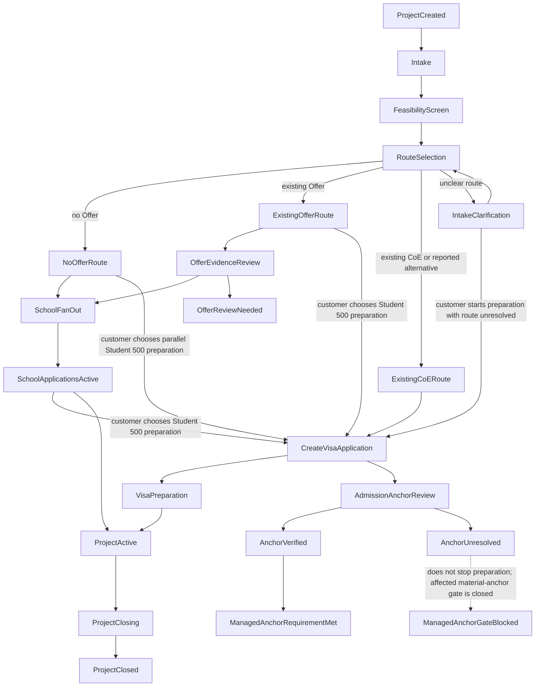
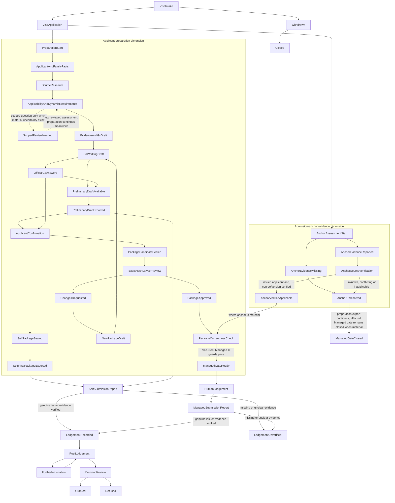

# Phase 13 M0-003 — Study Journey Workflow and Requirements Governance Design

**Status:** M0-003-R2 DELIVERED — AWAITING INDEPENDENT REVIEW; NOT OWNER-ACCEPTED.
**Task:** M0-003 workflow and policy governance contract, read from expected activation commit `a234e4ff4ad0124e2ed522579e6a26075f34f273`.
**Local evidence checkpoint:** branch `phase13-study-journey-project-centric`, HEAD `355721919d049d16070dfc887105d3c2a943afaa` (the M0-002-R1 prerequisite). The activation commit is its direct child. R1 began with the uncommitted M0-003 design and three status-document edits from the preceding task; R2 began from that same uncommitted R1 documentation WIP and preserved it. Neither pass moved or rewrote Git history.
**Scope:** architecture proposal only. Every new entity, transition, rule, limit and status below is proposed unless explicitly identified as checked-in source behavior. This document is not a schema freeze, professional approval, legal opinion, implementation authorization or release authorization.

## 1. Evidence, invariants and authority boundary

### 1.1 Inputs reviewed

- `AGENTS.md`, the Phase 13 roadmap, M0-001 audit, M0-002-R1 data/authorization design, shared handoff/milestone/project-state/decision records, the M0-003 task contract at activation commit `a234e4ff4ad0124e2ed522579e6a26075f34f273`, the M0-003-R1 correction brief and the M0-003-R2 owner brief. The R2 brief says the independent review accepts all eight R1 corrections; they remain preserved below.
- The checked-in `doc/Study_Journey_School_and_Student500_Facts_Documents_Lawyer_Review_V0.1_2026-10-22.pdf` is available, but it is not established as the latest annotated copy: its 12 PDF annotations are external URL links, and no separate annotated copy was found in the repository or supplied attachment files. The latest annotated PDF is therefore unavailable for this pass. The R2 comments below are recorded as owner-supplied provisional lawyer feedback, not as extracted annotations or approved rules. The other checked-in architecture PDF and presentation assets remain dated working/presentation references. None is a functional requirement or professional approval.
- The matrices classify rows as baseline fact, conditional fact, optional information, common/conditional evidence or external outcome. They expressly say they are not a universal school or legal checklist. The supplied source list includes Study Australia, selected institution pages, the National Code, CRICOS, Home Affairs Student 500 pages, the Document Checklist Tool, Genuine Student material and a page about changes dated 2 October 2026. This design does not re-check those pages or assert that any listed rule, date, limit, form or evidence item is current or applicable.

### 1.2 Checked-in source facts versus proposal

| Status | Evidence or position |
|---|---|
| **VERIFIED in checked-in source** | Existing immigration conversations and matter-document evidence are Chat-scoped. `chatbot/lib/conversations/scope.ts` returns `projectId: null`; no `StudyJourneyProject`, Project workflow, `ProjectTask`, or `TaskPlanner` implementation was found in the inspected schema/source at the local checkpoint. The Phase 13 domain described below is proposed. |
| **VERIFIED in checked-in source** | `chatbot/lib/db/schema.ts:1096-1129` stores Policy Intelligence source snapshots with authority, canonical URL, retrieved/source/effective dates, evidence and hash. `:1148-1222` stores append-only analysis/editorial revisions and publication lifecycle fields. This is a provenance and editorial pattern; it is not a Project requirement engine or an eligibility decision. |
| **VERIFIED in checked-in source** | `chatbot/lib/policy-intelligence/conversation-policy-binding-service.ts:71-90,108-182` resolves a requested slug through the server's published-policy read before it persists a conversation snapshot. `conversation-policy-binding.ts` and `schema.ts:1409-1456` bind that snapshot to a conversation; this does not create Project membership or share a Project source packet. |
| **VERIFIED in checked-in source** | `chatbot/lib/policy-intelligence/editorial-access.ts:15-26` takes the session identity only; `editorial-service.ts:632-653` re-reads actor role, verified-email status and active editor capability before publication. Reuse this separation pattern, not its global policy-editor authority as an application-level permission. |
| **VERIFIED in checked-in source** | `chatbot/lib/conversations/turn-ledger.ts` and `widget-turn.ts:167-235,290-343` provide the shared durable, idempotent, fenced widget-turn lifecycle. A Project conversation must keep using that lifecycle; it does not create a second answer or persistence path. |
| **VERIFIED in checked-in source** | `chatbot/lib/db/schema.ts:96-207` defines VIP purchase/plan/subscription billing records for AI entitlement. No Project professional-fee `PaymentEvent`, `PaymentAllocation`, `ServiceFeeObligation`, or client/third-party-funds custody ledger was found in application source. The names in §§12.2–12.3 are proposed architecture only; they must not be confused with Stripe/VIP billing. |
| **VERIFIED in checked-in source** | The M0-002-R1 audit records a source-level document security contradiction: `matter-documents/service.ts:145-175` starts upload pending then completes storage, while `db/queries.ts:2565-2585` can set `securityStatus="clean"` merely when `storageStatus` becomes `stored`; scanner reconciliation has a separate pending-to-verdict path (`security-reconciliation.ts:24-70`, adapter `queries.ts:3398-3407`). Production scanner delivery was not observed. This finding remains unresolved in code and is a Project real-data prerequisite; this task does not fix it. |
| **PROPOSED** | All Project workflow templates, workflow/application states, task planning, dynamic requirement rules, source snapshots, publication gates, impact analysis, package gates and payment allocations below. No current source behavior is implied. |
| **LAWYER / EDUCATION-AGENT PENDING** | Legal-source applicability, admission evidence sufficiency, the four PDF matrices, professional scope, GS review standards, customer disclosure, fee/contract terms, retention and lawful disclosure. None is approved by this design. |
| **NOT VERIFIED** | Live database contents, current external source pages, school/agency integrations, source licensing, production scanner behavior, staff credentials, contract enforceability, fee evidence requirements, external submission routes, retention or legal-hold operations. No database, cloud, payment, runtime or customer external system was accessed. GitHub was read-only for the expected task contract and commit metadata. |

### 1.3 Binding invariants

1. A Study Journey exists only after explicit Project creation. Standalone Chat, its modes, history, uploads, evidence scope and deletion behavior remain independent. A Project is not a `LegalMatter`.
2. One Project may contain many independent school applications and related people. Facts and bytes may be reused only within explicit Project grants and after their provenance/applicability is checked for the target application. One school application never overwrites another.
3. Student 500 is a separate application workflow. It may use a verified existing CoE or a separately verified applicable alternative as its admission anchor. A school-application workflow is not a universal prerequisite to visa preparation.
4. Intake answer, evidence, source consistency, customer confirmation, professional verification, applicability, requirement satisfaction, package approval and external outcome are separate dimensions. Unknown is never silently false, satisfied or approved.
5. GPT-6 may research, extract candidate facts, surface conflicts, propose/reprioritize tasks and draft from the bounded authorized packet. It cannot grant authority, turn a candidate into a confirmed fact, publish a rule, accept terms, confirm payment, authorize a customer, approve a package, submit externally or invent an external receipt, Offer, CoE or visa result.
6. Source authority, human operational standards, application-specific evidence and AI interpretation remain separate records. Internal templates do not become legal authority by being reviewed or published.
7. Managed professional submission is per application and exact package version. It requires the accepted exact-version engagement coverage, contractual fee condition when applicable, customer authorization, current assigned professional authority, required exact-hash lawyer approval and an authorized human submitter. Self-Service can receive clearly labelled AI preparation/export without those managed-service prerequisites, subject to access, security, consent/disclosure and lawful service constraints.
8. Progress measures preparation activity only. It cannot imply eligibility, completeness, admission probability, visa success or submission permission.
9. A changed fact, source, rule, evidence grant or package creates new assessment/history. Historical packages, reviews, authorizations, submission records and outcomes are not rewritten.

## 2. Proposed workflow and version model

Use separate immutable `WorkflowTemplateVersion` and `RequirementTemplateVersion` concepts. A workflow version owns fixed stage IDs, allowed transitions, terminal states, required gate identifiers and permitted task classes. It does not encode every school or visa branch as a separate state machine. Requirement versions own typed rule/evidence definitions and source references. Human approval of one version does not automatically approve later versions.

Each application has its own `WorkflowInstance` identity/state and revision, bound to the template version chosen at creation. A Project-level journey is an orchestrator that links one or more school instances and one or more Student 500 instances; it is not a shared application state. `ProjectApplication` remains the generic M0-002 scope row, with school/visa subtype and workflow introduced at their approved later milestones. School and visa package, external evidence and lifecycle state never share one mutable row.

Reuse the proposed M0-002 `ProjectTask` and `ProjectTaskDependency` as the persisted task-instance store. `TaskPlanProposal` is a typed, bounded planner output; `TaskPolicyValidator` validates it; accepted AI suggestions materialize as `ProjectTask` rows. Deterministic tasks required by an already-approved workflow rule are generated by the rule/task materializer, not by the model and not subject to an AI suggestion cap. Deferred or failed work remains visible in a durable task/backlog state. Do not add a separate permanent task table per workflow stage or per checklist row. A task can reference an application, requirement instance, package/review or a parent task, but task completion is never a submission, requirement, customer-confirmation or approval verdict.

### 2.1 Package version, confirmation and approval lifecycle

Use one immutable version/hash boundary for every formal package review. Editable preparation material is a draft; a sealed candidate is a content-and-evidence manifest snapshot that cannot be edited in place. A preparation lawyer may edit a Managed draft before customer confirmation. The customer then confirms the factual statements attributed to them in that candidate. Sealing creates `PackageCandidate(version, hash)`; a verified assigned lawyer reviews that exact hash and appends one of `approved`, `changes_requested` or `rejected`. Approval creates an `ApprovedPackage` status/event for that immutable version, not a mutable package. A later managed gate separately evaluates whether that approved version is still current and whether all C guards pass; `approved` is not `submission_ready`.

If changes are requested, retain the reviewed candidate and decision unchanged, create a new draft/version, and repeat customer confirmation for every changed customer-attributed fact or statement. Seal the new candidate and repeat exact-hash lawyer review. Any edit after sealing is a new version; an approved version is never reopened or modified. A material source, fact, evidence-grant or dependency change makes only the dependent current candidate/approval ineligible for a new gate and requires a new version/review when materiality is established. Self-Service can separately export a labelled preliminary AI draft before formal confirmation or lawyer approval; that export is not an approved package, confirmation event, managed readiness result or submission record.

### 2.2 Shared route selection

The initial intake stores a customer-selected route signal (`no_offer`, `existing_offer`, `existing_coe`, `qualified_alternative`, `unknown`) and the underlying evidence state. It is not a semantic classifier and does not itself establish an Offer/CoE. Routes may coexist within one Project: an existing CoE can feed one visa application while the customer also considers another school; each school instance remains independent.

- **No Offer:** run a bounded early visa-feasibility/risk screen before major school commitments; create any number of independent school applications after the customer chooses options. Student 500 preparatory fact collection, source research and AI drafting may also start in parallel even though the admission anchor is missing; only an affected Managed gate remains closed until a material anchor is source-verified.
- **Existing Offer:** create or resume the matching `SchoolApplication` at offer review. Store the reported Offer as a candidate, then verify its issuer, applicant, course/intake, conditions, date and status from evidence before using it as a verified external state. The customer may start Student 500 preparation in parallel; an Offer alone is not a verified visa anchor. Do not recreate completed selection/application tasks.
- **Existing CoE:** permit direct Student 500 preparation without creating a school application. Bind the exact CoE/alternative evidence to the visa application and verify the issuer, applicant, course, status and relevant dates. If verification/applicability is unknown, the user may still receive an honest AI preparation draft; the managed submission gate remains closed where the anchor is material.
- **Offer/CoE generated by a Project school application:** link the verified external record to that specific school application and to the visa application that actually relies on it. Do not copy a school-specific admission requirement into unrelated applications.

### 2.3 Version-bound admission-anchor link

When a Student 500 application relies on a School application's verified Offer/CoE, create an explicit server-validated link bound to the exact source record version and exact target application. The link carries the same `projectId`, source `SchoolApplication` and `ProjectEvidenceRef`/outcome version and hash, target `VisaApplication`, relevant applicant party, link revision, actor/event provenance and current status. The source and target applications and person must belong to the same Project; a customer or service cannot reuse a record from another Project/user or select an arbitrary evidence ref. The target VisaApplication records which verified CoE (or separately reviewed applicable alternative) it relies on. Offer evidence may inform the chosen admission route, but is not silently treated as a visa anchor.

This is a typed relationship over the existing M0-002 application, outcome and `ProjectEvidenceRef` identities, not a new general cross-Project sharing table. If an Offer/CoE is revoked, expires, is corrected or is reissued, append the changed source record and mark only links pinned to that affected version stale. Reassess only dependent requirements, facts and the current package/readiness of linked VisaApplications. A corrected/reissued CoE requires an explicit new version-bound link; the old link and completed external history remain immutable. A linked school record does not change any other application, and no CoE issuance is inferred from Offer acceptance or condition satisfaction.

## 3. Project journey orchestration

The Project status summarizes lifecycle and active work; it does not replace application statuses. Closing a Project prevents new work and starts the separately governed retention/closure process. It does not synthesize successful completion for child applications.



`SchoolFanOut` denotes independent applications, not one shared school workflow. Student 500 preparation and admission-anchor verification are separate status dimensions: creating a visa application starts both tracks, but a missing/unverified/unresolved anchor does not block fact collection, research, AI preparation or clearly labelled draft export. `ManagedAnchorRequirementMet` can be recorded only when the affected application has source-backed verification of the actual CoE or a separately verified applicable alternative; the other Managed C guards remain separate. The gate does not infer a CoE from an Offer, acceptance, or satisfied conditions.

## 4. School Admissions workflow

Each `SchoolApplication` binds one provider, institution, course, campus, intake and application route. Several can run concurrently under one Project. Shared Project facts/documents are candidates only; target-school applicability, currency and evidence conditions are assessed independently.

```mermaid
stateDiagram-v2
  [*] --> SchoolIntake
  SchoolIntake --> EarlyRiskScreen
  EarlyRiskScreen --> ProviderCourseResearch
  ProviderCourseResearch --> SchoolRequirements
  SchoolRequirements --> EvidenceAndFacts
  EvidenceAndFacts --> SchoolPackageDraft
  SchoolPackageDraft --> PreliminaryDraftAvailable: A checks pass; no final confirmation required
  PreliminaryDraftAvailable --> PreliminaryDraftExported: customer explicitly exports labelled AI draft
  PreliminaryDraftExported --> CustomerConfirm: customer chooses to finalize a version
  SchoolPackageDraft --> LawyerDraftEdits: managed preparation edit before sealing
  LawyerDraftEdits --> CustomerConfirm: customer confirms changed personal statements
  SchoolPackageDraft --> CustomerConfirm: customer chooses final self-service version
  CustomerConfirm --> SelfPackageSealed: self version sealed; no lawyer approval implied
  CustomerConfirm --> PackageCandidateSealed: managed candidate sealed with exact hash
  PackageCandidateSealed --> ExactHashLawyerReview: assigned lawyer reviews this candidate hash
  ExactHashLawyerReview --> PackageApproved: approval event bound to exact hash
  ExactHashLawyerReview --> ChangesRequested: decision bound to candidate hash
  ChangesRequested --> NewPackageDraft: create next version; retain prior candidate unchanged
  NewPackageDraft --> LawyerDraftEdits: managed edits are needed
  NewPackageDraft --> CustomerConfirm: only necessary confirmations repeat
  PackageCandidateSealed --> CandidateStale: material dependency changed before approval
  PackageApproved --> PackageStale: material dependency changed after approval
  CandidateStale --> NewPackageDraft
  PackageStale --> NewPackageDraft
  PackageApproved --> ManagedGateReady: all current Managed C guards pass
  SelfPackageSealed --> SelfFinalPackageExported: customer explicitly exports this version
  PreliminaryDraftExported --> SubmissionReportPending: customer reports actual external action and supplies receipt evidence
  SelfFinalPackageExported --> SubmissionReportPending: customer reports actual external action and supplies receipt evidence
  ManagedGateReady --> ManagedHumanSubmission
  ManagedHumanSubmission --> SubmissionReportPending: assigned human reports actual action and supplies receipt evidence
  SubmissionReportPending --> SubmissionRecorded: genuine issuer receipt/evidence verified
  SubmissionReportPending --> ReceiptUnverified: evidence is absent, unclear or not yet verified
  ReceiptUnverified --> SubmissionReportPending: new receipt evidence is supplied
  SubmissionRecorded --> InstitutionReview: institution reviews the recorded application
  InstitutionReview --> OfferReview: institution issues Offer evidence
  InstitutionReview --> SchoolRequirements: institution requests more material
  OfferReview --> OfferVerified: issuer and exact Offer version verified
  OfferReview --> NeedsReview: issuer/version cannot be verified
  OfferVerified --> CustomerDecisionPending: verified institution procedure permits a decision now
  OfferVerified --> OfferConditionsTracked: condition states tracked independently
  OfferConditionsSatisfied --> CustomerDecisionPending: institution requires prior conditions; decision not yet recorded
  CustomerDecisionPending --> CustomerAcceptanceRecorded: customer records one decision for this Offer version
  CustomerAcceptanceRecorded --> OfferConditionsTracked: track any remaining conditions independently
  CustomerAcceptanceRecorded --> InstitutionAcceptancePending: institution requires an external acceptance step
  InstitutionAcceptancePending --> InstitutionAcceptanceVerified: genuine institution acknowledgement received
  OfferConditionsTracked --> OfferConditionsSatisfied: all applicable conditions evidenced per institution terms
  OfferVerified --> CoEReview: actual institution-issued CoE is received as a separate event
  CustomerAcceptanceRecorded --> CoEReview: actual institution-issued CoE is received as a separate event
  OfferConditionsSatisfied --> CoEReview: actual institution-issued CoE is received as a separate event
  CoEReview --> CoERecorded: genuine CoE is verified
  CoEReview --> InstitutionReview: new/changed issuer record needs review
  SchoolRequirements --> NeedsReview: material source/fact applicability unknown
  NeedsReview --> EvidenceAndFacts: new evidence or human resolution
  SchoolRequirements --> Withdrawn: customer withdraws application
  InstitutionReview --> Refused: institution refusal evidence recorded
  OfferVerified --> Declined: customer declines this exact Offer version
  CustomerAcceptanceRecorded --> Declined: customer withdraws acceptance where institution process permits
  SchoolPackageDraft --> Deferred: customer defers application
  Deferred --> SchoolIntake: new intake creates a new versioned plan
  CoERecorded --> Closed: school instance complete or handed to visa workflow
  Refused --> Closed
  Declined --> Closed
  Withdrawn --> Closed
  [*] --> OfferReview: existing Offer enters at evidence review
```



### 4.1 School transition and evidence table

| Transition/event | Actor and guard | Evidence/record | Rollback, invalidation and audit |
|---|---|---|---|
| Create `SchoolApplication` / `SchoolIntake` | Project owner or authorized project member chooses a provider/course/intake; server checks Project and membership revision. | New application ID, provider/course/campus/intake facts with origin and status; route choice. | A mistaken choice is corrected by a new application revision or cancellation event; never repoint another school's history. |
| Early risk screen → provider/course research | AI may create candidate questions/tasks after resolving only granted facts. A material legal issue creates a review task; it does not block unrelated school research. | Candidate facts, source refs, unresolved flag and task trigger. | New facts/sources reevaluate only dependent tasks. The screen cannot declare visa eligibility. |
| Provider/course research → requirement resolution | AI/service captures an actual provider/official source snapshot or records source unavailable. Requirement row must be scoped to this institution/course/intake and a template version. | Source authority, canonical URL when observed, retrieved time, known publication/effective dates, content hash, applicability inputs. | Stale/contradictory source becomes `unknown/needs_review`. It is not treated as proof that no requirement exists. |
| Evidence/facts → package draft | AI or human prepares a draft from clean, granted evidence and fact assertions; conflicting assertions remain visible. | Artifact origin, exact evidence/version refs, extraction status and current source/template versions. | Source bytes are not modified. Replacing/revoking evidence stales only dependent candidate assertions/assessments. |
| AI draft → preliminary Self-Service export | A passes access, entitlement, safe-input and disclosure checks. No formal personal-statement confirmation or lawyer approval is required for this labelled preliminary export. | Exact exported draft/version/hash, AI-origin label, warnings and customer export action. | Export records only a file delivery. It does not mean customer confirmation, lawyer approval, package acceptance or external submission. |
| Editable draft / lawyer preparation edits → customer confirmation | Customer or separately authorized guardian confirms the exact changed personal facts/statements in the draft they are finalizing. Managed preparation edits happen before sealing. | Actor, authority, time, exact draft content/hash and disclosure version; confirmation is scoped to customer-attributed statements. | Changed statements require new confirmation. AI and staff cannot confirm for the customer. Preliminary export remains unconfirmed. |
| Customer-confirmed draft → sealed package candidate | Server seals an immutable version and evidence/dependency manifest after required confirmations. Managed path uses `PackageCandidate`; Self final version may be sealed without lawyer approval. | Version number, content and manifest hashes, customer-confirmation references, current source/template/fact revisions. | Sealing freezes this candidate. Any edit is a new version. Sealed candidate, approved package, and managed submission readiness are distinct states. |
| Sealed candidate → exact-hash lawyer review → approved or changes requested | Verified assigned lawyer reviews the precise `PackageCandidate` hash under the school-package capability. Decision is append-only and bound to that hash. | Reviewer identity/assignment/capability, exact hash, immutable decision and reason codes. | `approved` creates an `ApprovedPackage` event for that exact version. `changes_requested` retains the candidate and starts a new draft/version; changed customer statements are reconfirmed as needed, then the new hash is reviewed. Never modify an approved version. |
| Approved package → Managed gate result | Gate re-reads the current hash and every C guard. Only an exact current approved package can reach `ManagedGateReady`. | Gate snapshot binds package hash, current application/source/requirement/contract/fee/authorization/assignment revisions. | Approval alone is not readiness. Missing/stale/unknown C conditions deny readiness while preserving approval history. A material change makes only the dependent package stale and requires a new version/review. |
| Self export → actual Self-Service submission record | A Self customer explicitly records that they performed the external action and supplies genuine provider receipt/status evidence for the target application and event. | Customer action event, target application, customer-reported exported version/hash, evidence ref, issuer/channel and observed date; verification status is explicit. | Export alone never records submission. Without genuine evidence there is only a pending/unverified report, not a real submission record. The receipt proves only what it actually shows; do not claim it proves the submitted content/hash unless it does. This event does not retroactively confirm every statement or imply lawyer approval. |
| Managed gate ready → human submission report | Assigned authorized human performs the external action; platform has no external-school API call. | Human action plus genuine provider receipt/status evidence bound to the exact approved package hash. | Gate readiness is permission for handoff, not proof of submission. Missing or disputed proof stays pending/unverified; retries append events. |
| Submission evidence pending → institution review | Authorized human verifies a genuine receipt or provider status for the exact application; duplicate receipt IDs are idempotent only if content matches. | Issuer/channel, receipt hash/reference, observed time, verifier and package version/hash. | Conflicting or unverifiable evidence remains unverified; no AI-generated portal status. |
| Institution review → Offer authenticity/version review | Issued Offer evidence is tied to issuer, applicant, institution, course/intake, conditions, version, date and current status. | Exact institution-issued Offer version/hash and source evidence; verifier and school application. | Customer report alone remains candidate. Corrections/reissues append a new version; do not overwrite prior Offer evidence. |
| Verified Offer → customer acceptance record | The customer explicitly chooses to accept or decline that exact Offer version. Institution-specific terms/source determine whether acceptance is allowed now or requires prior conditions/action. | Customer/authorized guardian, exact Offer hash, action/time and the institution-specific acceptance method/conditions relied on. | This records the customer decision, not an institution acknowledgement. Any required external acceptance action/receipt is separately recorded and verified. If allowable sequence is unknown, hold for review. |
| Customer acceptance decision → institution acceptance status | If the institution requires an external acceptance action, only the customer/authorized human performs it through the institution's stated route; status is not inferred from the product's customer decision record. | Exact Offer version, human actor/action time and genuine institution acknowledgement/receipt evidence when issued. | Keep external status pending/unknown until issuer evidence is verified. A recorded customer decision alone is not an institution acceptance outcome. |
| Offer conditions → satisfied / still pending | Each condition is tracked independently from Offer authenticity and customer acceptance. The applicable institution source determines whether conditions must precede acceptance, may follow acceptance, or affect CoE processing. | Exact Offer version, typed condition, institution source, evidence/issuer and reviewer outcome. | Do not require every conditional Offer condition before customer acceptance unless this institution's terms say so. Unknown terms/status remain `needs_review`; accepted Offer does not mean conditions are satisfied. |
| CoE evidence received → verified CoE | A genuine institution-issued CoE version is independently received and issuer/person/provider/course/status/date are checked. | Exact CoE evidence/hash/version, issuer verification, related Offer if any, and actual issue/status event. | Condition satisfaction or acceptance does not guarantee issuance. Revoked/expired/corrected/reissued CoE creates a new version and stales only links/assessments depending on the old version. |
| Any active state → needs review/deferred/withdrawn/closed | Authorized customer or staff action, material source/fact change, expiry or actual external event. | Reason code, actor, triggering revision/evidence and event time. | Reopen by a new event/version. Old tasks and approvals remain historical; unrelated applications continue. |

### 4.2 Multiple-school invariants

- `SchoolApplication` has its own provider, intake, source set, requirement instances, tasks, package/hash, lawyer approval, submission authorization, external receipt, Offer and CoE links.
- One shared passport or transcript may support multiple requirements, but the evidence ref is resolved under each application’s grant and target criteria. A target-specific translation, certified copy, portal form or deadline cannot be inferred from another school’s status.
- At least three independent applications are a later acceptance scenario. One app's refusal, deferral, Offer acceptance or CoE does not complete/cancel the others unless the customer explicitly changes them.
- If the customer chooses an existing verified CoE route, no SchoolApplication need be created. A school application may still run in parallel for a different course/provider.

### 4.3 Offer and CoE are separate version-bound records

An Offer is a versioned external record with separate authenticity/version status, one customer decision for that exact version, per-condition status, any institution acknowledgement, and actual CoE issuance. The Offer's issuer, applicant, provider/course/intake, version, issue/status dates and conditions are verified before it can drive the institution-specific procedure. A changed or reissued Offer creates a new version; prior verification, customer decision and acknowledgement remain immutable and do not transfer automatically.

The customer decision is recorded once for an exact Offer version, when the verified institution procedure permits that action. If the procedure allows acceptance while conditions remain open, acceptance and condition tracking proceed independently. If verified terms require a condition first, the condition is evidenced and marked satisfied before the customer is offered the acceptance action; satisfying that condition does not create or repeat a customer acceptance event. Unknown sequence is `needs_review`. Where the institution requires an external acceptance step or acknowledgement, record the actual human action and issuer evidence separately from the customer's decision.

Proposed typed records remain distinct rather than one mutable Offer-status flag: `OfferVersion` (school application, applicant, issuer, exact source/evidence refs, version/hash, issue/status dates and stated conditions); `OfferAuthenticityReview` (exact Offer version, verification result, verifier, time and evidence); `InstitutionProcedureSnapshot` (institution/course scope, captured source/version, retrieval and known effective dates, verified acceptance sequence, condition ordering and whether an external acknowledgement is required); `OfferCustomerDecision` (one accepted/declined decision, customer or authorized guardian, exact Offer version, action/time and procedure ref); one `OfferConditionAssessment` per versioned condition (state, evidence, source and reviewer); `InstitutionAcknowledgement` (actual human action plus genuine issuer acknowledgement evidence); and `CoEOutcomeVersion` (actual issuer record, applicant/course match, version/hash, status/date and verifier). Procedure snapshots with unknown scope or dates remain unverified/`needs_review` and cannot authorize a transition.

```mermaid
flowchart LR
  OfferReceived --> OfferVersionCheck
  OfferVersionCheck -->|issuer, person, and version verified| OfferVerified
  OfferVersionCheck -->|unknown or conflicting| OfferReview
  OfferVerified --> CustomerDecision
  OfferVerified --> ConditionTracking
  ConditionTracking --> ConditionSatisfied
  ConditionSatisfied -. "only if verified institution procedure requires a condition first" .-> CustomerDecision
  CustomerDecision -->|one decision for this version| CustomerAcceptanceOrDecline
  CustomerAcceptanceOrDecline -->|external step required| InstitutionAction
  InstitutionAction -->|actual issuer evidence| InstitutionAcknowledgement
  OfferVerified -->|actual CoE later received| CoEAuthenticityReview
  CustomerAcceptanceOrDecline -->|actual CoE later received| CoEAuthenticityReview
  ConditionTracking -->|actual CoE later received| CoEAuthenticityReview
  CoEAuthenticityReview -->|issuer and case details verified| CoEIssuedVerified
```



`ConditionSatisfied` gates the customer-decision action only when the verified institution procedure says so. It never loops back to a previously recorded acceptance. `InstitutionAcknowledgement` and `CoEIssuedVerified` require separate genuine issuer evidence. A CoE review begins only when an actual institution-issued version is received; condition satisfaction or Offer acceptance never creates or guarantees one.

## 5. Student Visa 500 workflow

A `VisaApplication` owns its applicant parties, intended lodgement context, official-source snapshot set, applicable requirement assessments, GS content, package, review and human submission records. The workflow accepts current facts and family/exception cases as inputs; it does not hardcode a universal document checklist, one visa scenario or one subclass-specific route.



The two tracks start from the same `VisaApplication` but progress independently. Missing, unverified or unresolved CoE/admission-anchor evidence does not prevent applicant/family fact collection, source research, consistency work, other evidence preparation, either GS output, or clearly labelled Self-Service draft export. Unknown official source or individual-checklist material is recorded as `unknown/needs_review`, never as “no requirement.” If this application relies on a school outcome, its `AdmissionAnchorLink` must still be same-Project, applicant-bound and pinned to a source-verified outcome version. Before an affected Managed gate passes, the material anchor must be source-backed as the actual issuer-verified CoE or a separately verified, legally applicable alternative; a reported upload, Offer, acceptance or satisfied condition is insufficient. Independent school applications continue.

### 5.1 Visa transition and evidence table

| Transition/event | Actor and guard | Evidence/record | Rollback, invalidation and audit |
|---|---|---|---|
| Create VisaApplication / intake | Customer or authorized guardian explicitly chooses Student 500 preparation. Server binds the application to the Project and identified applicant party. | Intended lodge date/location as customer-supplied candidate facts; party roles; service pathway preference. | Later correction supersedes values; no date, location or legal status is inferred by GPT. |
| Applicant/family facts → anchor check | AI may extract candidate facts from granted Project context; family and exceptional facts become dynamic scoped questions where relevant. | Fact origin, person/application scope, exact evidence refs, confirmed/conflicting/unknown states. | A dependent’s data is not applied to applicant by identity similarity. Missing facts remain unknown. |
| Create application → admission-anchor verification dimension | Start source-backed verification concurrently with preparation. Record a reported CoE/alternative or explicit absence; do not require it before fact collection, research or draft/export. A school-origin item must be linked from the verified source application/outcome version to this exact visa application and applicant within the same Project. | Exact source/issuer evidence, source school application, `ProjectEvidenceRef`/outcome version and hash when applicable, target visa application/person, link actor/event and dates. | Missing, cross-Project, wrong-person, unresolved or superseded anchor does not stop AI preparation/export. It keeps an affected Managed gate closed when material. Revoke/expiry/correction/reissue stales only dependent assessments/packages; replacement requires a new link. |
| Source research → applicability assessment | Capture actual legislation/instrument, official guidance/checklist, relevant source state, capture time and known effective/transition window; research and provisional preparation continue when one source is unavailable. | Snapshot ID/hash, source type/issuer, URL, observed/retrieved time, version and explicit unknowns. | Out-of-order or stale source cannot replace current snapshot. A new source does not retroactively rewrite a historical package. Unavailable material is `unknown/needs_review`, not a global preparation stop. |
| Applicability → dynamic requirements | Typed three-valued rules evaluate facts and source-backed conditions; human resolves material legal ambiguity. | Requirement instance and append-only assessment with `true/false/unknown`, evidence/source set, evaluator/template version. | Unknown is `needs_review`; false only means the condition was actually evaluated false. New facts/source version creates a new assessment. |
| AI draft → preliminary Self-Service export | A passes access, entitlement, safe-input and disclosure checks. Personal facts/GS statements need not yet be formally confirmed for a clearly labelled preliminary draft. | Exact exported draft/version/hash, AI-origin label, warnings and customer export action. | Export is a file-delivery event only. It is not confirmation, lawyer approval, managed readiness or lodgement. |
| Editable draft / lawyer preparation edits → applicant confirmation | Applicant/authorized guardian confirms the exact changed personal facts and final GS statements in the version they are finalizing. Managed preparation edits happen before sealing. | Actor/authority, time, exact draft content/hash, language and disclosure version; confirmation scope. | Changed customer-attributed statements require renewed confirmation. AI/staff cannot confirm for applicant. Preliminary exports remain unconfirmed. |
| Applicant-confirmed draft → sealed package candidate | Server seals a new immutable version and evidence/dependency manifest after required confirmation. Managed uses `PackageCandidate`; Self final version may be sealed without lawyer approval. | Version number, content/manifest hashes, confirmation references and pinned source/template/fact revisions. | Any edit creates a new version. Sealed candidate, approved package and managed submission readiness remain separate. |
| Sealed candidate → exact-hash lawyer review → approved or changes requested | Verified assigned lawyer reviews the exact sealed candidate under visa-package and GS capability. | Reviewer identity/assignment, exact hash, immutable decision and reason codes. | Approval creates an `ApprovedPackage` event for that hash. A change request retains that candidate and creates the next draft/version. Reconfirm every affected applicant statement, seal a new candidate and repeat exact-hash review. Never modify an approved version. |
| Approved package → Managed gate result | Gate independently reads the current package, exact approval and all current C guards. | Gate snapshot binds package hash, revisions, scope, fee, authorization, material assessments and assigned submitter. | Exact-hash approval alone is not readiness. C denial preserves the approved package but blocks the handoff; material dependency changes stale only the dependent package and require new version/review. |
| Self export → actual Self-Service lodgement record | Applicant explicitly reports that they performed the external action and supplies genuine government/provider receipt or status evidence for the target application and event. | Customer action event, target VisaApplication, customer-reported exported version/hash, evidence ref, issuer/channel/date and verification status. | Export alone never records lodgement. Without genuine evidence there is only a pending/unverified report. The receipt proves only what it actually shows; do not claim it proves the submitted content/hash unless it does. Recording a real submission does not retroactively confirm every statement or imply lawyer approval. |
| Managed gate ready → human lodgement report | Assigned authorized professional performs the external action through an allowed route; the platform makes no government call. | Human action plus genuine receipt/status evidence bound to the exact approved package hash. | Gate readiness is not proof of lodgement. Missing/disputed evidence stays pending/unverified; retries append events. |
| Lodgement evidence pending → post-lodgement | Authorized human verifies genuine receipt evidence, then records a real further-information request or decision only from issuer evidence. | Exact visa application/package, issuer/source evidence, event and receipt dates, verifier. | Unverified/missing evidence does not mark lodged, granted or refused. Actual request/decision records append and never overwrite earlier events. |
| Further information / changed circumstances / decision | Official request or decision is recorded only from real issuer evidence; assigned human reviews legal significance. | Original communication and event time, evidence ref, response package version if applicable. | A new response is a new version and separate human lodgement event. Grant/refusal state comes only from verified evidence. |
| Cancel/withdraw/reopen | Applicant or authorized human records the request/outcome. | Actor, reason, effective event date if evidenced and relevant authority. | Preserve all prior states. Reopen by a new application/workflow revision; do not erase history. |

### 5.2 Versioned GS output contracts

The Student 500 workflow has two separate versioned outputs. “Official” in the second type means structured against the actual applicable online form; it does not mean approved, legally sufficient, or accepted by Home Affairs.

| Output type | Purpose and proposed contents | Version/provenance contract |
|---|---|---|
| **Comprehensive GS Working Draft** | Detailed factual preparation, applicant timeline and context, fact/evidence mapping, consistency checks, missing/uncertain material, and lawyer working material. It may contain sections useful for drafting and internal review. | Immutable `GsWorkingDraftVersion` with applicant/application scope, version/hash, authored/edited-by provenance, fact assertion and evidence refs per material statement, source/form snapshots consulted, consistency issue refs, and review status. It is not automatically a government-form answer or accepted supporting attachment. |
| **Official GS Question Answers** | Structured answer per question/field in the actual applicable online form, including only applicable questions and verified current wording/constraints. | Immutable `OfficialGsQuestionAnswersVersion` with exact form/source snapshot and retrieval time; stable question IDs/labels where observable; one answer value per question; applicable word/character/format limits; provenance from working-draft spans and underlying fact/evidence refs; lawyer edit history; applicant confirmation state; content hash. No question, limit or trigger is inferred from the V0.1 matrix alone. |

`Official GS Question Answers` is derived from the working draft through a traceable mapping, not by assuming a comprehensive narrative can substitute for per-question answers. Preserve each lawyer edit as an attributed revision. The applicant confirms the exact final answer set and relevant personal statements; the confirmation binds to that answer-set hash and form version. A sealed submission `PackageCandidate` binds the actual answer-set hash, evidence/dependency manifest, applicable form snapshot and other required package artifacts; exact-hash lawyer approval and Managed C evaluation apply to that candidate. The comprehensive working draft remains review material and is excluded from the submitted package by default. Include it as an attachment only when the actual form/source permits that use and a human explicitly approves that exact artifact.

A material change to applicant facts, evidence, source interpretation, applicable form wording/constraints, working-draft statements or lawyer-edited answers creates new dependent versions. Re-derive only affected formal answers, obtain renewed applicant confirmation for changed applicant-attributed statements, seal a new package hash and repeat required exact-hash lawyer review. Old answer sets, confirmations and approvals remain historical and immutable.

### 5.3 Document verification dimensions and early professional-review suggestions

Document status is multidimensional; one result never implies another:

| Dimension | Proposed states / record | What it does not prove |
|---|---|---|
| Malware and storage security | `pending`, `clean`, `rejected`, `unknown`; bind the scanner verdict to the exact immutable document version/object generation. | A clean scan says nothing about extraction completeness, authenticity or evidentiary sufficiency. |
| Extraction completeness | `not_started`, `complete`, `partial`, `failed`, `not_applicable`; record processor/version, pages/units covered, omissions and immutable output hash. | Complete extraction does not prove that the source document is genuine or sufficient. Partial/failed extraction does not prove the document contains no relevant fact. |
| Authenticity / issuer verification basis | `original_sighted`, `certified_or_partner_verified`, `scan_only`, `unknown`; append verifier identity, verification time, partner identity and basis where used, exact immutable document/evidence refs, and the observed issuer result or limitation. | A scan-only copy or successful parsing is not issuer verification. “Original sighted” and partner verification record what was checked; they do not alone establish legal admissibility or case sufficiency. |
| Professional evidence sufficiency | `not_assessed`, `sufficient_for_scoped_purpose`, `insufficient`, `needs_review`; record qualified reviewer, capability, application/requirement scope, reasons and source/rule version. | Sufficiency for one requirement/application does not generalize to another application or convert a provisional matrix into an operative rule. |

Verification updates append new review events rather than changing the original file or prior verdict. A partner claim must preserve its identity, authority/basis and immutable evidence; an unknown or scan-only state remains explicit. Only scanner-clean content may enter a permitted extraction/context path, subject to the separately recorded M0-002 security-state remediation prerequisite.

The planner may suggest narrowly scoped early professional review when source-backed case material shows a material refusal, inconsistent study history, an unusual course transition, or another specifically sourced case risk. Each suggestion records its triggering fact/evidence refs, source/rule version, scope and reason; it asks a qualified human to review and does not decide eligibility, credibility, GS genuineness or likely outcome. Migration intentions, age, or Australian relatives alone are not adverse findings and cannot independently trigger an adverse GS or visa conclusion. No demographic or case-specific hardcoded outcome rule is introduced.

## 6. Fixed stages, adaptive tasks and TaskPlanner contract

### 6.1 Fixed stage contract

The high-level stages below are versioned product workflow structure, not legal requirements. A stage can be skipped only through an explicit typed route/evidence event or an approved template transition. Deterministic rules create required tasks from already-approved workflow requirements; GPT-6 may add bounded suggestions, but cannot add a hard gate, remove a gate, self-approve a stage or change the workflow template.

| School stage family | Fixed purpose | Examples of allowed dynamic work |
|---|---|---|
| Intake and feasibility | Identify the selected applicant, goals, intended timing and early legal-risk questions before material commitment. | Clarify “unknown” answers, collect a relevant source, create a scoped lawyer question. |
| Provider/course research | Compare candidate providers/courses/intakes using source-backed information. | Refresh one provider deadline, request a course-specific prerequisite, compare two selected options. |
| Per-school requirement resolution | Resolve institution/course/intake-specific requirement instances from published template plus actual provider source. | Ask for translation, prerequisite evidence, course form or research proposal only if the source/approved rule supports it. |
| Evidence and package preparation | Build a per-school draft and manifest from facts/evidence. | Reconcile a name/date discrepancy, request a missing file, draft a school statement. |
| Customer review / managed professional review | Collect customer confirmation and, on Managed, exact-version lawyer decision. | Correct selected package content; clarify reviewer reason. |
| Submission handoff / institution outcome | Permit the correct human path and record real receipt/outcome evidence. | Follow up on a genuine institution request or changed Offer condition. |
| Student 500 intake and source applicability | Capture applicant/family/date context and resolve current official-source set. | Request only relevant facts; compare current and event-time source snapshots. |
| Visa requirements, evidence and GS | Assess dynamic applicability, organize evidence and draft candidate GS answers. | Clarify a source-supported gap, reconcile contradictory education/work/family facts. |
| Customer confirmation / lawyer review | Confirm applicant facts and exact text; Managed requires lawyer review. | Route unresolved material legal issue to a qualified reviewer. |
| Human lodgement and follow-up | Human submits; record actual receipt, further request and decision evidence. | Create a task from a genuine official communication. |

### 6.2 TaskPlanProposal typed shape

```text
TaskPlanProposal {
  proposalId, projectId, projectRevision,
  applicationId?, applicationRevision?, workflowTemplateVersionId,
  parentStageKey, triggerEventId, dependencyDigest,
  planningRunId, cursorAfterWorkItemKey?, workItemKeys[],
  proposals: [{
    proposalKey, sourceWorkItemKey, taskKind, objectiveCode, boundedDescription,
    requirementInstanceId?, factKeys[], evidenceRefIds[], sourceSnapshotIds[],
    triggerCode, actorSuggestion, dependencyProposalKeys[],
    prioritySuggestion, risk/currentness flags, expectedCompletionEvidence,
    professionalReviewSuggestion?:{
      kind:"early_professional_review",
      reasonCode:"material_refusal"|"study_history_inconsistency"|
        "unusual_course_transition"|"other_sourced_case_risk",
      supportingFactKeys[], evidenceRefIds[], sourceSnapshotIds[],
      applicationScope, requestedCapability:"lawyer_review",
      disposition:"suggestion_only"
    },
    sensitiveDataRequest?, humanApprovalRequired?,
    origin:"ai_suggestion",
    provenance:{modelId, promptVersion, requestTraceId, createdAt}
  }],
  workItemOutcomes:[{workItemKey, disposition:"suggested"|"no_suggestion"|"needs_review"}],
  invocation:
    | {kind:"user", userId, idempotencyKey, permittedAction,
       projectScope, applicationScope?}
    | {kind:"service", servicePrincipalId, eventId, idempotencyKey,
       permittedAction, projectScope, applicationScope?}
}
```

This is a proposal packet, not an API accepted from the browser. `projectId`, application membership, source/evidence identity, actor permissions and current revisions are resolved server-side. The model may name only evidence refs in its current bounded context. `objectiveCode`, task class, actor suggestion and expected proof are enumerated contract values; free text is short, user-readable and cannot create a guard. No arbitrary code, SQL, URL fetch, shell action or external form submission is a task action.

### 6.3 Deterministic TaskPolicyValidator

For every proposal or deterministic task-materialization event, validate in this order:

1. Resolve an authenticated customer/staff actor **or** a registered service principal. For a user, re-read active Project/application, membership, assignment and grants. For a service event, verify the principal's allowlisted capability, server-owned immutable event provenance, current Project/application scope and idempotency key. Reject stale, forged, replayed-with-different-payload or cross-Project scope before any write.
2. Check the selected workflow version permits the task class at this stage. The planner cannot change the parent state, gate definition, service pathway, permission, contract, fee or external status.
3. Resolve every requirement, source, fact and opaque evidence ref against server records. Missing refs are rejected; unknown source applicability may create a review task but cannot be restated as a rule.
4. Canonicalize a task identity from `project + application + stage + taskKind + requirement/fact/source key + dependency digest`. De-duplicate retries and semantically identical candidates by this bounded identity, not fuzzy text matching.
5. Validate dependencies reference accepted existing/proposed tasks, contain no self-edge or cycle, and are within the same Project/application boundary unless an explicitly modeled cross-workflow handoff exists.
6. Enforce configured per-page, per-run, per-trigger, per-application and per-Project workload/token/cost limits. A limit creates a durable deferred/backlog disposition; it never drops an actionable requirement or reports planning complete while work remains. Exact defaults are configuration/owner decisions, not fixed constants in this design.
7. Sensitive-data requests require an explicit purpose, minimum fields, target person and consent/confirmation task. The AI cannot initiate document access, widen a Project grant or ask for secrets/credentials. Requests for protected identifiers or additional sensitive information follow the separate privacy policy and fail closed if unclear.
8. AI may suggest priority, but the validator applies only typed ordering/urgency constraints and configured caps. It must not determine legal eligibility, legal relevance or an official deadline from a model score.
9. Accepted AI suggestions become `ProjectTask` rows with `origin=ai_suggestion`, provenance and an auditable validator outcome. Deterministic tasks required by already-approved rules use `origin=rule_required` and are produced without an AI call. User/staff review or confirmation remains mandatory before sensitive-data collection, customer commitment, contract/signature, payment, permission changes, package approval or external action.

An early professional-review suggestion must be scoped to one application and carry the triggering fact/evidence/source refs and a reason code. It may surface a sourced material refusal, inconsistent study history, unusual course transition or another explicit case risk for lawyer review; it cannot issue a legal/credibility/GS conclusion, silently change requirements, or create an adverse status. The validator checks identities, grants, scope, supported references and allowlisted task type; a qualified human determines whether the issue is material and what follows.

#### Service-principal contract

TaskPolicyValidator accepts either a customer/staff command with the existing authenticated actor and capability checks, or a server-initiated Project event under a constrained registered principal. A service invocation includes `servicePrincipalId`, immutable triggering `eventId` and kind, source revision/digest, `projectId` and optional exact application scope, permitted action, idempotency key, bounded expiry/replay window, per-event call/token/cost budget and trace/audit ID. Valid event sources include publication of a reviewed workflow/rule version, a recorded source/fact/evidence revision, an authenticated processing verdict, or a configured due-work event. The server derives all project/application scope; a queue payload or model cannot nominate an arbitrary target.

Allowlisted service actions are limited to (a) propose AI tasks, (b) materialize deterministic tasks from already-approved workflow rules, (c) create candidate requirement assessments from current typed inputs, and (d) enqueue dependency-scoped reevaluation. The principal has no user identity and cannot impersonate a customer, lawyer, education agent, guardian or finance confirmer. It cannot grant access, accept a contract, confirm a user fact, verify evidence as a human, publish a rule, approve/seal a package, authorize a customer, confirm a payment, pass a managed gate or submit externally. Audit rows preserve `actorKind=service`, principal, trigger event and actual effect. Retries are idempotent and cost bounded; invalid/stale scope fails closed without a model call.

### 6.4 Bounded continuation, deterministic cursor and visible backlog

Separate **required workflow work** from optional **AI suggestions**:

- When an already-approved rule evaluates `true` and its required evidence/action is outstanding, a deterministic materializer creates a `ProjectTask(origin=rule_required)` or an explicit pending task record. An `unknown` material condition creates the approved clarification/source-review task. This lane does not depend on the model and cannot be suppressed by an AI open-task cap. The materializer itself works in configured bounded database pages; every known required item remains in the durable queue/backlog until materialized and visible. Requirement applicability/satisfaction remains a separate assessment; task completion is never requirement completion.
- The AI planner receives a deterministic, bounded page of eligible work-item keys (for example, unresolved typed requirement instances, fact conflicts and source-refresh dependencies), sorted by stable application/requirement/event keys. `planningCursor` pins the trigger/dependency digest, eligible work-set digest, next-after key, pending count, configuration version, continuation count and cumulative token/cost budget. The cursor is stored in the existing workflow/audit event stream or task-plan execution record; this proposal does not require a standalone permanent table.
- One invocation processes at most the configured page size and model/cost budget. The response must give exactly one outcome for every input work-item key (`suggested`, `no_suggestion`, or `needs_review`), and every proposed task names its source work item. A missing/duplicate/unknown outcome makes the page incomplete and leaves the cursor in place. Persist every proposal and its disposition (`accepted`, `duplicate`, `rejected`, `deferred_capacity`, `deferred_budget`, or `needs_review`), plus explicit no-suggestion outcomes, before advancing the cursor. Idempotency is `project + application + triggerDigest + cursorPage + workItemKey + plannerVersion`; replaying a page returns the saved outcomes. A repeated trigger digest may therefore continue at its next cursor; it is not limited to one planner invocation.
- Pending AI suggestions that exceed the configured active-task limit remain durable, visible deferred `ProjectTask`/proposal items, with reason, age, dependencies and next eligibility. A fair FIFO/round-robin scheduler resumes them as capacity becomes available. It may not silently discard them or call the model in a tight loop.
- Each trigger has configurable maxima for page size, continuation calls, wall time, tokens, cost and active AI suggestions per application/Project. Reaching a cumulative limit sets `planningStatus=paused_budget`, preserves the exact cursor/backlog and surfaces it to the customer/staff; it is not `complete`. A later configured budget window or explicit authorized resume may continue from the saved cursor. No component retries indefinitely.
- If a new source, fact, rule or evidence version changes dependencies, compute the affected work-item keys from the dependency index and create a new scoped digest/cursor for only that subset. Unaffected applications and completed task history remain unchanged. A failure, timeout or malformed page leaves the cursor at the last committed page and exposes the backlog.

Planner completion means only that the current bounded suggestion work-set is exhausted or that the run is visibly paused at a configured limit. It never means every requirement is satisfied, no more evidence is needed, or a legal/professional gate passed.

### 6.5 Task lifecycle, de-duplication and invalidation

Proposed task states: `proposed → accepted/open → in_progress → completed`, with `blocked`, `needs_review`, `stale`, `deferred_capacity`, `deferred_budget`, `cancelled` and `rejected` outcomes. A task's dependency links and expected completion evidence are immutable once completed; a correction is a new task/event. “Completed” means the task's stated activity was recorded, not that a legal fact is correct, evidence is sufficient or an external action happened.

- Retries with the same idempotency key return the existing proposal/task outcome. A changed source/fact/template digest creates a new plan only for impacted work.
- A changed dependency marks only downstream open tasks `stale/needs_review`; completed tasks remain historical and can have a new successor task.
- If a task plan is malformed, over budget, cyclic, unsupported or times out, keep current application states and existing tasks; record a bounded failure outcome and surface the exact cursor/backlog gap. Do not silently turn a required task into “not required.”
- Human overrides require actor/capability, reason code and before/after values. A reviewer cannot delete history or mark a policy condition false without source/fact evidence where required.
- The planner receives only a bounded authorized Project packet. Customer documents and external source text are untrusted input and cannot grant the model tools, permissions or authority.

## 7. Source authority and temporal applicability

### 7.1 Authority matrix

| Source class | What it can support | Capture and applicability requirements | Governance boundary |
|---|---|---|---|
| Commonwealth Act, regulation, legislative instrument | The actual enacted text and legal status within its scope. Different instruments can amend, commence or transition rules. | Exact source identity/version, relevant provision, source and retrieval dates, commencement/effective window and transition text when present. Apply only to the relevant event date and established facts. | A qualified lawyer resolves legal effect, hierarchy and application where material. “Official” alone is not enough; a homepage or graph link is not exact authority. |
| Court/tribunal decision | The decision, court/tribunal, date, procedural posture and holding; weight depends on jurisdiction and authority. | Capture the actual decision or trusted official record, court, neutral citation/identifier, date and relevant passage. | No source rank is inferred from the word official. A lawyer resolves bindingness, later treatment and applicability. |
| Home Affairs legislation/guidance/checklist/DCT/ImmiAccount item | Government-published operational guidance or individualized checklist observation; it may show current administrative material and person-specific evidence prompts. | Preserve actual URL/source snapshot, retrieval time, applicant inputs and result time. A DCT output is specific to those inputs/time, not a universal legal checklist. | Guidance/checklist is not silently substituted for legislation. Unavailable or stale result means unknown/review, not “no requirement.” |
| CRICOS / official education register | Provider/course registration facts visible in that source snapshot. | Store issuer, exact provider/course identity, retrieved time, source status and match criteria. | Does not decide admission eligibility, visa eligibility or institution approval. |
| Institution's official course/intake/admissions page, form, Offer, CoE or direct communication | That institution's own current published process or its issued case-specific record. | Scope to provider/campus/course/intake/person; keep content hash, actual capture time, any publication/effective date, issuer verification and changed/reissued history. | Does not become a universal school rule. A reported Offer/CoE is not issuer verification. |
| Lawyer/education-agent operational standard | The firm's reviewed service workflow, evidence-review convention or internal checklist. | Immutable template/version, author and discipline, reviewer capability, publication/effective dates, source links and explicit scope. | Internal publication is not legal authority and cannot overrule current law or a provider's own terms. Lawyer and agent capabilities stay action-specific. |
| Applicant/customer file, transcript, conversation or third-party material | Candidate evidence of a person-specific fact or issuer communication, depending on provenance and verification. | Keep origin, owner/project grant, exact document version/run/hash, page/locator and confirmation/verification state. | Untrusted content cannot alter platform instructions, permissions, source authority, approval, fee, receipt or status. |
| AI summary/search candidate | A lead for follow-up or a candidate extraction/draft. | Keep the observed source locator and same-request trace; store an authoritative source snapshot only after the approved server path actually captured it. | Never invent source dates, legal text, provider policies, evidence refs or external facts. It cannot publish rules or satisfy a human gate. |

Do not use one numeric “authority score” to collapse legislation, instruments, cases, tribunal decisions, operational guidance, institution rules and internal standards. Each requirement assessment records the source role it relies on.

### 7.2 Temporal record and event-time evaluation

A source snapshot should carry, when genuinely available: stable source identity, issuer/authority class, title, canonical URL or supplied-file provenance, retrieval timestamp, publication/source date, effective/commencement start and end, content/version hash, capture method, status, scope, and known uncertainty. Missing dates remain null/unknown. An observed URL without captured text is a locator, not an exact backend source snapshot.

Application events have their own dates: planned/actual school submission, Offer/CoE issue and acceptance, intended/actual visa lodgement, official request and outcome. Evaluate a date-sensitive rule against the event the rule governs. Do not substitute “latest retrieved source” for historical law or a later source for the date the event occurred. Preserve both:

- **valid time:** when the source/rule says it applies, if established; and
- **record time:** when the system captured, reviewed, published or superseded the information.

A later source can require prospective reassessment but does not rewrite a previously submitted package or historical event. If commencement, transition, publication or the relevant event date is unknown, applicability is `unknown`; a material managed gate remains closed until qualified resolution. It is not automatically a legal contradiction or a reason to block an otherwise safe labelled AI draft.

### 7.3 Source status and trust pipeline

Keep separate status fields for `sourceStatus` (for example observed operative, published guidance, announced, proposed, enacted-not-commenced, superseded, withdrawn, unknown), capture/verification status, and template/editorial status. A source fetch succeeding does not approve its legal interpretation. An internal lawyer/agent publication does not change the official source text. A customer-supplied PDF or AI-generated summary is never promoted to official source by a URL in its body.

For the four matrix inputs, preserve the source document ID and row ID as proposed metadata such as `MATRIX_V0_1/SC-08`; map it to a typed candidate definition and reviewed source refs. Do not transcribe that PDF's legal claims into operative rules without review. Policy Intelligence snapshots/revisions may be referenced for legal-source identity after the Project source resolver verifies the published revision; school-source captures remain scoped to provider/course/intake as needed. No second parallel legal-source authority is proposed.

## 8. Requirement-template governance and matrix mapping

### 8.1 Version contract and review roles

Four logical registries are proposed: `school_facts`, `school_evidence`, `student500_facts`, and `student500_evidence`. Each template row has a stable source row key, typed field/evidence key, source document/version, workflow scope, initial category, condition expression (if any), evidence expectation, source references, sensitivity class, authored/reviewed/published actors, version and content hash.

Candidate lifecycle: `draft → review_required → reviewed → approved_for_internal_use → published/effective → superseded/withdrawn`. The explicit human decision must state the professional domain and scope. The template's publication status is not the source's legal force. AI can diff, summarize or propose a template change; only a qualified and assigned human can accept/publish it. One verified individual may hold both lawyer and education-agent capabilities and perform each action under the correct capability. No default second reviewer is required. Any professional conflict/independence requirement remains an owner/lawyer non-decision.

A human-provided update is ingested as a new source artifact with provenance, hash and confidentiality label; it is not merged into an old file. Reviewers can mark each row `required`, `conditional`, `optional`, `outcome_only`, `rejected`, or `unknown` for a specific scope. `required` is only an internal template designation; legal/provider authority and current applicability still need separate evidence.

### 8.2 State dimensions

Keep separate fields/events for:

- `intake_requested`, `answered` (including explicit “unknown/not yet”), `evidenced`, `source_consistency_checked`;
- `customer_confirmed`, `professional_verified`, and their actors/bases;
- `applicability = true | false | unknown`;
- `requirement_status = pending | satisfied | not_applicable | needs_review | stale`;
- `workflow_task_status`, `package_version_status`, `lawyer_approval`, customer authorization and actual external state.

An AI-extracted answer can be evidenced and consistency-checked while still unconfirmed. A customer-confirmed statement is not independently source-verified. A document upload does not satisfy a requirement by itself. `outcome_only` stores a real Offer, CoE, submission receipt or decision event after it exists; it is not a pre-submission checklist item.

### 8.3 Candidate row mapping from the provisional PDFs

IDs below are exact source IDs from the 22 October 2026 V0.1 working draft. Categories are the document's candidate classifications, not accepted rules. Each ID maps to a namespaced typed definition in one immutable template version; implementation may normalize display labels without losing the original ID.

#### School facts (`SC`, `SX`, `SO`)

| Source IDs | PDF category | Proposed typed mapping | Applicability / warning |
|---|---|---|---|
| `SC-01..SC-14` | Baseline fact answer | `school.fact.<id>` with typed value, answer state, person/application scope and sensitivity | “Baseline” means intake prompt in this draft, not evidence sufficiency or a universal school condition. `SC-08` English status can be answered “no result/unknown”; it does not require every applicant to already hold a test score. `SC-10/11/13` may trigger legal review tasks, never a hardcoded legal conclusion. `SC-14` service preference is not contract acceptance. |
| `SX-01..SX-08` | Conditional facts | `school.fact.<id>` plus a versioned three-valued trigger | Trigger must come from reviewed, typed facts/source. Unknown age, transfer, scholarship or course scope creates a clarification/review task, not silent false. |
| `SO-01..SO-08` | Optional preference/context | `school.fact.<id>` with `required=false` under this version | Omitted optional data does not block assessment. `SO-04` is the `ELICOS / Foundation / Diploma pathway preference`; it is an education pathway preference and must not be confused with an Australian Bridging Visa. A later reviewed template may reclassify a row in a new version. |

#### School evidence (`SD`)

| Source IDs | PDF category | Proposed typed mapping | Applicability / warning |
|---|---|---|---|
| `SD-01..SD-08` | Common, institution-dependent or submission item | `school.evidence.<id>` with target provider/course/intake and accepted evidence characteristics | The PDF's “usually”/“when submitting” language is not a universal requirement. `SD-04` and `SD-08` require current target-school source resolution; `SD-07` is an authorization artifact for the selected pathway, not a substitute for managed-contract or customer-authorization records. |
| `SD-09..SD-18` | Triggered evidence | `school.evidence.<id>` with reviewed trigger/source refs | Research CV/proposal/references, portfolio, work/RPL, identity continuity, underage or scholarship items activate only where the exact reviewed provider/course rule and facts support them. |
| Any Offer/CoE/acceptance/refusal row added later | External outcome | `school.outcome.<event>` with issuer evidence, exact application and event-time metadata | Not an applicant document checklist prerequisite. Never create from model output. |

#### Student 500 facts (`VC`, `VX`, `VO`)

| Source IDs | PDF category | Proposed typed mapping | Applicability / warning |
|---|---|---|---|
| `VC-01..VC-16` | Baseline fact answer | `student500.fact.<id>` with person/application scope and answer state | The PDF describes intake fields. It does not prove each field is legally mandatory at every stage. `VC-03/04/05` retain event dates, place, status and history as customer/evidence facts, not AI-selected routing. `VC-15` records family intention and parties; it does not decide dependant eligibility. `VC-16` is service/statement intention, not a signed engagement or authorization. |
| `VX-01..VX-11` | Conditional facts | `student500.fact.<id>` with a source-backed reviewed trigger | Onshore/current-status, family, underage, special study, finance, English, historical and transition matters remain unknown until facts and current applicable source support resolution. The model cannot treat the code/label as a legal branch. |
| `VO-01..VO-05` | Optional context | `student500.fact.<id>` with optional collection state | Optional preferences do not block AI preparation; sensitive data collection still requires purpose and consent. |

#### Student 500 evidence (`VD`)

| Source IDs | PDF category | Proposed typed mapping | Applicability / warning |
|---|---|---|---|
| `VD-01..VD-02`, `VD-04..VD-10` | Common, conditional or lodgement material | `student500.evidence.<id>` tied to exact visa application, source version and party | The PDF itself says the official individualized checklist and applicable rule govern. `VD-02` is an admission anchor/outcome evidence item whose form may vary; `VD-04` GS prompt limits/content must be revalidated from the actual current form before operational use. `VD-06/07` are conditional and cannot be generalized. |
| `VD-03` OSHC | Candidate coverage/evidence row; actual applicability requires current official sources and the applicant's facts | `student500.evidence.VD-03` plus a source-versioned applicability assessment; keep coverage, issuer, period and relevant family members distinct | Owner-supplied provisional lawyer comment says Chinese applicants are not covered by the referenced OSHC exemption. This comment is not an operative rule: verify the actual applicable official source and temporal scope, capture relevant applicant facts, and obtain qualified human review before publishing any rule. Do not encode a universal nationality rule. Keep OSHC exemption analysis separate from English- and financial-evidence exemptions. |
| `VD-11..VD-21` | Triggered/conditional evidence | `student500.evidence.<id>` with reviewed trigger and source | History, funds, employment, study gaps, minor/guardian, dependants, special-category, health/character, representative and name-change evidence are activated only for established relevant facts and current source. No row is automatically required for every family or applicant. |
| Lodgement receipt, further-information request, grant/refusal | External outcome | `student500.outcome.<event>` with genuine government evidence and exact event time | Record only after an actual human action or issuer event. Never infer visa grant/refusal from a conversation, package or task state. |

### 8.4 Example candidate rows

| Candidate row | Candidate rule / expected status | What must remain distinct |
|---|---|---|
| `SC-08` English status | Intake can complete with test held, no test, planned test or unknown. | “Answered” is not “school English evidence satisfied”; that depends on the selected current provider/course source. |
| `SX-01` underage | If date-of-birth and relevant date are known and a reviewed template trigger evaluates true, create guardian/welfare intake/evidence tasks. | Unknown date or incomplete official applicability remains unknown; do not invent an age gate from PDF text alone. |
| `SD-04` school English evidence | Conditional requirement for a selected course only when the reviewed current school source says so. | A school waiver does not decide visa English evidence and vice versa. |
| `SO-04` ELICOS / Foundation / Diploma pathway preference | Optional education-pathway preference. | It is not an Australian Bridging Visa; missing response never blocks selection or export. |
| `VC-15` family intention | Record each relevant person and their stated intention; add conditional fact tasks when the current reviewed scope calls for them. | It does not determine family legal status or right to apply. |
| `VX-06` / `VD-07` English evidence | Evaluate an alleged exemption/evidence requirement only against actual applicable legal/source snapshot and confirmed facts. | A source date/version missing means unknown/review, not a block for AI draft or a finding of exemption. |
| `VD-03` OSHC | Evaluate coverage and any alleged exemption only from actual applicable official source snapshots, relevant applicant facts and qualified human review. | Owner-supplied comment on Chinese applicants is provisional; do not generalize it or conflate OSHC with English/financial evidence exemptions. |
| `VD-02` CoE/alternative | Bind actual CoE or a separately reviewed alternative source to the exact visa application and parties. | A user upload/report alone is not issuer verification; no generic CoE requirement is encoded for all paths without legal review. |
| Document verification | Evaluate security, extraction, authenticity/issuer verification and professional sufficiency on separate axes (§5.3). | A clean scan, complete OCR, original-sighted note, or partner check alone does not satisfy another axis or every target requirement. |
| GS outputs | Version a comprehensive working draft separately from the actual form's per-question answer set (§5.2). | A narrative is not a substitute for online answers or automatically an accepted attachment; preserve derivation, edits, confirmation and exact hashes. |
| Offer, CoE or visa decision | Outcome event with source evidence and actor verification. | No task planner or document checklist may synthesize the external event. |

## 9. Rule expression and three-valued evaluation

### 9.1 Typed, non-executable expression form

A requirement rule is immutable data, not code. Example shape:

```text
RuleDefinition {
  key, version, scope:{workflowKind, provider/course/intake?},
  classification: required|conditional|optional|outcome_only|unknown,
  when: TypedPredicate | null,
  evidenceSpec: TypedEvidenceSpec[],
  sourceRefs: SourceSnapshotId[],
  validity:{effectiveFrom?,effectiveTo?,sourceState},
  review:{author,disciplineReviewer,decision,decisionAt},
  materiality: advisory|managed_gate_candidate,
  dependencyKeys[]
}
```

`TypedPredicate` may use only allowlisted fact keys and typed operators such as equality, set membership, date-before, date-range overlap and boolean composition. It cannot call a URL, model, database query, arbitrary function, regex-semantic classifier or user-supplied code. The rule engine checks schema, type compatibility, declared dependencies, cycles, source refs and validity metadata before evaluation.

### 9.2 Three-valued truth

Use strong Kleene logic for predicates:

| A | B | `A AND B` | `A OR B` |
|---|---|---|---|
| true | true | true | true |
| true | false | false | true |
| true | unknown | unknown | true |
| false | false | false | false |
| false | unknown | false | unknown |
| unknown | unknown | unknown | unknown |

`NOT true=false`, `NOT false=true`, `NOT unknown=unknown`. Unknown includes missing, conflicting, stale, unverified, source-unavailable or temporally unresolved inputs. **False** means the predicate was actually evaluated false against adequate typed inputs; absence is not false.

- Conditional + true → applicable assessment and requirement tasks/evidence criteria activate.
- Conditional + false → `not_applicable` for this exact application and template/source version; record predicate inputs.
- Conditional + unknown → `needs_review`; create only bounded clarification/source-review tasks. Do not say “not required.”
- Optional → informational by default and never a hard gate. It can become conditional only through a later reviewed template version.
- Outcome-only → record only when a real external event occurs; never evaluate as a pre-submission missing document.
- Any AI `satisfied` suggestion is advisory. Requirement satisfaction is a separate assessment against approved criteria and actual evidence; professional verification is recorded only by an authorized human where the workflow requires it.

## 10. Rule change impact and invalidation

### 10.1 Deterministic impact procedure

1. **Capture change:** append source/template version with content hash, authority/source type, observed and known effective dates, scope, status and origin. Do not overwrite old rows. Reject a stale/out-of-order source event as current if its source identity/revision is older; retain it as history.
2. **Diff typed keys:** compare stable requirement/fact/evidence keys, trigger AST, source refs, scope selectors, validity interval and evidence criteria. Treat missing effective dates or unparseable semantics as `impact_unknown`, not “no change.” AI may summarize the diff but cannot approve its classification.
3. **Resolve dependency index:** find active applications whose assessment, task, package or gate references a changed key/source/template. Restrict by Project, provider/course/intake, applicant party, confirmed facts and event-time window. For an unknown scope match, create a review task for the plausible affected application only; do not fan out across every Project.
4. **Evaluate a new assessment:** pin the new source/template version plus current fact/evidence versions and evaluator version. Keep the previous assessment immutable. If applicability is unresolved, set `unknown/needs_review`.
5. **Propagate by dependency DAG:** stale only the changed requirement and downstream tasks/claims/package artifacts whose stored dependency references include it. Leave independent tasks, school applications and packages untouched.
6. **Determine package effect:** if changed material content or a still-unknown material issue is present in the sealed package dependency set, mark that package stale for a *new* managed gate. Preserve historical approval/authorization, but neither may satisfy the new package hash/revision. If a qualified review establishes no material impact, append that review result and leave the current package active; do not mutate it.
7. **Publish atomically with a transactional outbox:** in one database transaction, verify publisher authority and expected current base, insert the immutable reviewed/published version, advance its active-version pointer, record its typed changed-key/scope digest, and insert durable outbox event(s) for affected-scope reevaluation and notification. Either all of these commit or none do. A publisher cannot report success if the reevaluation event was not committed. A competing newer version aborts this transaction and requires a fresh diff against the new base.
8. **Reevaluate and notify asynchronously:** idempotent workers consume the committed events, materialize deterministic required tasks, append scoped candidate assessments, and issue notifications. Reevaluation and notification delivery have separately tracked idempotent completion/retry status. Retries use the outbox event ID plus scope/application/revision keys; duplicate delivery is harmless. Failed notifications or worker attempts remain retryable and visible, with bounded retry/backoff and operator-visible dead-letter/failed state rather than deletion. Delivery failure never removes the committed version or its reevaluation obligation.
9. **Keep gates fail-closed on currentness:** every managed gate reads the current published pointer and checks the application's pinned source/template/assessment revisions against changed keys and scope. If the affected application has stale assessment, pending/failed reevaluation, unknown scope impact, or an unconsumed relevant reevaluation event, deny with a stable `policy_reevaluation_pending` or `currentness_unknown` reason. A failed notification cannot erase the requirement update or make a stale application appear current; once reevaluation is complete and currentness is proven, notification delivery may retry independently. Applications proven outside the changed scope remain unaffected.
10. **Preserve history:** submitted packages, approvals, contract coverage, receipts, source snapshots and prior assessments remain immutable. No retroactive claim is made that the old submission was evaluated against the new rule.

A managed submission permit (if a later milestone uses one) must bind `projectRevision`, `applicationRevision`, `template/source digest`, `packageHash`, active contract/coverage, fee state, customer authorization and lawyer approval. Compare all revisions again at the final human handoff. A concurrent policy publish, package edit, permission revoke, payment reversal or authorization revoke makes the permit stale and denies the handoff. No long-lived permit or external API call is proposed here.

### 10.2 Worked examples

| Change | Impacted records | Unaffected records / gate behavior |
|---|---|---|
| Reviewed English evidence waiver/template change | Reevaluate only the visa applications whose applicant facts and event dates could fall within the changed waiver scope; assess school English requirements separately against each provider/course. If the legal commencement/source is uncertain, relevant visa assessments become unknown and receive a legal review task. | A visa or school application with unrelated requirements is untouched. AI draft/export can continue with an honest warning; a material unresolved managed gate fails closed. No waiver is assumed from applicant nationality/course wording alone. |
| One institution changes an intake deadline or course condition | Reevaluate only the matching provider/course/campus/intake `SchoolApplication` instances and their dependent tasks/package if the deadline/condition is material. A linked visa application is reevaluated only if it relies on that specific course/CoE/date. | Other providers/intakes, unrelated school applications and visa evidence not dependent on that CoE remain unchanged. A deadline is never replaced by a model guess or a prior intake's date. |
| New Student 500 financial/GS/dependant source with uncertain commencement | Capture the new snapshot and mark plausibly affected applications `unknown/needs_review` based on the known scope/date selectors. Send only scoped review tasks. Preserve older event-time assessments until a qualified applicability decision exists. | No global “all visas now require X” update. Self drafts remain available if safe; affected Managed C gates cannot treat the uncertain condition as satisfied. |
| Customer corrects a fact used by an already-approved package | Append the correction/supersession, recompute dependent requirement assessments, GS statements and package manifest. A materially changed current package becomes stale; obtain new applicant confirmation and exact-hash lawyer approval before a Managed gate can pass. | Other packages/facts not dependent on that assertion remain unchanged. The old approval and submitted package remain historical, not deleted or rewritten. |

## 11. Preparation, information status and submission truth tables

The three results are independent. A record may be export-ready while information status is provisional/unknown and Managed submission is denied.

| Condition | School Self A | School Managed A | Student 500 Self A | Student 500 Managed A | Information result B |
|---|---|---|---|---|---|
| Authenticated user has Project/application access and the requested existing AI mode is allowed | Required | Required | Required | Required | Report mode/access separately; VIP is not Project permission. |
| Evidence used in the draft is owned/granted, stored and independently scanner-clean | Required for that evidence | Required for that evidence | Required for that evidence | Required for that evidence | Pending/rejected/failed files are excluded; partial extraction may be labeled uncertain, never complete. |
| User-facing scope/privacy disclosure and safe handling pass | Required | Required | Required | Required | Show the disclosure/version actually presented. |
| Template/matrix is provisional or not lawyer/agent approved | Does not alone block | Does not alone block AI preparation | Does not alone block | Does not alone block AI preparation | Label provisional and identify unresolved requirement/source items. |
| Advisory requirement is missing or official source is unavailable/stale | Does not alone block draft/export | Does not alone block draft/export | Does not alone block draft/export | Does not alone block draft/export | Return `unknown/needs_review`, not legal completeness or “no requirement.” |
| CoE/admission-anchor evidence is absent, unverified or unresolved | Does not alone block fact collection, research or clearly labelled draft/export | Does not alone block AI preparation | Does not alone block fact collection, research or clearly labelled draft/export | Does not alone block AI preparation; the affected Managed C gate remains closed when the anchor is material | Show anchor status and source gap honestly; never infer verification from an Offer, upload, acceptance or condition satisfaction. |
| Customer-confirmed final statements / exact lawyer review | Not required for a preliminary AI draft/export; status is never implied | Not required for AI preparation; required confirmations/review are separate from A | Not required for a preliminary AI draft/export; status is never implied | Not required for AI preparation; final applicant/GS confirmation and exact-hash lawyer review are Managed C requirements | Report only recorded confirmation/review events; do not infer them from export or task completion. |
| Engagement, payment, lawyer approval, managed authorization | Not applicable to A | Not applicable to A | Not applicable to A | Not applicable to A | These are not inferred from A or a subscription. |

| Managed C condition, for the exact application/package | School Managed C | Student 500 Managed C |
|---|---|---|
| Current active project, verified staff identity, membership and application-specific permission | Required | Required |
| Accepted exact contract version explicitly covers this application/service | Required | Required |
| Exact fee condition is satisfied, or a permitted explicit waiver/no-fee term is recorded | Required when the accepted contract says so | Required when the accepted contract says so |
| Current immutable package hash, source/evidence manifest and required applicant confirmations | Required | Required, including final GS statements |
| Material hard requirements rely on a reviewed and applicable rule/source; no material conflict or unknown | Required | Required |
| Admission anchor is source-backed and verified for the correct applicant and exact visa application whenever material to that application | Not applicable | Required for an affected Managed gate; actual CoE or separately verified applicable alternative, including same-Project version-bound school link where used |
| Official GS Question Answers match the actual applicable form version, preserve derivation/evidence provenance, and bind to applicant confirmation and the candidate hash | Not applicable | Required for the Student 500 package; the Comprehensive GS Working Draft remains review material unless its exact attachment use is separately verified and approved |
| Verified assigned lawyer approval is for the exact current hash | Required | Required |
| Customer/authorized guardian authorization binds application, package hash, submission scope and disclosure version | Required | Required |
| Assigned human submitter has the correct education-agent or visa-submission capability | Required | Required |
| VIP/Stripe paid entitlement | Irrelevant | Irrelevant |
| Product calls school/government or fabricates a receipt | Never | Never |

| External submission event recording | School Self-Service | Student 500 Self-Service | Managed school / Student 500 |
|---|---|---|---|
| Export by itself records an external submission | Never | Never | Never |
| Actor and explicit action | Customer explicitly records that they performed the actual external action, scoped to the exact application and exported version | Applicant/authorized guardian explicitly records the actual external action, scoped to the exact visa application and exported version | The assigned authorized human records the actual external action after the exact C gate passed at handoff |
| Evidence to create a verified submission record | Genuine school/institution receipt or issuer status for the exact application/event; separately record the version the customer says they used | Genuine Home Affairs receipt or issuer status for the exact application/event; separately record the version the applicant says they used | Genuine institution/government receipt or issuer status for the exact application/event; separately retain the approved package hash handed to the human |
| If action is reported but evidence is missing, unclear or unverified | Keep only a pending/unverified report; do not record a verified submission | Keep only a pending/unverified report; do not record a verified lodgement | Keep only a pending/unverified report; do not record a verified submission |
| Effect on customer confirmation, lawyer approval or legal correctness | Evidence verifies an external event only; it does not retroactively confirm every statement or imply lawyer review | Evidence verifies an external event only; it does not retroactively confirm every statement or imply lawyer review | Receipt does not cure a stale hash, missing approval or failed current gate; preserve historical action and escalate discrepancies |

**Self-Service path:** user can prepare and export a clearly AI-labelled preliminary draft even if personal statements are not all formally confirmed, an internal template remains provisional, or a non-safety advisory item is unresolved. The product does not label it lawyer-reviewed, legally complete or guaranteed. Export is only a file-delivery event. To record a real external submission/lodgement, the customer must explicitly report the action and supply genuine issuer evidence for the exact application/event; record which local version the customer says they used. An unverified report remains pending and does not become a verified submission. Do not claim the receipt proves submitted content or hash unless it does. This event does not backfill customer confirmation or lawyer approval. Applicable service, consent, safety or legal restrictions must have their own reviewed basis and reason code; an unapproved checklist cannot invent a prohibition.

**Managed path:** AI preparation remains available under A; only C authorizes readiness for an assigned human handoff. C is fail-closed for missing/stale scope, contract acceptance, applicable fee condition, exact package/hash, required review, customer authorization, material reviewed requirement or submitter capability. The platform never submits externally. One staffer may hold both lawyer and education-agent capabilities, but each action is checked under the separate capability; no second reviewer is mandatory by default.

## 12. Engagement, contract coverage and one-payment allocation

### 12.1 Contract and authorization boundaries

A Project-level engagement can cover multiple explicitly named school applications and Student 500 services where the service is professionally permitted. Each immutable contract version carries explicit coverage rows and a fee condition per application. New applications never inherit coverage. A scope/term amendment is a new version and requires fresh authorized customer acceptance; previous versions and approvals remain history.

Contract acceptance, offline fee satisfaction, customer submission authorization, lawyer package approval and human submission are separate facts. A chat message, AI plan, VIP subscription, task completion, payment receipt or older package approval cannot stand in for another.

### 12.2 PaymentEvent / PaymentAllocation ledger proposal

Adopt the M0-003 follow-up resolution: represent one real off-platform professional-service-fee receipt received by the company exactly once, then allocate its value to one or more service-fee obligations.

- **`PaymentEvent`**: append-only record of one real received payment (unique local identity/receipt provenance; payer, captured amount and currency, received time, method category, evidence reference, staff confirmer and confirmation time). It is a professional-service payment, not Stripe/VIP. Do not duplicate the cash event per application.
- **`ServiceFeeObligation`**: immutable fee obligation derived from an accepted engagement-version coverage row, scoped to exactly one application/service, with currency, amount or explicit `not_required` condition. A missing payment row does not imply no fee is due.
- **`PaymentAllocation`**: append-only allocation of an amount from one confirmed `PaymentEvent` to one fee obligation. A single event may have multiple allocation rows. Enforce same currency unless an explicitly authorized FX event records the actual conversion; do not use model exchange rates. Under a transaction/lock, cumulative net allocations across all obligations may not exceed the confirmed un-reversed event amount.
- **`PaymentAdjustment` / allocation reversal**: append-only refund, chargeback, correction, reversal or reallocation linked to the original event/allocation and authorized staff evidence. Never edit/delete the original cash record. A reversal reduces net available allocation and can make a currently required fee obligation unsatisfied.
- **Waiver/credit:** a waiver is a distinct authorized contractual decision, not a payment event. A credit must have its own source/owner and allocation record. A fee obligation is satisfied only when accepted terms say `not_required`, a valid explicit waiver covers it, or net confirmed allocations meet the required amount.

Multiple partial payments can satisfy one obligation; one payment can be split among several obligations; allocations across a payment cannot exceed its net amount. Revisions/cancellations do not silently transfer money to another application. A new accepted scope may require a fresh fee obligation; any permitted transfer/reallocation is explicit, consented where required, recorded as reversing and new allocation events, and evaluated by the receiving contract. If a refund/reversal occurs before handoff, re-evaluate C and deny when the fee condition is no longer met. A previously completed real submission remains a historical event and is referred for human accounting review; the ledger does not erase it.

### 12.3 Firm service-fee receipts versus client/third-party funds

Keep the §12.2 `PaymentEvent` / `PaymentAllocation` / `ServiceFeeObligation` proposal for actual professional-service fees. It is a proposed design contract, not a current code feature. It must not become a general cash ledger that treats every amount received by the company as firm revenue or as an application fee. Receipt of cash and accounting revenue recognition remain separate; finance determines the applicable accounting treatment.

| Payment path | Record and ownership boundary | Required evidence and lifecycle |
|---|---|---|
| Customer pays the company for an agreed professional service fee | Record one actual company receipt as `PaymentEvent` with its accepted contract/coverage, payer and company beneficiary; allocate only to the covered `ServiceFeeObligation`. Classify it as a firm service-fee receipt only where the accepted terms and authorized accounting/legal basis support that classification. The amount is not duplicated by application; receipt alone does not determine accounting revenue recognition. | Payer, company beneficiary, amount/currency, actual received time and account-category reference, receipt/bank evidence, confirmer, contract/coverage, allocation, adjustment/refund/reversal, reconciliation and audit provenance. |
| Customer or third party pays the company funds intended for an institution (for example tuition or a deposit) | Keep separate from firm-fee events and allocations. A conceptual client/third-party-funds custody record must state payer, intended/actual beneficiary, purpose, reported owner/basis, reviewed ownership status (`pending`, `unresolved` or verified with basis/reviewer), amount/currency, receiving-account category, actual company receipt, current balance and reconciliation status. Do not treat the funds as firm service-fee revenue or use them to satisfy `ServiceFeeObligation`. | Append separately evidenced transfer/disbursement and refund events with actor, destination/payee, amount/currency, actual event time, transaction evidence/reference and resulting balance. Reconcile receipts against transfers/refunds and retain unmatched, partial and disputed amounts as visible exceptions with an audit trail. |
| Customer pays the institution directly | No company cash receipt or company-held-funds record is created. The Project may record a customer-reported payment and genuine institution evidence as an external event, preserving the actual payer, institution beneficiary, amount/currency/date and what the evidence verifies. | Distinguish customer report from verified institution receipt. Record any evidenced institution refund as a separate external event. Do not include direct payments/refunds in the company's cash balance, firm revenue, custody balance or service-fee allocation; preserve event provenance and audit. |

For any company-held institutional funds, do not infer ownership from payer identity, the receiving account, or the person who initiated a transfer. Record ownership as unresolved until an explicit verified contractual/legal basis and authorized reviewer support the classification. Account category and permitted custody, segregation, transfer, refund and reconciliation process require finance, owner and counsel decisions. This design does not assert that a particular trust-account classification applies, that any account may hold these funds, or that fee and third-party funds may share an account. Licensing, custody duties and permitted combinations are **OWNER/COUNSEL/FINANCE PENDING**. No money movement, account creation or actual reconciliation is implemented or authorized here.

### 12.4 State and concurrency checks

Managed gate evaluation re-reads accepted contract version, per-application coverage, net allocations/waivers, payment reversal state, package hash, reviewer, assignment and customer authorization in one concurrency-controlled boundary. A payment receipt shared across applications is stored once; its allocations prove how much value satisfies each obligation. Concurrent duplicate staff confirmations require idempotency keys and a unique source receipt identity; conflicting amounts/proofs are held for review, not double-counted.

## 13. Three M0-002 relational follow-up resolutions

These are technical recommendations only. No schema or business term is approved by this document.

### 13.1 ApplicationParty key versus FactAssertion composite FK

The M0-002 candidate `UNIQUE(applicationId, personId, partyRole)` cannot serve as the target for a foreign key that carries only `(projectId, applicationId, personId)`. At the same time, making role part of every fact assertion is semantically wrong: a person's date of birth or education fact does not belong to one of their roles.

**Recommended model:** make one `ApplicationParty` identity per `(projectId, applicationId, personId)` and move one-or-more roles to a child `ApplicationPartyRole` relation. The fact assertion for an application-person fact references the party identity through `(projectId, applicationPartyId)`; it may retain person/application IDs for query only if a matching composite FK guarantees they agree. Put the at-most-one-principal-applicant constraint on the role relation (unique application where role is `principal_applicant`). This supports one person with multiple roles without duplicating party identity or making fact provenance ambiguous.

**Alternative:** require unique `(projectId,applicationId,personId)` and store a role set on the party row. This is simpler but less normalized and complicates role-level provenance. Do not retain the old role-inclusive unique key as the only candidate FK. Negative tests: cross-Project party, fact referencing another application's party, duplicate party identity, multiple principal applicants; positive test: one person with two roles and one shared fact assertion.

### 13.2 ProjectApplication subtype consistency across M2/M5/M7

A deferred “exactly one subtype” constraint on a generic `ProjectApplication` introduced at M2 is not compatible with M2 creating the base scope before the School subtype is planned for M5 and Visa subtype for M6/M7. A temporary incomplete base row is valid during staged introduction and must not be misreported as a completed workflow.

**Recommended staged invariant:** M2 creates a discriminated generic application scope with `kind` and lifecycle `provisioning`; no subtype trigger yet. M5 and M6/M7 add their subtype tables and write base+matching subtype atomically for that kind. At each rollout, add a constraint validating only enabled kinds and explicitly allowed lifecycle: `provisioning` may have zero subtype; an `active` school/visa application must have exactly its matching subtype and must not have the other subtype. Before enabling a workflow kind, run a preflight for orphan/mismatched rows and add the corresponding validated constraint in that milestone. No active row without subtype may reach a gate. A final two-subtype exactly-one constraint is introduced only when both kinds are deployed and all rows are reconciled.

**Alternative:** one discriminated `ProjectApplication` table stores common fields and all subtype-specific nullable groups guarded by `CHECK(kind=...)`. This avoids cross-table trigger timing but may make the generic row wide and complicate evolution. The owner should choose in M0-004 after M2/M5/M7 sequencing review. Negative tests at each stage: unsupported kind; active row missing subtype-specific data; school row with visa data; visa row with school data; provisioning row cannot enter readiness/submission gate; cross-Project subtype FK.

### 13.3 One PaymentEvent funding several coverage obligations

Use the PaymentEvent/PaymentAllocation ledger in §12.2: a single confirmed cash receipt record can fund multiple exact application-specific fee obligations through bounded allocations; there is one record for cash, not one cloned receipt per service. Partial payments, explicit waiver, credit, refunds, chargebacks and reallocation are append-only ledger events. Application coverage and fee satisfaction remain separate. Owner, finance and counsel must still approve actual service combinations, amounts, currency/FX, evidence, refund and consumer-term policies.

## 14. Security and regression acceptance matrix

This is a proposed acceptance matrix for later authorized implementation. It is not a test result, and no test suite was run for M0-003.

| Threat/scenario | Required assertion | Expected outcome |
|---|---|---|
| Cross-owner/Project/application task, evidence or source ref | Every FK/ref resolved against current Project and application; server derives identity and grant. | Reject before read/write; no data leaks through errors or planner context. |
| Standalone Chat or old account document automatically enters Project context | Project association/import is explicit; Standalone scope unchanged. | Deny implicit import/share; existing files remain conversation-scoped. |
| Prompt injection in customer PDF, Offer, school page or lawyer draft | Untrusted text cannot override system instructions, permissions, source status or gates. | Treat as evidence candidate only; tool/policy authority unchanged. |
| Storage transition reports `stored` before scanner verdict | Project path keeps independent `securityStatus=pending`; current R1-1 standalone finding remains recorded. | No extraction/context/package use before authenticated scan-clean reconciliation. Real customer Project-file use waits for separately authorized remediation and regression proof. |
| Duplicate, forged, stale or out-of-order scanner event | Event identity, active version/generation and server-known object identity are checked. | Idempotent identical replay; conflict/stale event audited and cannot clean replacement. |
| Partial/needs-review extraction | Packet preserves run provenance/uncertainty. | May be a labelled AI lead only; never completes requirement or Managed gate. |
| Applicant says they have Offer/CoE or visa result, but no issuer evidence | Customer assertion is not issuer verification. | Candidate status stays reported/unknown; no bypass/outcome state. |
| Conditional Offer acceptance, conditions and CoE sequence | Exact Offer version and institution-specific terms control; customer decision, each condition and issuer CoE event are separate. | Permit acceptance with open conditions only when that institution allows it; otherwise keep pending/review. No condition state or acceptance guarantees CoE issuance. |
| Offer condition is satisfied after the customer already accepted that exact Offer | Customer acceptance is an immutable one-time decision per Offer version; condition completion updates its own dimension. | Do not record acceptance again. Only a new Offer version can require a distinct new decision; institution acknowledgement and actual CoE remain separate issuer events. |
| CoE/admission-anchor evidence is missing, unresolved or unverified during Student 500 preparation | Preparation, source research, fact collection, GS drafting and labelled draft export run independently of anchor verification. | Permit those preparation outputs; keep the affected Managed gate closed when the anchor is material until the correct applicant/application and source-backed CoE or applicable alternative are verified. |
| Package edited after customer confirmation or lawyer review | Candidate hash is immutable; exact-hash decision is append-only. | Create a new version, reconfirm changed customer statements, reseal and repeat exact-hash review; old approved version remains unchanged. |
| Comprehensive GS Working Draft is converted to formal question answers | Each answer carries working-draft/fact/evidence provenance and actual form version/constraints; lawyer edits and applicant confirmation bind to exact output hashes. | Do not treat the comprehensive narrative as a replacement for official per-question answers or as an accepted attachment unless exact use is verified and approved. Material changes invalidate dependent answers, confirmations and review. |
| OSHC comment about Chinese applicants or a claimed OSHC exemption is entered as a rule | Require actual applicable official source evidence, temporal scope, relevant applicant facts and qualified human review before rule publication. | Keep the owner-supplied comment provisional; do not hardcode nationality or merge OSHC with English/financial evidence exemptions. |
| Document is malware-clean but extraction is partial, authenticity unknown or evidence not reviewed | Security, extraction completeness, authenticity/issuer basis and professional sufficiency have separate versioned statuses. | Show each status; never infer genuine or sufficient evidence from clean storage/OCR, or infer completeness from an issuer check. |
| Partner/original/scan verification changes | Append verifier identity, method, partner basis and immutable evidence against the exact document version. | Preserve earlier status and source bytes; scan-only and unknown remain explicit and do not become authenticated by extraction. |
| Material refusal, inconsistent study history, unusual course transition or other sourced risk appears | Record a narrow review suggestion with its evidence/source/version and application scope. | Ask for professional review without automatically deciding eligibility, credibility, GS outcome or adverse treatment. Migration intention, age or Australian relatives alone are not adverse. |
| Preliminary Self-Service draft is exported before statement confirmation | A/export may pass with explicit preliminary label and provenance. | No confirmation, lawyer approval, managed readiness or submission is implied; only separate customer action plus genuine receipt evidence can record actual external submission. |
| TaskPlanner receives more work than one configured page or active-task budget | Deterministic cursor, persisted page outcomes and required-rule task lane are checked. | Continue idempotently within budgets; excess stays visible/deferred; pause is not completion; no approved actionable requirement is lost or hidden. |
| TaskPlanner is triggered by a server event | Service principal, event provenance, Project/application scope, allowlisted action, idempotency and cost limits are checked. | Permit only task proposals/candidate assessments/scoped reevaluation; deny impersonation, access grants, confirmations, approvals, payment, gate passage or external submission. |
| Rule publication commits but a notification or reevaluation worker is unavailable | Version, current pointer and transactional outbox commit atomically; worker delivery is idempotently retried. | Keep failed work visible and retryable; affected Managed gates deny while currentness is pending/unknown; notification failure cannot lose the requirement update or grant readiness. |
| School Offer/CoE is linked to a Student 500 application | Both applications/person, source outcome version/hash and link are same-Project and server-validated. | Cross-Project/wrong-person link is rejected. Revocation, expiry, correction or reissue stales only dependent current assessments and readiness; reissue needs an explicit new link. |
| Wrong/missing/effective-date-uncertain legal or provider source | Valid time and record time are separate; no source/date is fabricated. | Applicability `unknown`; scoped review task; no legal-compliance assertion. |
| Matrix update changes only one provider/intake/visa predicate | Dependency index scopes changed requirement and descendants. | Only impacted assessments/tasks/packages reopen; unrelated school/visa cases remain current. |
| Fact correction after exact-hash lawyer review | Assertion is append-only; package dependency digest changes. | Old approval/authorization retained but cannot satisfy new hash; unrelated package survives. |
| Planner returns unsupported refs, duplicate tasks, cycle, excess budget or permission request | Deterministic validator checks schema, scope, budgets, refs and dependency graph. | Reject/hold plan; no authority or guard changes; one bounded failure record, no research loop. |
| AI proposes customer/legal confirmation, payment, permission, review or external action | These are human-only capabilities and typed commands. | Reject; AI cannot set final state. |
| Concurrent membership revoke, rule publish, package edit, fee reversal or authorization revoke | Gate compares current revisions/hash and permissions under transaction/lock. | Stale gate denied; no time-of-check/time-of-use passage. |
| Two reviewers or staff payment confirmations race | Unique/idempotency keys and row locks; exact reviewer/receipt identity. | One decision/event wins; conflicting action is surfaced, never double approval/payment. |
| One payment allocated to several obligations; partial pay/refund/reversal | Net allocation per event and fee obligation is checked transactionally. | No cloned cash receipts or over-allocation; affected pending gates recalculate. |
| Company receives tuition/deposit funds intended for a school | Keep a conceptual client/third-party-funds record apart from service-fee `PaymentEvent` and `PaymentAllocation`; preserve payer, beneficiary, ownership basis/status, receiving account category, receipt, transfer/refund, reconciliation and audit. | Do not treat the funds as firm revenue or fee allocation. Account/custody/licensing/trust classification and permitted account combinations remain owner/finance/counsel decisions; no movement is implemented. |
| Customer pays a university directly | Record only the customer's reported/verified institution payment event with actual payer, institution beneficiary, evidence and status. | Do not record a company receipt, company custody balance or firm-fee allocation. |
| Customer receives OSHC status or a purported nationality exemption | Assess only against verified current official source, applicant facts and human review. | Do not publish the lawyer comment or any nationality-based shortcut as an operative rule; keep English/financial exemptions separate. |
| Family, underage or guardian path | Party identities, roles, authority and consent are scoped to relevant person/application. | No dependent facts attributed to applicant; unknown authority triggers the relevant review only. |
| Customer is Self-Service with provisional template | A/B/C are separate; no fake lawyer-review badge. | Labelled AI draft/export may be available; no managed submission state. |
| Contract covers two of three school applications | Immutable coverage is per application. | Covered apps evaluate independently; third app has no coverage until an accepted amendment. |
| Fake receipt or model-generated decision | Only human/issuer evidence records external outcome. | Remains unverified; no Offer, CoE, submitted or grant status created. |
| Cancellation, Project closure or staff departure | Revoke current access, preserve append-only history; retention policy still pending. | Deny new access; no silent erasure or invented retention promise. |

Later coverage should include the four combinations School/Student 500 × Self/Managed, no Offer/existing Offer/existing CoE/qualified alternative, 2+ concurrent school applications, dependants/family, underage and guardian, source/effective-date changes, GS edits and reconfirmation, application cancellation/defer/reissue, and a real payment split across obligations. Self tests must prove missing managed guards do not block allowed draft/export. Managed tests must prove each required guard blocks independently. VIP changes must not affect Project authority, contract/payment coverage or lawyer review.

## 15. Compatibility and staged rollout boundaries

This design keeps the M0-002 staged rollout:

| Milestone | Workflow/policy implication |
|---|---|
| M1 | Project membership and new Project Chat association only. No workflow, application, requirement, document or staff submission authority. |
| M2 | Generic application/person scope as approved, facts/evidence, templates/assessments and generic `ProjectTask`; candidate definitions may exist only as provisional and synthetic/de-identified development inputs. |
| M3 | Education-source snapshots and provider/course identity only as separately approved. A captured page does not publish a requirement. |
| M4 | Scoped staff assignments, project messaging, engagement versions, per-application coverage, acceptance and payment evidence foundations. |
| M5 | School subtype and school workflow; rules remain provisional until reviewed for operational use. |
| M6–M7 | Legal-source applicability and Student 500 subtype/workflow with current Policy Intelligence provenance; no unreviewed rule promotion. |
| M8 | Exact package, lawyer approval, customer authorization, Managed C and human receipt records. |
| M9–M10 | UI/reliability/pilot gates as the roadmap assigns; real-case activation requires applicable professional signoff and separate release authorization. |

No migration, API, schema, DB, AWS/S3, Stripe, external submission, paid call, source download or test DB action is authorized by this design. No new standalone customer sharing is created. Existing `MatterDocument.chatId`, Standalone Chat, Fast/Legal Check/Premium entitlements, turn ledger, policy binding, lawyer clarification and Stripe VIP behavior remain unchanged. The R1-1 document security-state contradiction is explicitly carried as a prerequisite before Project documents are used with actual customer data; this document does not claim it is fixed.

## 16. M0-004 architecture-freeze prerequisites

M0-004 is not started by this document. Before owner can accept/freeze the technical architecture or authorize M1, review and record:

- [ ] Independent review of M0-001, M0-002-R1 and M0-003 against the roadmap and current source; resolve contradictions without treating a proposal as accepted.
- [ ] Confirm Project/person/application cardinality, ApplicationParty role model, subtype staging choice and exact M1/M2/M4/M5/M6/M7/M8 boundaries.
- [ ] Confirm typed rule schema, three-valued semantics, version pins, source freshness/transition treatment and dependency/impact algorithm; retain all unavailable dates as unknown.
- [ ] Confirm workflow stage IDs, three route entries, school fan-out, direct CoE/qualified-alternative route, cross-workflow references, terminal/reopen/cancel semantics and external event evidence model.
- [ ] Confirm the nonblocking Student 500 preparation/anchor-status dimensions and the source-backed, applicant/application-bound admission-anchor condition at every affected Managed gate.
- [ ] Confirm Offer authenticity/version, one customer decision per version, separately tracked conditions, institution acknowledgement and actual CoE issuance; validate permitted sequencing from each institution's verified procedure.
- [ ] Confirm TaskPlanner cursor/backlog semantics, configurable per-page/cumulative cost limits, fairness/resume behavior, deterministic required-task lane, allowed task classes, human confirmation requirements, PII minimization, idempotency and constrained service-principal event policy.
- [ ] Confirm the transactional rule-publication/outbox contract, scoped asynchronous reevaluation, retry/dead-letter observability and fail-closed currentness check at each managed gate.
- [ ] Confirm immutable package-candidate → exact-hash review ordering; customer reconfirmation after material edits; the distinction between preliminary export, approval and Managed readiness; and Self/Managed external-submission evidence records.
- [ ] Confirm the versioned Comprehensive GS Working Draft and Official GS Question Answers contracts, actual form/constraint snapshot, provenance and lawyer-edit history, applicant confirmation, exact package hash, and invalidation after material changes.
- [ ] Resolve the owner-supplied OSHC comment against actual applicable official sources, time scope and applicant facts; obtain human approval before any operative rule and keep it separate from English/financial exemptions.
- [ ] Confirm separate document security, extraction-completeness, authenticity/issuer-verification and professional-sufficiency axes, including original-sighted, certified/partner-verified, scan-only and unknown evidence with verifier provenance; review narrowly scoped early professional-risk suggestions.
- [ ] Confirm the version-bound same-Project school-outcome-to-visa anchor link and its scoped invalidation behavior.
- [ ] Confirm exact per-application Managed guards, Self disclosure/authorization boundaries, one-person dual capabilities, no default second reviewer and service-role definitions.
- [ ] Confirm the PaymentEvent/PaymentAllocation/ServiceFeeObligation model for service fees and separately decide accounting/ownership/custody, payer/beneficiary, receiving-account category, actual receipt, transfers/disbursements, refunds, reconciliation and audit for company-held or directly paid institution funds. Owner/finance/counsel must decide licensing, custody, trust-account classification and permitted account combinations; keep Stripe/VIP separate and do not authorize money movement here.
- [ ] Assign qualified lawyer and education-agent review of the four provisional matrices and source groups by domain. Record row-level decisions/source IDs/applicability/effective windows; do not require universal signoff for technical foundations, but do not activate unreviewed rules in real managed cases.
- [ ] Resolve privacy, customer disclosure, source licensing, retention, deletion, legal hold, guardian authority and staff support access with the appropriate owner/professional.
- [ ] Decide the separately scoped remediation and acceptance prerequisite for the source-verified `storageStatus → securityStatus=clean` contradiction before real Project file use.
- [ ] Confirm no client-facing progress indicator implies legal or admission success; confirm screenshots remain presentation-only.
- [ ] Review threat/negative-test matrix, isolated synthetic/de-identified test plan, rollback/quarantine behavior and legacy compatibility. Do not contact production systems during this design review.
- [ ] Owner explicitly accepts named documents and separately authorizes concrete M1 scope. M0-004 acceptance is not lawyer approval or deployment permission.

## 17. Outstanding decisions

| Decision owner | Pending decision |
|---|---|
| Product owner | Review the R2 parallel preparation/anchor dimensions, separate Offer events, GS output contracts and scoped early-review suggestions along with the package/route/task/service-event design; choose generic-row/subtype strategy; approve final M1/M2 boundaries and whether one Project may contain multiple concurrent visa applications. |
| Qualified lawyer | Row-level legal interpretation, authority/effective-date/transition rules, official evidence sufficiency, Student 500 applicability, GS content/review and actual-form constraints, family and exceptional cases, OSHC exemption comment/source/time verification, professional-risk review triggers, customer disclosure and professional submission scope. |
| Qualified education agent | Provider/CRICOS identity, institution-specific requirement evidence, Offer-version authenticity, permitted acceptance/condition sequence, CoE issuance/status evidence, submission channels, agent authority and applicable education-agent agreements. |
| Owner + finance + counsel | Contract terms and permitted combined coverage; amounts/currencies/FX; professional-fee payment proof, allocations, waivers/credits/refunds/chargebacks; ownership/accounting/custody classification and account categories for institution tuition/deposit funds; direct-payment evidence; transfers/disbursements, refund, reconciliation, audit, licensing and permitted combinations; signature and cancellation effects. No trust-account classification is assumed. |
| Privacy/records owner + counsel | Consent wording, sensitive-data minimization (including payer/payment evidence), guardian authority, staff visibility, source licensing, payment-evidence access/retention, general retention, erasure, legal hold, account closure and deletion notice. |
| Owner + professional reviewers | Whether a conflict/independence rule ever requires a second reviewer; technical recommendation is no default second reviewer and two separate capabilities for one qualified person. |
| Implementation/release owner | Transaction/outbox and reevaluation-worker implementation plan; managed handoff evidence; authoritative human submitter role per service; current-source freshness policy; scanner remediation acceptance; and staged rollback procedure. |

These decisions remain open. No item in this table is silently approved by delivery of the design.

## 18. M0-003 review-resolution maps

### 18.1 M0-003-R1 review-resolution map

| Review correction | Resolution in this R1 design |
|---|---|
| Package sealing and exact-hash approval order | §2.1 defines editable drafts, customer confirmation, sealed immutable candidate, exact-hash lawyer decision, new-version correction loop, immutable approved package and separate Managed readiness; both workflow diagrams and transition tables are updated in §§4–5. |
| Preliminary AI export vs confirmation and real external action | §§4–5 and §11 allow labelled preliminary export before final confirmation, expressly separate export from approval/submission, and require explicit customer action plus genuine evidence to record a Self-Service external submission. A/B/C truth tables now preserve the distinction. |
| TaskPlanner starvation/backlog | §§2 and 6.1–6.5 separate deterministic required tasks from AI suggestions, replace fixed caps with configurable budgets, and define stable cursors, idempotent pages, visible deferrals, fair continuation, scoped dependency resets and a non-completion pause state. |
| Offer acceptance, conditions and CoE sequencing | §4.3 and the School state/transition tables in §§4–4.1 treat Offer version/authenticity, customer decision, condition satisfaction and actual CoE issuance as distinct records; institution-specific source determines allowable order, with no universal issuance guarantee. |
| Service-triggered planning | §6.2–6.3 permit authenticated user actions and scoped server events; §6.3 defines service-principal provenance, allowlisted actions, scope, idempotency and budgets and prohibits human/customer authority impersonation. |
| Atomic rule publication and propagation | §10.1 requires one transaction for version, pointer and transactional outbox, then asynchronous idempotent reevaluation/notifications; stale, pending, failed or unknown affected-scope assessments deny Managed readiness. |
| Cross-application admission evidence | §§2.3 and 5 require a same-Project, person/application-scoped link pinned to the verified source outcome version/hash; revocation, expiry, correction or reissue invalidates only dependent current assessments/readiness. Existing typed evidence/application identities are reused. |
| `SO-04` wording | §8.3 and §8.4 now use `ELICOS / Foundation / Diploma pathway preference` and expressly distinguish it from an Australian Bridging Visa. |

### 18.2 M0-003-R2 Lawyer Feedback Integration

The R2 independent review accepts all eight R1 corrections; those remain intact. Classification key: **VERIFIED EXISTING CODE** refers only to checked-in behavior recorded in §1.2 (including the absence of a Project workflow and the existing VIP-only billing boundary); **PROPOSED TECHNICAL DESIGN** means the contract is not implemented; **LAWYER COMMENT — SOURCE/LEGAL VERIFICATION REQUIRED** means provisional feedback that cannot become an operative rule without current authority, relevant facts and qualified review; **OWNER/FINANCE/PRIVACY PENDING** marks decisions outside this design's authority.

| R2 correction | Resolution and consistency locations | Classification / remaining gate |
|---|---|---|
| R2-1 — Nonblocking Student 500 preparation | §§3 and 5 start preparation and anchor verification as separate tracks; §5.1 makes anchor verification concurrent and nonblocking; §11 permits AI preparation/export while the affected Managed gate remains closed when anchor is material; §§14 and 16 add the regression/freeze checks. The same-Project, exact-outcome-version `AdmissionAnchorLink` from R1 §2.3 is preserved. | **PROPOSED TECHNICAL DESIGN.** No Project workflow code exists in the checked-in source (§1.2); no implementation is authorized. Source-backed anchor verification remains mandatory for any affected Managed gate to pass. |
| R2-2 — Independent Offer state dimensions | §§4, 4.1 and 4.3 separate Offer authenticity/version, one customer decision per exact version, condition states, institution acknowledgement and actual CoE issuance. A condition-first procedure enables a not-yet-recorded customer decision; it never loops back to record acceptance again. | **PROPOSED TECHNICAL DESIGN.** Institution-specific permitted transitions require verified institution sources and education-agent/lawyer review (§17). No Project Offer/CoE lifecycle code was found. |
| R2-3 — Firm income and third-party funds | Preserve the proposed fee-only `PaymentEvent` / `PaymentAllocation` / `ServiceFeeObligation` ledger in §12.2 and its gate/concurrency checks in §12.4. §1.2 records **VERIFIED EXISTING CODE**: current VIP purchase/subscription records are separate AI-entitlement billing; no professional-fee or custody model was found. New §12.3 separates firm fee receipts, company-held tuition/deposits and direct customer-to-institution payments, with payer/beneficiary, ownership basis/status, receiving-account category, actual receipt, transfer/disbursement, refund, reconciliation and audit. §§13.3, 14, 16 and 17 preserve the boundary. | Fee and third-party-funds ledgers are **PROPOSED TECHNICAL DESIGN**, not current code. Accounting recognition, ownership, account category, custody, licensing, trust classification, permitted account combinations and access/retention of payment evidence are **OWNER/FINANCE/PRIVACY PENDING** with counsel. No money movement is authorized. |
| R2-4 — OSHC nationality/exemption review | §§1.1, 8.3 (`VD-03`), 8.4, 14, 16 and 17 record the supplied comment that Chinese applicants are not covered by the referenced OSHC exemption. The latest annotated PDF was not located; the checked-in V0.1 has only URL-link annotations. | **LAWYER COMMENT — SOURCE/LEGAL VERIFICATION REQUIRED.** Treat as owner-supplied provisional feedback only. Verify actual applicable official source, time scope and applicant facts, then obtain human approval before publication. No nationality regex/rule; no conflation with English or financial evidence exemptions. |
| R2-5 — Comprehensive GS draft and formal answers | §§5 diagram/table and 5.2 define separate versioned Comprehensive GS Working Draft and Official GS Question Answers; §§11 and 14 bind formal answers to actual form/version, answer provenance, lawyer edits, applicant confirmation and exact package hash; §16 adds a freeze review. Material changes invalidate only dependent versions and approvals. | **PROPOSED TECHNICAL DESIGN.** No corresponding current Project artifact code was found. Actual online questions, constraints and permitted attachment use require current source verification and qualified review; the narrative is not a replacement for the question set or automatically an accepted attachment. |
| R2-6 — Document authenticity and risk escalation | §5.3 separates malware/security, extraction completeness, authenticity/issuer basis and professional sufficiency; it records `original_sighted`, `certified_or_partner_verified`, `scan_only` or `unknown` with verifier/partner provenance and immutable refs. §§5.3, 8.4, 14, 16 and 17 define bounded early professional-review suggestions without adverse automatic conclusions. | **PROPOSED TECHNICAL DESIGN.** These states and review suggestions are not existing Project code. Actual source-backed risks and evidence sufficiency need qualified review. Age, migration intention or Australian relatives alone never become adverse GS/visa findings. |
| R2-7 — Consistency and scope | Rechecked affected diagrams, transition/truth tables, proposed typed contracts, document/funds/risk records and §16 M0-004 checklist. Preserved R1's bounded resumable planner, transactional outbox, Project ownership, same-Project CoE link and all eight accepted corrections. §15 rollout/M1 boundaries are unchanged. | **PROPOSED TECHNICAL DESIGN; OWNER DECISIONS PENDING** as listed in §17. M0-004 and M1 have not started. The matrices are not approved and architecture is not frozen. |

## 19. Validation and stopping record

- Documentation-only scope followed; no code, SQL, migration, test suite, database, AWS/S3, Stripe, paid model, external legal-source fetch or application submission was run. The M0-003 task contract was read through the connected GitHub source at its expected activation commit.
- Mermaid blocks were reviewed for declared state IDs and transition structure. A Mermaid renderer was not available in the local environment, so graphical rendering was not independently validated.
- Required `git diff --check` PASS after the final document and status updates. Since this design remains untracked, a separate direct trailing-whitespace scan was also run and found no matches; the exact changed-file inventory and local branch/HEAD status are recorded in the handoff.
- M0-003-R2 stops here for independent review. M0-004 and M1 have not started; the architecture is not frozen.
